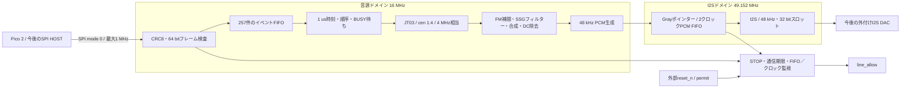

# JT03・SPI・イベントFIFO・I2Sを組み合わせたUP5K最小構成

2026-11-14。固定版JT03を使い、PicoからSPIで投入した時刻付きレジスタイベントを
FPGA内で実行してI2Sへ出す**RTL試作**を実装した。
音源側16 MHz／I2S側49.152 MHzを分けた構成で、iCE40UP5K-SG48への配置配線まで確認した。
Rev CのGPIO・回路・常用ファームウェアを変更したものではない。
物理ピンの確定、FPGA設定ローダー、Pico向けSPIファームウェア、実機受入は次段階。

## 構成



- 音源ドメイン：16 MHz、JT03への`cen`は4クロックに1回。
  前回PCシミュレーションと同じ`JT49_DIV=3`、`YM2203_LUMPED=0`の4 MHz音源。
  上流RTLと`simulation-jt03/revc_jt03.v`を変更しない。
- I2Sドメイン：49.152 MHz、BCLK=3.072 MHz、LRCK=48 kHz。
  L/Rとも同じ16 bit PCMを32 bitスロットの上位へ置く。
  NXP I2S仕様のとおり、WS変化から1 BCLK後にMSBを出し、立下りでデータを更新する。
  STOP・BEGIN・正常終了の間もBCLK/LRCKは継続する。
- 両クロックは**同じ基準から生成する**前提。初期位相は一致しなくてよい。
  別々の発振器のppm差を吸収し続ける適応型レート変換は未実装。
- イベントFIFO：256×48 bitのRAM＋1件の先読みレジスタ、計257件。
  32 bitのµs時刻、レジスタ8 bit、値8 bit。同時刻も投入順を維持する。
  リングを周回しながら補充できる。時刻はSTARTからの相対値。
- PCM FIFO：64×16 bitのデュアルポートRAM＋1件の先読み。
  ポインターをGray化して登録し、各方向を2段の同期器で渡す。8サンプル蓄積後に出力を許可する。
- SPIのパケット形式・状態・回復手順は[PROTOCOL.md](PROTOCOL.md)。
  既存のC版I2C v2との互換プロトコルではない。

## 配置配線結果

[検証記録](verification/minimal-up5k-20261114.json)。同じツールと3通りのseedで測定した。
音源・SPI・両FIFO・時刻／BUSY制御・音声変換・I2S・監視／消音を含む。

| リソース | 使用／全体 | 使用率 | 残り |
| --- | ---: | ---: | ---: |
| LC | 4,850／5,280 | 91.9% | 430 |
| EBR（4 Kibit） | 7／30 | 23.3% | 23 |
| DSP | 2／8 | 25.0% | 6 |
| SPRAM（256 Kibit） | 0／4 | 0% | 4（128 KiB） |
| PLL | 0／1 | 0% | 1 |
| グローバルバッファー | 8／8 | 100% | 0 |

EBR7個はJT03に3、イベントに3、PCMに1。
LUT4は2,898、FFは2,765。共有・パッキングした後のLC数を上表に記載した。
ロジックの残りは約8%であり、これ以上の機能追加には使用量の再確認が必要。
グローバルバッファーはクロック以外の高ファンアウト制御信号の自動昇格分も含む。
新たな回路へそのまま追加クロックを割り当てられるとは扱わない。

| seed | 音源16 MHz制約：推定Fmax | 音声49.152 MHz制約：推定Fmax | 判定 |
| --- | ---: | ---: | --- |
| 1 | 22.135 MHz | 62.602 MHz | 両方PASS |
| 2 | 21.240 MHz | 59.411 MHz | 両方PASS |
| 3 | 23.145 MHz | 60.544 MHz | 両方PASS |

FIFO読出しの次ポインターを先に計算し、I2Sの読出し要求とFIFO残量を登録することで
49.152 MHz側の長い経路を分割した。偽パスやマルチサイクル例外、タイミング失敗の無視は使わない。
Fmaxは静的タイミング解析の推定。基板I/Oのsetup/hold・負荷・クロック品質・実機動作の認定ではない。
ピンは解析用に自動配置しており、基板へ適用するPCFではない。
Verilator専用の観測・故障注入ポートは合成時には含めない。

## クロック境界の検査

- SPI入力3本、状態／制御4本、Grayポインター14 bit、計21個の第1段同期器を保持する。
- 合成後ネットリストをたどり、データ／イネーブルのクロック跨ぎがこの第1段に限られること、
  Gray入力が組合せ生成ではなく送信側FFの出力であることを検査する。
- PCM RAMの書込みポートは音源側、読出しポートはI2S側であり、各アドレス・許可・データの所属も検査する。
- 配線後の両方向のクロック跨ぎ最長経路は約6.56～8.35 ns。
  Gray転送の配線遅延を保守的に確認するため、各方向の**経路全体**が速い方の周期20.345 ns未満であることを判定する。
  これはベンダーのMTBF計算やメタステーブルのアナログシミュレーションではない。
- リセットは非同期assert、各ドメインで2段同期してreleaseする。セッションのclear信号は単一FFで保持する。
  非同期リセットのrecovery/removalと、非同期安全出力`line_allow`はデータ経路の構造検査とは別の確認事項。

## 安全停止と再開

| 要因 | 動作 |
| --- | --- |
| 電源投入／reset／permit解除 | ゲート閉、再生停止、両FIFOクリア。許可復帰だけでは再生しない |
| STOP | 即時に許可を閉じ、イベント・先読み・PCMを破棄。I2Sクロックは継続 |
| 通信リース1秒 | 全音停止、fault保持。READはリースを延長しない |
| CRC・長さ・命令・時刻異常 | 消音、FIFO破棄、fault保持 |
| イベント満杯／未SEALでの1 ms枯渇 | 消音して停止 |
| BUSYが実行可能イベントを1 ms妨げる | 消音して停止 |
| PCM満杯／読出し枯渇 | 消音して停止 |
| I2S側クロック停止 | 音源側の監視／PCM満杯で消音 |
| 音源側クロック停止 | I2S側でPCM枯渇を検出し、音源側の復帰を待たずに消音 |
| SEALした終端時刻 | 全イベント完了なら正常消音、未完ならfault停止 |

異常解除はBEGINから明示的にやり直す。STOPだけではfaultを解除しない。
**両クロック同時停止・FPGA設定前／無給電の消音は外部permit／監視・ゲート回路で担保する必要がある。**
今回のRTLだけで、それらの基板電気条件を検証したとは扱わない。

## 音声処理の範囲

FMは前後のネイティブサンプルを8 bitの係数で線形補間し、16 MHzの3/1000タイマーで48 kHzを生成する。
SSGは1 MHzで2段の簡単なシフトIIRを通す。FM＋SSG×32を幅の広い整数で加算し、
一次DCブロッカー（係数1/1024、48 kHz時およそ7.5 Hz）と共通0.5倍、16 bit飽和を適用する。
48 kHz化した後にFIFOでI2Sクロックへ渡すため、単に55.56 kHzのデータを48 kHzで取り出してはいない。

これは固定4 MHz向けの最小音声経路であり、PC比較WAVの高精度リサンプラーと同じ波形ではない。
SSGの帯域制限も完全なアンチエイリアスではない。可変クロック、任意比率変換、高音質フィルターは今後の課題。
FM／SSGの短い単音とSPIイベント列は検査したが、このRTLでのYs II全曲・実DAC出力は未確認。

## 実行と検証

`projects/ym2203-sound-module`から実行する。

```sh
python3 fpga-jt03-minimal/tools/check.py --output outputs/jt03-minimal/run-01
```

既存`.cache/jt03/upstream`の固定版41ファイルを照合し、Verilator／Yosys／nextpnrを実行する。
必要なツールの版と実行ファイルSHAは既存`simulation-jt03/core-lock.json`と
`synthesis-jt03/toolchain-lock.json`を参照する。
環境が異なる場合は版を確認し、`--allow-other-tools`で別の実験として実行する。
以前の測定を上書きしないよう、毎回空の出力先を使う。

検査内容：

- システムRTL17件：SPI CRC／長さ、同時刻順序、FM／SSG発音、I2S形式・L/R・クロック継続、
  STOP・再開、リースとREAD、KEEP、満杯、時刻逆転、枯渇、BUSY停止、片側クロック停止、permit、
  初期位相3通り、600イベントの補充とリング周回。
- FIFO RTL3件：異なる周期・位相で各5,000件を転送し、満杯・空・周回・バッファーを残したreset後の破棄を確認。
- 既定リースRTL1件：製品設定の16,000,000クロック＝1秒をそのまま試験。
  システム17件では試験時間短縮のため50 msへ変更する。
- Python13件：CRC／パケット、CDC逸脱検出、2クロックの制約・判定・経路遅延判定。
- 合成`check -assert`、CDC構造検査、seed 1/2/3の配置配線、両クロックのタイミングと跨ぎ経路の検査。

ログ・ネットリスト・ASC・実行バイナリは`outputs/`へ置きGit管理外とする。
合格値だけを抽出して、失敗した配置を隠す処理はない。基板へ書き込む処理も含めない。

## 管理とライセンス

このフォルダーのRTLとC++テストはGPL-3.0-or-later。
GPL全文は`simulation-jt03/LICENSE-GPL-3.0.txt`。Pythonツール／テストはMIT。
JT03とJT49の上流表示を保持し、元RTLをキャッシュから参照する。
楽曲データをRTLや合成入力へ埋め込まない。従来の音源単体の測定・PC音声比較は上書きしない。
