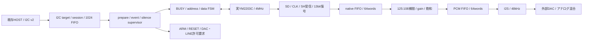

# 実YM2203バス・FM受信・PCM・I2S RTL

2026-11-15。F1のI2C v2制御を実YM2203向けのバス／音声回路へ接続した。
`revc_real_ym_top`が統合入口。既存Rev CのHOSTライブラリ、player、Cファームウェアは変更しない。
以下はRTLシミュレーションとECP5技術マッピングの検証であり、実機受入ではない。

## 構成



| RTL | 役割 |
| --- | --- |
| revc_ym_bus | 8bit外部バス、address／data前のBUSY確認、read、方向切替、取消・timeout |
| revc_fm_rx | 2段同期、CLK安定確認、SHで区切る24bit LSB-first受信 |
| revc_fm_pcm | 逐次除算による符号付きfloor補間、固定gain、飽和とclip集計 |
| revc_audio_fifo | 同一clockのRAM FIFO、head先読み、同時push／pop |
| revc_i2s_tx | WS後1bit遅延、MSB-first、prime、無音／underrun処理 |
| revc_audio_path | RX→復号→FIFO→PCM→FIFO→I2S、faultとheartbeat |
| revc_domain_reset | 非同期assert・2段同期deassert |
| revc_ym_backend | 無音reset・初期化・prime、イベント完了、6声停止、clock監視 |
| revc_real_ym_top | 上記と既存I2C session、64bit µs時計の接続 |

## 時計とデータ形式

初回の検証対象は**YM 4MHz、音声49.152MHz、制御48MHz**。
YMと音声は同じ基準のSi5351Aから供給し、4MHz/72のnative FMを48kHzへ125:108で変換する。
Si5351Aは設定済みを前提とし、起動I2C controllerはまだ含まない。
独立した4MHz発振器と音声時計を無補正で混用する構成ではない。
可変クロック時の比率・FIFO設計と、既存v2で4MHz以外を宣言するAPIは今後の対象。

FMは24bitの上位13bitを指数3bit＋仮数10bitとして復号する。
指数1..7に対して`(mantissa - 512) * 2^(exponent - 1)`、指数0はfaultとし、
不正wordを補修・間引きして演奏を継続しない。
元Cの`wym1.c / revc_convert_stream`と同じfloor補間・Q10 gain・signed16bit飽和を行う。
ストリームの位相を保持し、125入力／108出力ごとの境界で音を切らない。
`GAIN_EIGHTHS=8`がunity。0..16を合成時に選べるが、動的gain／5block rampや新I2C命令は追加していない。

I2Sは3.072MHz BCLK、48kHz LRCK、**32bit slot×左右**。
左slotにsigned PCM16＋zero16、右slotはzero32。
Rev Cと同じ左DAC経路を使い、左右のアナログ出力へ混合する前提。
Rev C PIOの16bit slot×左右とwire bitstreamが同一という意味ではない。
選定するDACのI2S形式・極性・clock条件は基板接続時に再確認する。
STOP／prepare中もI2S時計は維持し、データをzeroにする。PCMは16word以上蓄積してから出力する。

## バスと停止

バスは既存`firmware-c/src/board.c`の保守的な1µs phaseと2µs write recoveryを基準にした。
BUSYはaddress前とdata前の両方で確認する。入力dataは2段同期後、read window内で捕捉する。
DIRの切替前後にOE無効区間を置く。A0・CS・RD・WR・OE・data driveは登録出力とし、
FSMの組合せdecodeのglitchを直接外部へ出さない。レベル変換器そのものは外付け。
取消は進行中の電気的phaseを完了してから応答し、BUSY固定は100msで安全idleへ移行する。
イベントはdata書込み完了後だけ消費し、同時刻のregister順序を保持する。

起動／BEGINでARM待機2ms、reset保持2ms、release待機2ms、無音設定8writeを行い、
実RX・PCM・I2Sがprimeした後だけ`audio_ok`を立てる。BEGIN中の正常な再準備では一時的に
`audio_ok=0`になるため、sessionはprepare完了／100ms timeoutまで待ち、完了時に音声健康を検査する。
この変更の回帰試験も追加した。未準備の状態からのBEGINを無条件で許す変更ではない。

STOP／leaseは即座に出力許可を閉じ、残イベントを捨て、FM3キーオフ＋SSG3音量zeroの
6write完了を待つ。正常DONEも同じ全声停止を行う。STOP／通信復帰／clock復帰だけで自動再演奏しない。

音声側にRX異常・指数0・FIFO overflow・I2S underrun・FM frame途絶のsticky faultを置く。
制御側は音声heartbeatの2ms停止、音声側は制御clock由来toggleの2ms停止を検知する。
音声faultと外部permitは最終ゲート要求を非同期に閉じる経路を持つ。
**FPGA未設定・無給電・両clock停止を含む最終停止は外付け回路の責務**。
これをRTLだけで保証したとは扱わない。

## クロック境界

RX以降の2個の音声FIFO・PCM・I2Sはすべて音声clock内に置き、PCMバスをCDCさせない。
制御／音声間のhealth・heartbeat・audibleは単一bitの2段同期。外部FM3本とYM read8bit、
SDA/SCLも明示した同期器を通す。resetは各domainで同期releaseする。
`clock_good / other_owned / global_stop`は制御clock同期の接続契約。
`reset / permit`は非同期安全入力。debugの複数bit monitorは整合snapshotではなく、I2C statusへ直結しない。

`check_real_cdc.py`は合成netlistで指定同期器の直列接続・初段fanout・clock、reset release、
外部制御信号の登録を検査し、2件の同期器bypass変異を拒否する。
全経路のCDC網羅・metastability MTBF・recovery/removal・IO setup/hold・STAの代用にはならない。
選定moduleの制約と配置配線で改めて検証する。

## 再実行と証拠

プロジェクトルートから、新しい空の出力先を指定する。

```sh
python3 fpga-standalone/check_audio.py --output outputs/f1/audio-01
# 任意。非公開楽曲は従来の高速制御モデルだけへ入力する。
python3 fpga-standalone/check_audio.py --output outputs/f1/audio-private-01 \
  --private-score local-test-data/ym2203/ysii/song.bin
```

Python標準ライブラリ、C/C++ compiler、Verilator、Yosysが必要。
各build成功後だけtestを実行し、ツール版・ソースと既存HOST／CのSHAをsummaryへ記録する。
失敗buildの古い実行ファイルで合格扱いにしない。

- 既存576frame／380C照合、24session（任意の非公開楽曲1件を含む）、8物理I2Cモデル試験。
- PCM：17gain×8入力列＝136ケース、73,440出力サンプルを既存Cと照合。backpressure、飽和数も確認。
- bus：128write、read、両BUSY確認、応答保持、4取消、100ms timeout、pin方向・phase幅。
- RX→PCM：54位相／data遅延／短いclock乱れの組合せ、100ms継続照合、指数0とframe途絶。
- I2S：bit順序、WS遅延、zero padding／右slot、mute中clock継続、reset／reprime、underrun。
- 結合7試験：無変更HOST→SDA/SCL→YM busモデル→合成serial→PCM→I2S。
  正常完了、STOPと再演奏、leaseとread-only再接続、音声clock停止、制御clock停止、指数0、permit断。
  両clockを各周期進め、実バス完了のregister列・CRCと全6声の停止を確認する。
- ECP5 mapping、`check -assert`、上記構造検査。

結合用のYMモデルはregister/BUSYと合成波形の**プロトコルfixture**であり、音源emulatorではない。
楽曲全体を実音と同等に生成した試験ではない。非公開Ys II全曲は従来制御モデルでの順序・CRC検証のみ。
最新結果は[20261115の検証記録](verification/audio-20261115.json)。
旧20261114記録は以前の検証範囲として保存する。

合成topの資源（20261115）：

| 種類 | 個数 |
| --- | ---: |
| LUT4 | 4,191 |
| TRELLIS_FF | 3,065 |
| DP16KD | 4 |
| MULT18X18D | 2 |
| TRELLIS_DPR16X4 | 203 |
| CCU2C | 1,292 |
| PFUMX / L6MUX21 | 372 / 13 |

LUT4数だけを必要LC数とみなさない。LUTRAM・carry・muxも配置資源を使う。
DP16KDは従来のevent FIFO3個＋要求buffer1個。音声FIFOはLUTRAMに対応する。
合成topの広いdebug portは基板のGPIO本数を意味しない。

配置配線／Fmax／最終module・pin／Si5351起動／USB CDC・MIDI／アナログ聴取／実機受入は未実施。
この段階で基板購入・製造・書込みを実施していない。新規独自RTL／試験／ツールはMIT。
JT03のGPL RTLやwrapperからコードを取り込んでいない。

## 仕様の参照元

- 既存C：`firmware-c/src/board.c`、`wym1.c`、`fm_rx.pio`、I2S送信PIO。
- Yamaha [YM3014B datasheet](https://www.quarter-dev.info/archives/yamaha/YM3014B.pdf)：指数／仮数、指数0禁止、serial形式。
- NXP [UM11732 I2S specification](https://www.nxp.com/docs/en/user-manual/UM11732.pdf)：WSとMSB、bit順序。

## 2026-11-15：専用clock起動と可変比率の追補

[CLOCKS.md](CLOCKS.md)にSi5351A managerと可変SRCの追加実装を記録した。
本書とaudio-20261115.jsonは固定4MHzの初回範囲として保持する。
可変版は別topで、既存の固定4MHz top／HOST／C照合も継続する。
