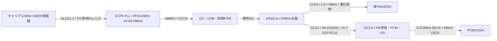

# F1：ULX3S 85Fの物理端子・クロック・配置配線

2026-11-15。評価用モジュールを**ULX3S 85F、PCB v3.0.8、
LFE5U-85F-6BG381C**へ具体化した。実YM2203C、Si5351A、PCM5102A、
電圧変換・アナログ合成・独立消音回路はキャリア側に置く。
ESP32／FTDIは音源制御に使わない。小型量産モジュールの決定・購入・実機認定ではない。

[物理ラッパー](boards/ulx3s/top.v)、[端子表](boards/ulx3s/PINOUT.md)、
[端子の正本JSON](boards/ulx3s/pins.json)、[LPF](boards/ulx3s/board.lpf)、
[SDC](boards/ulx3s/board.sdc)を追加した。診断用の数百bit出力を実端子にしない。
**49 pad**を使用し、JTAG／Flash／SDRAM／SDカード／ESP32共用GPIO11〜13は予約する。
YM IRQは今回のv2実装では使わず、追加候補の空きGPIOとして別途扱う。

## クロック構成



ULX3S内蔵25MHz（G2）は未使用。USBの48MHzをSi5351起動前から供給するため、
**3.3V CMOS 12MHz、精度±50ppm以下、P3でrise/fall各1ns以内**を条件とする
独立発振器をキャリアへ1個追加する。負荷・配線込みのエッジは部品選定と実機で確認する。
OLEDは装着せず、OLED1のSCL端子を専用PLL入力として使用する。
PLLはIN=1、FB=4、OUT=12、内部INT_OP帰還。PFD=12MHz、VCO=576MHzで、
[Latticeデータシート§3.19](https://www.latticesemi.com/api/document/download?id=50461)の
PFD 10〜400MHz／VCO 400〜800MHzを満たす。
25→48MHzの単純なIN=25／FB=48設定はPFD=1MHzになるため採らない。
発振器の精度・jitter、PLL lock／unlock、RST幅1ms以上は実機と部品選定時にも確認する。

48MHzと49.152MHzは非同期。Si5351 CLK0はFPGAのfabric clockに使わない。
USB用PLLを音声可変設定で変更しない。音声が未起動・停止した場合の消音は既存監視を維持する。
既定はYM 4MHz／gain 100%。SW1〜3はprofile番号、BTN2の立上りで申請する。
スイッチは申請前から安定させ、停止中のみ操作する。2FFは多bit同時変更の保証ではない。
非4MHzでは既存HOSTの4MHz BEGINとMIDI発音を拒否し、無言で別音程にしない。
公開HOST API／wireを追加・変更したものではない。

## 端子と電圧

端子表のJ1/J2番号は**縦型オスヘッダ**。上流回路図の直角メスヘッダ番号とは偶数・奇数が逆。
基板シルクのGP/GN名とFPGA ballも併記した。逆差し防止のキー・印をキャリアに置く。
全padはLVCMOS33。可変の`2V5_3V3`系を含め、使用bankのVCCIOが3.3Vであることを現物確認する。
5VのYMデータ・制御・FM serialを直結しない。従来どおり双方向データ変換器と
方向固定の制御／受信レベル変換が必要。Si5351出力のYM側もレベルを合わせる。
Si5351・12MHz発振器・3.3V側bufferはモジュールの3.3V系と電源をそろえる。
別系統で先に給電する場合はIoff／出力禁止で無給電FPGAへの流入を防ぐ。

HOST I2C=J2.9/10、Si5351 I2C=J2.11/12の**別バス**。
各SCL/SDAに3.3Vへの外付けpull-upを置く。初期設計値2.2kΩ、100kHz、
配線容量150pF以下を目標とし、実測rise timeで確定する。内部pull-upに依存しない。
出力LOWまたはhigh-Zで、HIGHを能動駆動しない。

## USB US2と自己給電

US1はFTDI/JTAG用で、今回のCDC/MIDIは**US2**。
US2の送信pad D15/E15と受信tap E16/F16を分けて使用する。
D+ bias B12は接続時HIGH、切断時high-Z。LOWにすると上流の15kΩ pulldown経路を選ぶため、
LOWをdetachとして使わない。D- bias C12は常にhigh-Z。
固定Zを通常のassignだけで書くと、この合成フローではLOWに置換されることを検出したため、
ECP5のOBZプリミティブを使い、mapped TRELLIS_IOのT=1も回帰検査する。
上流の27Ω直列抵抗、diode／抵抗によるpull-upと保護素子はそのまま参照するが、
GPIO USBの電圧・エッジ・インピーダンス・アイ波形やUSB認証を保証するものではない。
VID/PIDの既定0はdetachedを維持。配置配線時だけ使うCAFE:4001は実機用IDではない。

**US2 VBUSと外部5Vの分離は必須**。
[公式manualのPower節](https://github.com/emard/ulx3s/blob/6a92cec6b177191c5b0f80e260013a1f8ec147dd/doc/MANUAL.md#power)
では、標準のJ2 5V端子とUS2 5Vが接続され、ジャンパ切断・Schottky実装で分離できる。
評価キャリアは次の給電条件を満たす構成にする。

- 回路図レビューAでは**D9を開放・diodeも未実装**とし、US2を検出専用へ限定する。
  以前のSchottky候補案から具体化した。D8はUS1→本体の逆流防止diodeを確認する。
- 外部5VはD51側IN5V経路から供給し、D51 bridge切断＋diode実装、D52開放を現物と照合する。
  標準J2の5Vへ単に外部電源をつなぐだけではVBUS分離にならない。
- VBUSは**D9よりUSBコネクタ側**から検出し、J2.15 D18へ3.3V論理で渡す。
  5VをGPIOへ直結しない。47kΩ/68kΩの分圧と、3.3V Schmitt buffer／Ioff対応を候補とし、
  USBが抜けた時LOW、FPGA無給電時に逆給電しないことを回路図・部品仕様で確定する。
- PHY/US2を抜いても本体5V・YM電源・HOST電源は維持する。
  US1 FTDIの給電と未給電時pin負荷も別途確認する。

この分離・検出はRTLだけでは実現できない。
[キャリア回路図レビューA](../hardware/ym2203-fpga-board/carrier-f1/README.md)へ接続・部品を具体化した。実装は未完で、
US2からの給電／VBUS検出を実機で確認したとは扱わない。
VBUS即時inhibitと、SE0/reset／SOF timeout／suspendの既存停止を併用する。
MIDI所有時だけ切断で消音し、I2C所有時の再生をUSB切断から独立させる。

## 停止・監視

`permit`=J1.6 C11は外付け監視からの許可。初期値は外付け抵抗でLOW。
PLL unlock、reset、permit LOWではYM RESET／ARM／DAC／LINEを即時inhibitし、
変換器OEを無効にする。pad許可は2FFで解除するため、短いpermit中断後も古い要求を直ちに出さない。
coreのreset／STOP／lease／明示再開規則は変更しない。BTN0はreset、BTN1は同期化した全停止。

J2.16 E17から1kHz heartbeatを出す。これは**制御clockが動いている証拠**で、
音声・USB・ソフト処理の全正常証明ではない。permitに依存せず出力し、起動時の循環待ちを防ぐ。
外付け欠落パルス監視・電源監視は、設定前／全clock停止でもARM・RESET・OE・消音を安全側にする。
FPGA内のheartbeatを外付け監視の代わりにはしない。音声側の停止監視は既存coreが担当する。
外付け最終許可は回路図レビューAでTPS3808二電源監視、MAX6369 missing-pulse監視、
2段latch、NC外部停止、5V RESET clamp・DAC／line muteへ具体化した。
7モデル／接続検査とKiCad ERC0を確認し、電源ramp・部品PVT・実停止遅延は未計測。

[Diamond追加検証の準備](boards/ulx3s/diamond/README.md)には、持ち運び用source bundle、
Tcl、49pad／clock制約とIO／CDC／全cornerの確認項目を追加した。
Mac側で準備検査を実施し、Windows Diamondの合成・PAR・Traceは未実行。
過去のnextpnr記録をvendor timing合格へ読み替えない。

## 再現と判定範囲

[今回の固定記録](verification/ulx3s-board-20261115.json)は次の結果。内部OOCの過去記録は上書きしない。

| seed | control推定Fmax／50MHz目標 | audio推定Fmax／49.152MHz目標 |
| ---: | ---: | ---: |
| 1 | 50.772MHz / PASS | 88.238MHz / PASS |
| 2 | 55.420MHz / PASS | 87.789MHz / PASS |
| 3 | 54.054MHz / PASS | 86.162MHz / PASS |

使用量はTRELLIS_COMB 17,779/83,640、FF 6,783、DP16KD 5、DSP 4、IO 49、PLL 1、DCCA 2。
全6,783 FFのD/CE/LSR coneを検査し、説明済みCDC 25bit以外のclock間消費は0。
coreの同期段間52件に加えcarrierの6件を配線検査する。primary非同期入力やMTBFの完全証明ではない。
pad接続netの最長配線は26.468ns、I2Sの外部許容条件付きsetup/hold予算の最小余裕は145.90ns。

HOST／C照合元と以前の合格機能記録の全SHAを照合したうえで、USB・I2C結合の5試験を再実行した。
BEGIN排他、global STOP、USB再接続からの自動再発音防止、I2C中のUSB detach/reset/suspend独立性、
CDC停止／panicを確認。新規adapterテストは理想clock／故意に要求を出し続けるstub coreを使い、
raw permit/resetの即時inhibit・VBUS低下時のI2C継続・STOP同期・heartbeatを検査する。
PLLアナログ動作や実チップを模擬したものではない。
検査器の5単体試験には、pin重複・予約端子・誤電圧・clock緩和・不足・OOC・
固定ZのLOW化・I2C HIGH駆動を拒否する回帰を含む。

プロジェクトルートから実行する。空の出力先を指定する。基板へ書き込まない。

```sh
python3 fpga-standalone/check_board.py \
  --nextpnr /path/to/oss-cad-suite/libexec/nextpnr-ecp5 \
  --output outputs/f1/ulx3s-board-01
```

`--functional-report`で現在のソース・HOST・C照合元の全SHAが一致する合格記録を再利用できる。
省略時はUSB・clock・audio・sessionの機能検証を新規実行する。
LPFはpins.jsonから生成し、更新する時は`--write-constraints`を付ける。
通常P&Rを使い、OOC／unconstrained-IO許可／timing-allow-fail／false-path切断は使わない。

判定には全padのball・IO_TYPE・pull・配置BEL、PLL整数比、2 DCCAの実配線、
両clockのsetup、列挙した2FFの配線、全FF D/CE/LSRのCDC censusを含む。
pad接続netの配線遅延40ns上限と、I2Sの半周期162.76nsから配線差を引く予算も検査する。
I2Sのpad skew 4ns・PCB差2ns・受信setup/hold各10nsは**設計側の許容条件**であり、
まだ選定部品・実配線の測定値ではない。

setup marginにはcontrol 0.65ns、audio 0.25nsの工学的reserveを要求する。
実際のcontrol出力は48MHzだが、配置配線の内部clkには**50MHz／20ns**のsetup目標を指定し、
公称周期との差0.833nsを確保する。12MHz入力／PLL整数比は変更しない。
nextpnrはPLL派生制約とuser指定制約の差をwarningで表示する。最終reportのconstraintが
50MHzであり、そこにも合格していることを機械判定する。警告を理由に48MHzへ緩和しない。
controlはPLL公称period jitter上限0.025UI=約0.521nsを参照するが、
全温度・電源・ノイズ・clock skewを証明する予算ではない。
**nextpnr ECP5モデルはglobal clock配線の遅延を0として返す**。
PLL／DCCA／global配線は存在確認できても、siliconの挿入遅延・skewまで含む完全なSTAではない。
実pad／外付け変換器／USB／PCBのsetup/hold、reset recovery/removal、PLL jitter、
実機音質・OS列挙・USB電気適合は別途必要。ツール推定と実機受入を区別する。
次のvendor STAではWindows上のLattice Diamondで同じdevice／LPFと12MHz→48MHz PLL、
49.152MHz入力を設定し、実clock skew／uncertainty／IO delay／recovery/removalを評価する。
今回のnextpnr用SDCの50MHz予算を、物理PLL周波数50MHzへの変更として入力しない。

## 来歴

ULX3Sの公式[回路図v3.0.8](https://github.com/emard/ulx3s/blob/6a92cec6b177191c5b0f80e260013a1f8ec147dd/doc/schematics_v308.pdf)、
[LPF](https://github.com/emard/ulx3s/blob/6a92cec6b177191c5b0f80e260013a1f8ec147dd/doc/constraints/ulx3s_v20.lpf)、
manualとProject Trellisの85F CABGA381 IO databaseで端子を照合した。
上流commit・参照SHAはpins.jsonに保持。回路図一式やFPGA database binaryをリポジトリへ取り込まない。
端子事実の参照元の表示は[UPSTREAM-LICENSE.md](boards/ulx3s/UPSTREAM-LICENSE.md)に保持する。
独自ラッパー・検証コードはMIT。
