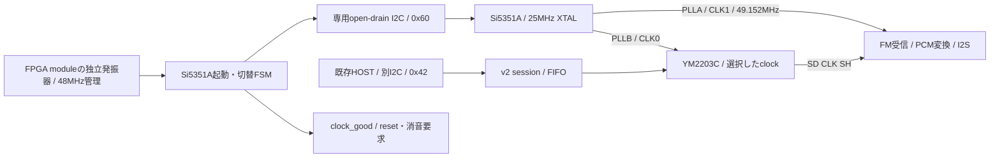

# Si5351A起動設定と可変クロックRTL

2026-11-15。[実YM音声RTL](AUDIO.md)へ専用I2C controllerとSi5351Aの設定FSMを追加した。
入口は`rtl/revc_clocked_ym_top.v`。外付けMCUは使わず、独立した48MHz制御clockで起動する。
既存HOST／player／Cファームウェアは変更しない。RTLモデル検証と技術マッピングの結果であり、実機受入ではない。

## 互換性と今回の境界

既存I2C v2の0x42・署名・要求・64byte status・CRC・sequence・STOP／1秒leaseを維持する。
**旧HOSTとv2で再生できるのは従来どおり4MHzのWYM1**。
音源clockが4MHz以外に選択されていれば、その4MHz BEGINをDATA6で拒否する。
ファイルのclock表記を無視して別の速度で再生したり、正常な音声経路を偽ってaudio_ok=0にしたりしない。

可変clockの選択は、まず**制御clock同期のRTL設定インターフェース**へ分けた。
新しいHOSTコマンド、未知のv2フィールド、GPIOへの仮割当ては追加していない。
他周波数の楽曲をHOSTから選んで転送する公開APIは、能力通知・ファイル検査を含む別工程。
この段階で旧HOSTが非4MHzの曲にも対応したとは扱わない。

## 時計の構成



- 初期ROMは**25MHz XTAL・内部負荷10pF**、Si5351AのAN619対象品種を仮定する。
  10-MSOP／20-QFN向け。16-QFNの異なるregister mapへそのまま使わない。
- PLLAは786.432MHz、整数MS1分周16でCLK1=49.152MHz。
- PLLBは各YM周波数に合わせ600〜900MHzへ設定し、偶数整数MS0分周でCLK0を生成する。
- 音声・YMは同じXTAL由来。音声出力は48kHzのままで、SRC比率だけを変更する。
- 制御clockをSi5351A出力に依存させない。初期設定前やclock断でも管理FSMは動く。
- 3.3V出力と実YMの入力レベル、レベル変換器、XTAL／負荷容量、電源・rise timeは基板で別途確認する。

| profile | YM公称周波数 Hz | 用途 |
| --- | ---: | --- |
| 0 | 4,000,000 | 起動既定・既存HOST互換 |
| 1 | 3,579,545 | 可変clock評価 |
| 2 | 3,993,600 | 可変clock評価 |
| 3 | 3,000,000 | 可変clock評価 |
| 4 | 2,000,000 | 可変clock評価 |
| 5 | 1,500,000 | 初期設計範囲の下限 |
| 6 | 2,500,000 | 可変clock評価 |
| 7 | 3,500,000 | 可変clock評価 |

1.5〜4MHzは今回の**実装・モデル検証範囲**であり、個々のYM2203実チップの保証範囲・音質評価を示さない。
任意の実数周波数や実行中のHz直接入力ではなく、今回は8profileから選ぶ。

## 設定値生成と再現性

`tools/si5351_profiles.py`がAN619のP1/P2/P3式を整数・有理数演算で計算する。
第三者driverコードやClockBuilderの生成物をコピーしたものではない。
整数Hzの1.5〜4MHzを扱い、PLLB出力分周に50の倍数を選び、feedback分母を20bit内に収める。
PLLA／PLLB、MS0／MS1の設定値を逆算して、公称周波数との厳密一致を検査する。
公称値の一致はXTALのppm偏差やPLL jitterがzeroという意味ではない。

プロジェクトルートから：

```sh
# 既定ROMを再生成。rtl/revc_si5351_rom.vはこの生成元と対で管理する。
python3 fpga-standalone/tools/si5351_profiles.py \
  --rtl fpga-standalone/rtl/revc_si5351_rom.v

# 別XTAL・負荷・周波数候補を、まず管理外のファイルへ生成する例。
mkdir -p outputs/f1
python3 fpga-standalone/tools/si5351_profiles.py \
  --rtl outputs/f1/custom-clock-rom.v --json outputs/f1/custom-clock-plans.json \
  --xtal 27000000 --load-pf 8 \
  --frequencies 4000000 3579545 3993600 3000000 2000000 1500000 2500000 3500000
```

後者は既存の出力ディレクトリを使う。profile0=4MHz、8profile、25／27MHz XTAL、6／8／10pFを検査する。
カスタムROMを採用する場合は、BOM・試験fixture・期待値・検証記録も更新し、実機で周波数を測る。
初期の結合モデルは25MHz／10pF版。27MHz版の検証は設定値の計算・逆算まで。

## 起動と監視

1. YM resetとDAC／LINE許可を閉じたまま、独立制御clockで10ms待つ。
2. Si5351Aのstatus0を読み、SYS_INIT解除を待つ。解除前にRAM設定を書かない。100msで打切る。
3. register3で全clock出力を無効化し、16..23の全出力driverをpower downする。
4. 設定ROMの53行をread-modify-writeし、書込みmask内を読戻して照合する。
   予約bitを保持する。XTAL負荷reg183の下位bitは仕様値010010を使用する。
5. PLLリセットreg177は予約bitを保持してA/B resetを立て、self-clearを確認する。
   2ms待機後、status0の正常を3回確認する。PLL待機は100msで打切る。
6. sticky status1の起動履歴をclear・読戻し検査してから、CLK0／CLK1だけをenable・読戻す。
7. `clock_good=1`になっても、音源側はreset／無音初期化／FIFO primeを行う。
   実経路の準備が完了した後だけv2 statusのaudio_okが立つ。

動作中は約5ms周期で現在のstatus0とsticky status1を読む。
現在正常に戻った短いLOL／LOS／SYS_INIT履歴も停止理由にする。
NACK・readback不一致・timeout・PLL異常はreadyを下げて保持し、可能ならreg3=FFでclockを無効化する。
SYS_INIT中はRAMへの停止書込みも行わず、外部YM reset・出力許可を閉じる。
異常後に自動再設定・自動再演奏はしない。

専用I2C masterは0x60、単一controller、約100kHz、readはrepeated START＋最後のNACK。
SCL伸長を許容しつつ1transactionを5msで打切る。NACK後はSTOP、timeout時はLow駆動を解放する。
SDA stuckの自動bus-clearや他controllerとの調停継続は行わず、faultとする。
HOSTの0x42バスとはSDA/SCLを共用しない。

## クロック切替インターフェース

| port | 契約 |
| --- | --- |
| config_valid / config_profile[3:0] | 制御clock同期。0..7を指定。1要求ずつ直列化し、done後にvalidを下げる |
| config_done / config_error | 起動または設定要求の完了pulseと結果。validを保持しても同じ要求を繰り返さない |
| config_busy | 起動・再設定中。状態monitorには短い定期読取り区間も区別して出す |
| active_profile / ym_frequency | 現在選択した設定。物理周波数の測定値ではない。fault中は有効clockを保証しない |
| clock_good / clock_error | 設定・読戻し・lock確認済みの許可とsticky故障理由。音声健康は別のaudio_okで示す |

切替は、sessionがIDLE／DONE／STOPPED／FAULT、FIFO空、DAC／LINE off、他所有者なしの場合に限る。
RUNNINGだけでなくPREFILLも拒否する。定期監視取引中の要求もBUSYとして拒否し、呼出し側は直列に再要求する。
受理するとclock_goodを落とし、sessionへglobal STOPを1pulse送り、未処理要求・FIFOを破棄する。
YMをresetに保持してSi5351Aを再設定し、音声FIFO・補間位相を破棄してprimeし直す。
戻っただけでは再開せず、4MHzなら新しいSTOP／BEGIN／upload／PLAYで明示的に開始する。

設定結果：0=成功、1=profile範囲外、2=所有中／状態拒否、3=I2C、4=SYS_INIT timeout、
5=PLL timeout、6=readback、7=現在／sticky clock異常、8=設定全体500ms timeout。
`config_error`は要求結果、`clock_error`はclock故障の保持値。v2 result/errorの番号とは別。
これらのmonitorを新しいv2 byteへ無断で割り当てない。

## 可変SRCとクロック境界

動的SRCは`YM_Hz : (72 * 48000)`、分母3,456,000の有理数補間。
1.5／2／2.5／3MHz等ではupsampling、3.579545／3.9936／4MHzではdownsamplingになる。
signed floor、gain 0..16 eighths、飽和とclip数は既存Cの4MHz経路と同じ規則。
固定版`revc_real_ym_top`と旧125:108経路も残し、既定動作を回帰試験する。
標準のYM divider=72を前提とし、禁止していたprescaler命令の許可は追加していない。

frequencyは管理clockから音声clockへ、**reset中だけ捕捉する安定した設定bundle**として渡す。
管理側はclock_goodを下げて設定を保持し、音声側はstream reset中の2段registerで捕捉する。
再設定完了後もYM reset／ARM待機があるため、bundleが安定してから音声処理を解放する。
多bitの2段registerだけで任意の実行中更新を安全にできる、という契約ではない。
PCM／音声FIFO／I2Sは同じ音声domainに留める。

STOPだけなら従来どおりI2S clockを維持する。
profile変更ではSi5351A自体をdisable／resetするため、消音中に音声clockの途切れを許容する。
両clock停止・FPGA未設定・無給電への最終停止は、引き続き外付けの独立回路が必要。

## 検証と再実行

```sh
# projects/ym2203-sound-moduleから、新しい空の出力先を指定する。
python3 fpga-standalone/check_clocks.py --output outputs/f1/clocks-01

# 任意。楽曲データは従来の制御モデルにだけ入力し、成果物へ収録しない。
python3 fpga-standalone/check_clocks.py --output outputs/f1/clocks-private-01 \
  --private-score local-test-data/ym2203/ysii/song.bin
```

Python標準ライブラリ、C/C++ compiler、Verilator、Yosysを使用する。
ツール版、実行ファイルSHA、RTL・試験・生成元・無変更のHOST／CのSHAをsummaryへ記録する。

- 従来回帰：576frame、380C照合、24session（任意の非公開楽曲1件を含む）、8物理I2Cモデル、
  136 PCMケース／73,440サンプル、54 RXケース、bus／I2S、音声結合7試験。
- 設定値3試験：管理対象ROMの再生成一致、25／27MHz各1,000乱数＋8既定周波数の逆算、範囲・負荷・既定値拒否。
- manager 25ケース：8profile・予約bit保持・readback・PLL reset self-clear・read最終NACK・SCL伸長、
  起動／held要求、演奏所有中の拒否、範囲外、write／read-address NACK、SCL／SDA固定、
  SYS_INIT固定、PLL unlock固定、readback破損、通常／短時間のlock喪失、予期しない再初期化と明示的復帰。
- 可変PCM 136ケース／34,816サンプル：8比率×17gain、signed floor・飽和数、reset・backpressure・無効比率。
- 可変RX→PCM→I2S：8profileそれぞれ100ms、計38,387サンプルを有理数参照値と照合。
  PCM FIFOは観測上14..17word。理想公称周波数でのモデル結果であり、温度変動やPLL jitterの試験ではない。
- Si5351設定バスを含む結合10試験：従来7試験に、8profile切替・4MHzデータの誤再生拒否と復帰、
  I2C／他所有者中の切替拒否、PLL喪失後の保持・明示再設定／再演奏を追加。
- ECP5 mappingと`check -assert`、指定同期器・reset・登録出力の構造検査とbypass変異2件の拒否。

最新結果は[clock検証記録](verification/clocks-20261115.json)。
旧frame／session／audioの記録は過去の範囲として保持する。
Si5351 fixtureはregister／I2Cと公称clockのモデル、YM fixtureは合成波形のprotocolモデル。
いずれもアナログPLLやYM音源そのもののemulatorではなく、全曲の実音検証ではない。

統合topのECP5技術マッピング結果：

| 種類 | 個数 |
| --- | ---: |
| LUT4 | 5,013 |
| TRELLIS_FF | 3,488 |
| DP16KD | 4 |
| MULT18X18D | 4 |
| TRELLIS_DPR16X4 | 203 |
| CCU2C | 1,577 |
| PFUMX / L6MUX21 | 426 / 11 |

carry・LUTRAM・muxを含むため、LUT4だけを必要LC数とみなさない。
4個のDP16KDは既存のevent FIFO3個＋要求buffer1個。ROMと音声FIFO等の資源も含む。
wide debug port数を物理GPIO本数として数えない。
構造検査では同期器38bit＋定数化5bit、登録制御24bit、reset release8bitとbypass拒否2件を確認した。
設定bundleの安定期間という接続契約を、構造検査だけで証明したとは扱わない。

配置配線／Fmax／IO timing、網羅的CDC／MTBF、物理module・pin、実周波数測定、
音量バランス・jitter・聴取品質、外付け最終停止、USB、実機受入は未実施。
基板購入・製造・書込み・commit・pushは今回の検証コマンドには含まない。

## 参照した一次資料

- Skyworks [AN619 Rev.0.8](https://www.skyworksinc.com/-/media/Skyworks/SL/documents/public/application-notes/AN619.pdf)：
  frequency plan、P1/P2/P3式、reg0/1/3/15/16..／177／183等の意味と予約bit。
- Skyworks [Si5351A/B/C-B Rev.1.3](https://www.skyworksinc.com/-/media/Skyworks/SL/documents/public/data-sheets/Si5351-B.pdf)：
  XTALと品種の差、I2C、起動設定手順、clock出力条件。

2026-11-15確認。資料PDFや第三者driverは配布物へ収録していない。
新規独自RTL・試験・生成ツールはプロジェクトのMITに従う。
