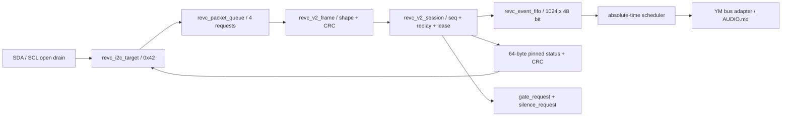

# I2C v2再生制御RTL

2026-11-14。外付けMCUを使わないF1向けのI2C制御部分。
[既存Rev C C版v2](../firmware-c/protocol-v2.md)のアドレス・要求・status・状態遷移を維持する。
既存のRevCStreamとHOST playerは変更せず、試験で実際のソースを読み込む。
制御のRTLシミュレーションと技術マッピングの結果であり、実音源の実機受入ではない。

## ブロックと接続



`revc_v2_core`は取引単位のframe/session結合、`revc_i2c_stream`は物理I2Cを加えた結合。
`revc_i2c_control`は同期64-bit µs時計も内蔵する。初期パラメーターは48 MHzで、
整数MHz・16 MHz以上に限定する。USB用の時計管理やSi5351設定回路は含まない。
SDA/SCLは2段同期器＋3サンプルの安定確認を通す。設計対象は単一controller、100 kHz。
物理pinは未割当てで、基板のopen-drain入出力プリミティブとプルアップは別に接続する。
`sda_low/scl_low=1`がLow駆動、0が解放であり、Highを駆動する信号ではない。

要求はSTOPで確定し、空のアドレスprobeはコマンドとして公開しない。
4要求×208 byteを保持し、209 byte以上や受信枠の超過はIO fault7で消音する。
受信中・検査中の断片を後から再生可能なイベントとして扱わない。
statusは読取り取引の先頭で捕捉してCRCを計算し、その間SCLをstretchする。
同じ取引中の64 byteは固定し、65 byte目以降はFF。master NACK後に送信を止める。
書込みと読取りはSTOPを挟む。repeated-start、複数controller、400 kHzは保証対象外。

## セッションとイベント

- 署名YM22S002、64-byte status、0x42、要求最大208 byte、PUSH最大32件を維持する。
- timestamp_ms:uint32、register:uint8、value:uint8の48-bit eventを1024件保持する。
  timestampはPLAY基準からの絶対オフセットで、同時刻も入力順を維持する。
- PUSHは件数・空き・全レコードの時刻・許可レジスタ／bit maskを検査する。
  RAMへ先に書いてもwrite pointerは公開しない。全件成功時にだけbatchをcommitする。
  失敗したPUSHの一部がheadへ出ることはなく、CRC・receivedも更新しない。
- FIFOのheadは同期RAMから先読みする。未SEALの枯渇や100 ms超の適用遅延はfaultとする。
- BEGINは4 MHz、1..131071件、正のperiodを受け付け、原音源のreset/prepare後にPREFILLへ進む。
  PLAYはmin(512,total)以上の蓄積後、250 ms先を原点にする。
- WYM1 headerから全eventまでCRCを蓄積し、SEALで期待CRCを確認する。
  全件適用後もperiodまで待ち、全声停止の完了後にDONEにする。
- 不正要求はnext_seqを消費しない。STOPのsequence再同期、uint32周回もCと同じ規則にする。
  直前成功フレームとsequence・全バイトが一致する再送はACKのみで、再実行やlease更新をしない。
  replay cacheは2 bankでcommitし、検査・コピー中の停止で前の成功フレームを壊さない。
- statusにはresultとsession errorを別々に出す。状態番号やflag、CRCの形式は変更しない。
  snapshotのelapsedは64-bit時刻差を逐次除算し、組合せ64-bit除算器を避ける。

## STOP、リース、外部adapter

成功したBEGIN/PUSH/PLAY/KEEP/SEALだけが1秒leaseを更新する。
READ、PING、重複、不正要求は更新しない。期限判定を命令処理より先に行い、
遅れたKEEPはFAULTから復帰できない。STOP→BEGIN→データ再送→PLAYが必要。
USB再接続やstatus読取りだけで開始する経路は作らない。

STOPはゲートを閉じ、公開FIFOと検査中の未公開batchを破棄する。
明示的なI2C STOP命令では、全声停止adapterの完了を待って成功ACKを公開する。
外部`global_stop`は1-cycleの同期パルスで、未処理の受信要求も破棄する。
gateの復帰は新しいBEGIN／PLAYで行い、STOPだけでは再開しない。

| interface | adapterの契約 |
| --- | --- |
| audio_ok | 音声経路が実際に正常・準備済みの場合だけ1。試作の都合で常時1へ固定しない |
| other_owned | MIDI／別の再生元が所有中なら1。BEGINをSTATE4で拒否する |
| prepare_request / done / result | requestを保持し、音源の無音reset・FIFO初期化・prime完了でdoneを返す。失敗はSTATE4またはAUDIO12。100 msで打切り |
| event_valid / ready / error | validのregister/valueを原子的に適用できたときだけready。BUSY中はready=0。失敗時error=1、イベントを消費せずfault7 |
| silence_request / done | requestを保持し、全声停止・後段buffer破棄を完了してdone。100 msで打切り。gateは完了を待たず閉じる |
| gate_request | RUNNINGかつ原点以降・正常時の許可要求。外部の電源監視・最終許可を代替しない |

これらは同じ制御clockに同期させる。実YMバス・音声clockからの接続には別途CDCが必要。
停止中もI2S clockを維持するか、音声bufferをどうprimeするかは音声adapterの実装項目。
両clock停止・FPGA未設定・無給電は、このRTL内のtimerだけでは消音できず、外付け最終許可回路を残す。

## 検証と再実行

```sh
# projects/ym2203-sound-module から。毎回新しい空の出力先を使う。
python3 fpga-standalone/check_session.py --output outputs/f1/session-01

# ローカル楽曲も制御モデルへ通す場合。データ・イベント列は成果物へ収録しない。
python3 fpga-standalone/check_session.py --output outputs/f1/session-private-01 \
  --private-score local-test-data/ym2203/ysii/song.bin
```

Python標準ライブラリ、C/C++ compiler、Verilator、Yosysで実行する。
Verilator 5.054、Yosys 0.71+post (5628c13240f670b97aaaca3d47940c4afb8ff572)、
Apple clang21.0.0で確認した。各実行でツール版・実行ファイルSHA、RTL／試験／照合元C／
無変更のHOSTソースのSHAをsummary.jsonへ記録する。基板への書込みはしない。

[検証記録](verification/session-20261114.json)：

- 既存frame試験576入力、C parserとの380件照合を継続。
- セッション23試験：Cとのstatus／ACK／CRC照合、満杯・原子的PUSH、再送・seq周回、
  deadline直前／期限切れKEEP、STOP・4秒停止、部分batch破棄、prepare／silence故障、
  枯渇・遅延・writer故障、64-bit時計とsnapshot、実HOSTによる補充・復帰など。
  このうち1件はローカル楽曲の任意試験。データ未指定時はその1件だけskipする。
- SDA/SCL線モデル8試験：アドレスACK／NACK、空probe、短いglitch、80-byte読取り、
  最大／破損packet、oversize、4要求overflow、実HOST＋playerの完走・repeat・Ctrl+C、
  STOP／lease／読取りのみの再接続／明示的な復帰。
- 既存HOSTソースを無変更で読み込み、CPython側ではMicroPythonのtime APIだけモデルへ接続する。
  C側は既存stream.c／wym1.c／transport.c／stream_bridge.cをnative compileして照合する。
- ローカルYs II：既存HOSTで123137件、period=298218 ms、CRC=ae592289を完了し、
  全レジスタと値の順序・件数・CRC、DONE、error=0、ゲートOFFを制御モデルで確認。
  全曲は取引単位のcoreで試験し、短い独自曲ではSDA/SCL線モデルも通す。
  楽曲・実行traceはGit管理対象へ入れない。

モデルは入力timeを進めることで全clockの空転を省略する。実YM writerは50 µsのBUSYモデル、
prepare／silence／audio_okも試験adapterである。実時間速度・実音・USBや電源の評価ではない。

## ECP5技術マッピング

I2C・4要求buffer・v2 session・1024 FIFO・status・48 MHz用timebaseを含む
`revc_i2c_control`をYosysで合成し、`check -assert`を通した。

| primitive | 個数 |
| --- | ---: |
| LUT4 | 3268 |
| TRELLIS_FF | 2061 |
| DP16KD | 4 |
| TRELLIS_DPR16X4 | 171 |
| CCU2C | 857 |
| PFUMX / L6MUX21 | 245 / 12 |

LUT4だけを全LC使用量として扱わない。snapshotをFFへ展開するYosys warningは、
全fieldを同一clockで捕捉する構造によるものとして検証ログに残す。
RAMはevent FIFOにDP16KD3個、要求bufferに1個の構成。
このtopには監視用の広い出力portもあり、合成port数を基板のGPIO本数とは扱わない。

**配置配線・Fmax・物理pin・IO setup/hold・アナログ特性・実機受入は未確認。**
USB CDC／MIDI、Si5351起動、外部YM bus、FM RX／復号／可変変換、I2S、外付け消音を含む
F1全体の収容・タイミング合格を示す値ではない。

## 2026-11-15の音声接続追補

[AUDIO.md](AUDIO.md)の実YMバス・音声RTLを追加した。prepare中の一時的なaudio_ok低下を
prepare完了／timeoutまで待つ回帰試験を追加し、sessionは24件（任意楽曲1件を含む）になった。
上の20261114記録・資源値は旧control-only範囲として保持し、統合topの新規検証とは区別する。

clocked topでは内部のconfigured_clock_hzを照合し、実clockが非4MHzの場合に
旧v2の4MHz BEGINをDATA6で拒否する。既定のCHECK_CLOCK=0と固定4MHz topの動作は維持する。
profile切替はglobal STOPで未処理要求・FIFOを破棄し、自動再開しない。[CLOCKS.md](CLOCKS.md)。
