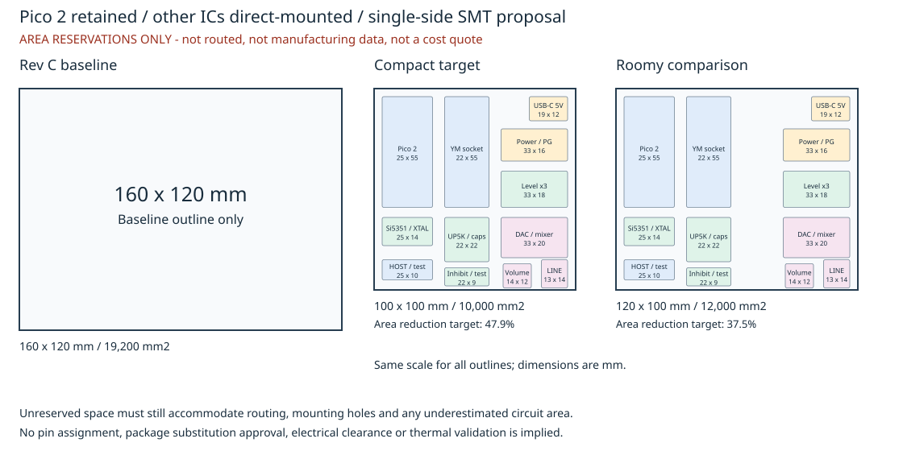

# Rev D案：直接実装、基板面積、実装費の検討

2026-11-14。ユーザー指定を反映した構成検討。**見積り・部品調達・回路図・PCB配置配線は未完了。製造用データではない。**

現在は[5枚・片面SMT＋Pico／YMソケットだけ自前実装のS案](FIVE-BOARD-COST-COMPARISON.md)を検討する。Pico 2とUP5K-SG48を維持し、その他の端子・音量器を含むTHTは委託する。[U：全実装委託の予算シナリオ](UPPER-COST-ESTIMATE.md)は比較基準として残す。以下の片面SMT／SOIC・0805案は、Uの費用を見て絞り込む比較基準として維持する。Uでは4層・両面SMT許容・THTまで業者実装を見込むが、そのPCBを配置配線したわけではない。

現在の追加条件は[端子ピッチ2 mm以上も自前実装するEconomic候補](ECONOMIC-BOM.md)。以下のU／S／A／Bは段階ごとの比較として保持する。現在の自前範囲はソケットだけに限定しない。

最新の別案は[H1：すべての主基板組立を手はんだで行う構成](HAND-SOLDERED.md)。細ピッチICは実装済みモジュールを使い、DIP・1.27 mm SOIC・1206と180×140 mmの余白を優先する。以下は直接実装／委託側の検討記録で、H1にも裸IC直接実装を要求するものではない。

## 1. 委託側で採用する方針

- Pico 2は維持する。初回試作はソケット接続を想定し、RP2350の単体実装へ進まない。USBコネクター、フラッシュ、MCU電源を主基板に再設計する費用を避ける。
- その他のICは、DIP化基板を介さず主基板へ直接実装する。FPGA、Si5351、DAC、レベル変換、電源、アナログICが対象。
- YM2203Cは所有するDIP40品をソケットに挿す。元のICがスルーホール部品なので、この部分をSMD化する意味ではない。
- USB-C電源ブレークアウトも省き、コネクターとCC1／CC2それぞれのRd等を主基板へ載せる。電源専用・5 V・PDなしの機能を維持する。
- SMTは片面へまとめて業者に依頼する。Pico用ピンソケットとYM用ICソケットだけを自前実装し、音量器、ジャック等のその他THTは委託する。
- 高額な場合は、まず**同じPCBでの部分SMT委託**へ切り替える。最小面積より製作可能性を優先し、SOIC／0805を手実装できる余白を残す。

可変クロック、実YM2203、ソフトウェアの回路化という主題は維持する。実装費削減のために外付け許可回路、レベル変換、電源順序、デカップリングを無条件に省略しない。

## 2. ICと実装区分

以下は調達型番・実装業者の在庫を確定する前の候補。パッケージ変更だけでもpin番号、端子配置、露出パッド、電源・無給電条件をデータシートで再確認する。

| 機能／Rev C | 直接実装の候補 | 基本の実装区分／手実装時 |
| --- | --- | --- |
| A1 Pico 2 | モジュールを維持 | 2列ソケットを手実装。USBプラグ、BOOTSEL、下面SWDへのアクセスを考慮 |
| U1 YM2203C | 現物DIP40＋ソケット | 手実装。音源ICを業者の一般在庫にあると仮定しない |
| A2 DAC | PCM5102A、TSSOP-20 | 業者SMT。手実装ならフラックス・拡大確認を伴う細ピッチ作業 |
| A3書込み＋U2読出し | SN74LVC4245A、TSSOP-24 | 業者SMT。SOIC-24品は手実装向け別PCB案の候補 |
| A4制御／クロック出力 | AHCT541等のSOIC／TSSOP | 単体IC。起動・無給電条件が適合する品種を確定してから採用 |
| U3 FM入力／IRQ | LCX245等のSOIC／TSSOP | 単体IC。4回路品への統合はTTL入力条件・速度を確認 |
| U4〜U7の論理・分周 | UP5K内部へ集約 | 対応する外部ICは省略候補 |
| U10独立許可 | 74HC11相当、SOIC-14優先 | 単体IC。SOICなら手実装へ切替しやすい |
| U8基準・合成 | MCP6022、SOIC-8候補 | 単体IC。既存の利得、基準電圧、負荷を維持して確認 |
| U9ライン消音 | CD74HC4053、SOIC-16候補 | 単体IC。初期状態・消音動作を維持 |
| U11＋追加電源・監視 | SOT-23系等を優先して選定 | 業者SMT／拡大確認付き手実装。レールと順序が優先 |
| 新規FPGA | iCE40UP5K-SG48、QFN-48 | 業者SMTを優先。底面パッドを含むため普通のこてだけでの実装を前提にしない |
| 新規可変クロック | Si5351A-B、10-MSOP＋25 MHz水晶 | 業者SMT。部分委託ではFPGA周辺とまとめる候補 |
| JPOWER電源入口 | 直接実装USB-Cコネクター | 比較的実装しやすい接点・固定脚の型番を選ぶ。定格と機械強度も確認 |
| 抵抗・コンデンサ | 原則0805（インチ）＝2012（メートル） | 両方の実装方法で扱える大きさ。容量・耐圧・電力により大型化 |

SOICを優先することは、すべてのICにSOIC品があるという意味ではない。PCM5102AのTSSOP、Si5351のMSOP、UP5KのQFNは残る。SOIC/TSSOPは同じフットプリントではないので、安易な重ね置き兼用パッドは採用せず、必要ならPCBの派生案として管理する。

抵抗値の共通化は実装機の段取りを減らす候補だが、アナログの音量比・帯域を変えてまで値をそろえない。結合用の無極性コンデンサを小さなMLCCへ変更する場合も、容量のDCバイアス依存、音声帯域、歪みを再評価する。大型部品のまま残す余地を見込む。

### 部品数の数え方

主要IC／モジュールは、初期14〜15個から電源等の具体化で17配置へ更新した。ただしこれは主要A/U配置の比較で、抵抗・コンデンサ・ソケットを含む全BOMではない。

DACの直接実装では、Rev Cですでに主基板上へ置いていたC13〜C21等の外付け回路を確認し、すべてを「モジュール内部から新たに増える部品」として二重計上しない。一方、レベル変換モジュールに載っていたバイパスやバイアスは、新主基板で必要な分を明示して数える。変換基板・ヘッダーがなくなる効果と、周辺回路の配置数を分ける。

## 3. 小型化の見通し

Rev Cの正本`design.json`の基板外形は160×120 mm。次の2案を比較する。

| 案 | 外形 | 面積 | Rev C比の面積削減目標 | 位置付け |
| --- | --- | ---: | ---: | --- |
| Rev C基準 | 160×120 mm | 19,200 mm² | — | 既存設計 |
| 小型化目標 | 100×100 mm | 10,000 mm² | 約47.9% | 片面SMTの機能領域を仮置きして検討する主目標 |
| 余裕のある比較案 | 120×100 mm | 12,000 mm² | 37.5% | 手実装、SOIC、アナログ部品や配線余白の増加へ対応する比較寸法 |

**上記は製造可能性を確認した外形ではなく、検討の目標寸法。** 100 mmを切ることや、特定寸法なら業者の価格が安くなることは前提にしない。コネクター・つまみの突き出しを含む装置外形も別に確認する。



図は`architecture.json`の`layout_study`を正本として生成したもの。Pico 2とYMソケットを左・中央、レベル変換をYMの近く、DAC・アナログ合成を右下、電源を右上へ仮配置する。USBプラグや音量つまみは基板の外側へ向ける意図だが、厳密なコネクター位置・向きは未確定。

| 仮領域 | 予算 | 根拠・限界 |
| --- | --- | --- |
| Pico 2＋ソケット | 25×55 mm | 公式のモジュール外形21×51 mmへ余白を足した仮領域。選定ソケットの実寸照合が必要 |
| YM2203C＋ソケット | 22×55 mm | 既存DIP40パッド列間15.24 mm・縦ピッチ列長48.26 mmを基準とする余裕。実ソケットを確定する |
| FPGA＋局所C | 22×22 mm | QFN周囲の電源C、引出し、検査用端子を置くための予算。実装成立を確認したcourtyardではない |
| クロック＋水晶 | 25×14 mm | 基準水晶、負荷、バイパス、配線の予算 |
| レベル変換3個 | 33×18 mm | TSSOP主体の予算。大型SOICを選ぶ場合は拡大が必要になり得る |
| DAC＋合成・消音 | 33×20 mm | 密度の高い仮領域。結合Cやアナログ配線次第で拡大する可能性が特に高い |
| 音量器／ジャック | 14×12／13×14 mm | Rev Cの本体形状を参考にした仮領域。軸・プラグの外側寸法は含まない |

その他の電源、HOST、許可回路、検査領域も図へ含める。比較案は右側の機能領域を20 mm動かし、追加の余白を作ったもの。実際のSOIC部品へ置き換えて配置した結果ではない。

解析ツールで確認するのは、機能領域の矩形が外形内にあり、互いに重ならないことと面積比だけ。空白は配線できる容量ではなく、取付穴、固定具、部品ごとのcourtyard、未集計のC/R、電源配線、リターン経路、検査、放熱にも使う。FPGAの実pinout、配線、全BOMが決まるまで面積削減の成立判定は保留する。

小型化の見込みは、DIP化基板2個＋DAC変換基板の省略、外部論理4個のFPGA集約、DIPアナログICのSOIC化から得る。PicoとDIP40、音量器・ジャックを残すため、極端な小型化より100〜120 mm級の比較から始める。

## 4. 費用が高い場合の切替

| 方法 | 業者へ依頼する範囲 | 自分で実装する範囲 | 位置付け |
| --- | --- | --- | --- |
| U：全実装委託 | 両面SMT許容、THT、書込み・基本検査も条件提示 | 手持ちYMをソケットへ挿すだけ | 最新指定の一次見積り用。費用・受託範囲は未確定 |
| S：片面SMT＋残りTHT委託 | 全SMT、音量器・ジャック・HOST等 | Pico用ピンソケットとYM用ICソケット | 現在の5枚比較条件。部品代を自前分まで含める |
| A：片面SMT委託 | 主基板の全SMT | Pico／YM用ソケット、音量器・ジャック等のTHT | 自前範囲をさらに増やす将来の減額比較案 |
| B：部分SMT委託 | 少なくともUP5Kと直近の電源C。起動用電源・監視・Si5351も合わせて見積る | SOIC、扱えるTSSOP、0805、THT | 高額時の第一候補。同じPCBの実装区分だけを変えられる |
| C：自前リフロー | 原則なし | QFNを含む全SMT＋THT | ステンシル、温調リフロー／予熱、拡大観察、短絡・電源検査、リワークの手段がある場合だけ比較 |

Bでは、実装しない部品は「未実装で出荷する」という組立variantを指定する。動作に必要な部品を回路上から削除するDNPとは区別する。電源・バイパス・許可回路を完成させる前に通電しない。全SMT用の組立資料を正本に、業者実装用と手実装用のref一覧を分け、両者の和集合が必要部品を満たすことを照合する。

Cの初期設備費やFPGA再実装の費用が、A/Bの委託費より安いとは仮定しない。こてだけで組む必要がある場合、UP5K-SG48の直接実装とは両立が難しいため、Bを優先する。FPGA実装済み子基板は最後の代替候補で、採用すると主案の「Pico以外を直接実装」を変えるため、別の構成案・面積・BOMで判断する。

### 同条件で比較する見積り

予算上限は指定されていないため未設定。Uについて公開料金＋仮予算の一次計算を別資料へ追加したが、正式見積りは未取得。全BOMと配置を作成後、次の条件で比較できる資料を準備する。

- 基板枚数2／5／10枚、実装枚数、同じ完成機能、同じ必要部品で比較する。
- A/Bそれぞれについて、2層と4層、100×100と120×100 mmを比較する。配線・リターン経路・電源が成立することが前提。手実装＝2層、SMT＝4層という関係ではない。
- PCB、IC/R/C、ソケット・端子、段取り／ステンシル／治具、部品種別・調達、実装、検査、送料・税を分ける。持込、余剰部品、最低ロットも記録する。
- B/Cは手元購入部品、ステンシル・消耗品、必要設備、再製作の費用も含める。業者の支払額だけをAの完成費と比較しない。
- 実装業者の在庫に合わせる場合も、電圧・パッケージ・温度・動作条件が同じかを再審査する。在庫と価格は見積り日と通貨を付けて記録する。

比較式は次のようにする。手作業時間は別欄で示し、指定のない時間単価を勝手に加算しない。

```text
1枚当たり現金費用 =
  (PCB代 + 委託先購入部品 + 手元購入部品 + 初期／実装／検査費
   + 工具・消耗品の今回負担分 + 送料・税 + 予備／再製作に見込む費用) / 完成予定枚数
```

| 枚数 | A：全SMT委託 | B：部分委託＋手実装 | C：自前リフロー |
| --- | --- | --- | --- |
| 2 | 未見積り | 未見積り | 設備の有無・費用未確認 |
| 5 | 未見積り | 未見積り | 設備の有無・費用未確認 |
| 10 | 未見積り | 未見積り | 設備の有無・費用未確認 |

Uが高ければ、片面SMTのA、次に同じ基板で可能な部分委託のBで節約額と手作業を提示する。続いてSOICを増やす120×100 mm派生案や調達しやすい同等品を比較する。値下げのために安全条件やFPGA化の主題を崩すのではなく、実際の完成費を見て選ぶ。実費見積りがない現段階で「安価に製造できる」とは結論しない。

## 5. 次に確定するもの

1. 電源順序・無給電条件を満たすIC型番、業者調達可否、直接実装する全C/Rを確定する。
2. Pico／YMソケット、USB-C、音量器、ジャックの機構外形と挿抜・操作の空間を確認する。
3. 100×100 mmへ**実フットプリント**を配置。取付穴、テストポイント、片面SMT、アナログ帰路を含め、難しければ120×100 mmへ広げる。
4. FPGA pinout・Pico信号表をレビューし、承認済みRev Cとは別の新基板として実装する。実装前のGPIO確認は引き続き必要。
5. 全BOM、メーカー型番、Gerber／穴／ペースト、CPL（位置・向き・面）、組立図、A/Bの実装ref一覧をそろえる。基板工場のDFM確認と見積りは、その資料ができてから行う。

既存の構成案、周波数・資源予算、実機比較計画は[README](README.md)を参照。今回の更新ではRev Cの回路・ファームウェア・受入記録を変更しない。

## 6. 一次資料と今回の確認

| 一次資料 | 使用箇所 |
| --- | --- |
| [Pico 2データシート](https://datasheets.raspberrypi.com/pico/pico-2-datasheet.pdf) | モジュール外形21×51 mmと接続方法 |
| [iCE40 UltraPlusデータシート](https://www.latticesemi.com/view_document?document_id=51968) | SG48、電源、ピンと実装条件 |
| [PCM5102A](https://www.ti.com/product/PCM5102A) | TSSOP-20。モジュールを使わず同じDACを直接実装 |
| [SN74LVC4245A](https://www.ti.com/product/SN74LVC4245A) | TSSOP／SOIC候補と双電源・電圧条件 |
| [MCP6022](https://www.microchip.com/en-us/product/MCP6022)／[CD74HC4053](https://www.ti.com/product/CD74HC4053) | 同一機能のSMDパッケージ候補 |
| [JLCPCB実装能力](https://jlcpcb.com/capabilities/pcb-assembly-capabilities) | 片面／両面、ピッチ・基板条件。個別型番の受注可否は未確認 |
| [JLCPCB価格の内訳](https://jlcpcb.com/help/article/pcb-assembly-price) | 段取り・部品種別・実装等の費用区分。現在の価格を予算として固定しない |

2026-11-14にメーカー・実装業者の一次資料を確認。文書の転載はせずリンクを記録した。実装先は未選定で、見積り依頼・部品の取寄せ・購入・発注は行っていない。
