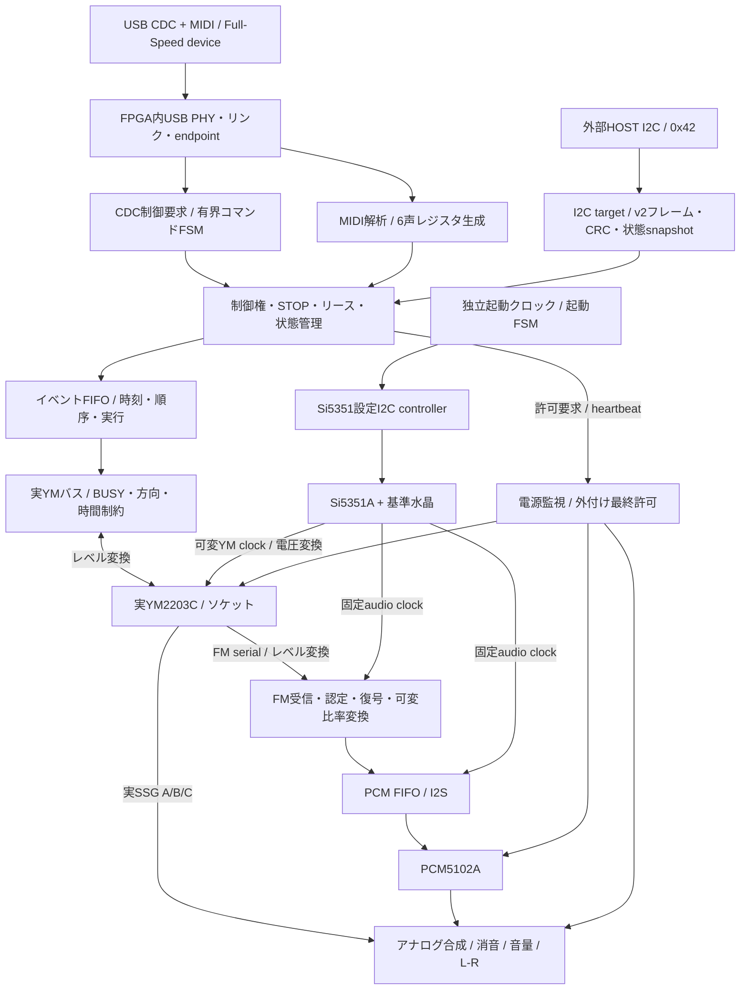

# F1：実YM2203＋FPGA単独制御＋Si5351A

2026-11-14のF1案。現在は比較・再利用資産。主案は[P2：PGA2350単独・FPGAなし](PGA2350-STANDALONE.md)。
当時の方針として、外付けマイコンを使わず、実YM2203の制御と
通信・音声処理をFPGAへ実装する。実機実験は既存Rev Cで継続できるため、
移植量の少なさより、従来のソフトウェア処理を回路として構成することを重視する。
WebLab・Rev C・F1のAPI互換を長期目標にする。

この文書は構成・開発順序の決定であり、完成回路やUSB動作、製造データの認定ではない。
RTLと検証範囲は[fpga-standalone](../../fpga-standalone/README.md)を参照。

## 維持・変更する条件

| 項目 | F1 |
| --- | --- |
| 音源 | 実YM2203C、DIP40 ICソケット。JT03への置換は今回の主案に含めない |
| MCU | Picoを含め外付けMCUを音源制御に使わない |
| FPGA内CPU | 初版は使わず状態機械・ROM・FIFOで構成。CPU案が必要になれば別の設計判断にする |
| FPGA | 実装済みモジュール／開発ボード。UP5K固定を解除し、ECP5を第一評価候補にする |
| クロック | Si5351Aを専用ICとして維持。可変YMクロックと固定音声クロックを生成 |
| 組立 | その他は狭ピッチSMDも手実装を許容。FPGA自体のBGAはモジュール内で実装済み |
| 外付けアナログ | レベル変換、実SSGとFMの合成、電源、独立した最終消音を維持 |
| DAC | 初版はPCM5102Aを比較基準にする。FPGA内ΔΣ DACは後続比較、採用済みと扱わない |
| 資産管理 | asamomijijp-code。Rev C・WebLabとその実機受入記録を維持 |

「FPGA単独」は音源制御に外付けMCUを必要としない意味である。
専用クロックIC、設定Flash、電源、アナログ回路をなくす意味ではない。
USB書込みブリッジや外部プログラマーは、実行時のCDC／MIDI処理を担当しない。

## 構成と分担

USBはPCに接続される**デバイス**。HOSTプレーヤーのHOSTという呼称とは分ける。
USBホスト、OS、ファイルシステムやMML解釈を初版FPGAに持ち込まない。
MML・楽譜・WYM1ファイルの読み出しはPC／操作側MicroPythonで行い、FPGAは
時刻付きレジスタイベントを受けて実行する。CDCコマンドも小さな有界FSMから始める。

USB専用MCUやUSB-UART変換ICでCDCだけ実現して、FPGAのUSB-MIDI対応と扱わない。
USB Full-Speed 12 Mbit/sでのCDC＋MIDI複合デバイスを最初のUSB到達点にする。
専用外付けUSB PHYは代替可能だが、部品削減のためGPIO PHY方式を先に評価する。

## 評価用モジュールの具体化（2026-11-15追記）

評価対象を**ULX3S 85F PCB v3.0.8、LFE5U-85F-6BG381C**に定めた。
[BOARD.md](../../fpga-standalone/BOARD.md)に全49 pad・縦型ヘッダの端子表、
USB US2／自己給電の分離、12MHzキャリア発振器→PLL 48MHz、Si5351音声49.152MHz、
通常配置配線と検証範囲を記録する。既存Rev CのGPIO／HOSTは変更しない。
購入・キャリア回路図・PCB・実機受入は未完。以下の候補表と35本小計は初期比較を保持したもの。

## FPGAとモジュールの候補

候補比較であり購入・採用確定ではない。セル数の異なるファミリーを単純な倍率で比較しない。

| 候補 | 選ぶ理由 | 未確認・制約 |
| --- | --- | --- |
| **ECP5、ULX3S 85Fを評価用第一候補** | 公開資料に56 GPIO、直接USB用経路、LUNAのFull-Speed対応例がある。通信・音声を分離して評価しやすい | 大きな評価ボードであり最終小型モジュールとは別。搭載ESP32等は音源制御に使わない。版・電源・US2・端子共用を照合してから選ぶ |
| ECP5の小型モジュール | 最終基板の候補。USB用端子と十分な3.3 V GPIOを引き出せるもの | 型番は未確定。最低40本の利用可能信号枠を選定目標とし、電圧・予約端子・時計入力を別途確認 |
| iCE40UP5K、UPduino | 既存ツール・試験資産を使える比較対象 | M1の31本予算を流用しない。USB・Si5351設定・HOST I2C追加後の端子／資源／タイミングが未検証 |
| Gowin GW5A-25、Tang Primer 25K | モジュール形式と一般IO75本を製作者が公表。Windows用ツールを利用できる比較対象 | 2×60 pin BTB、電源・IO bank、USBデバイス配線／コアの評価が必要。DockのUSB-C書込み口をUSB-MIDI用端子と誤認しない |
| OrangeCrab | ECP5・直接USBの参考実装 | 製作者販売ページではDiscontinued、通常GPIO20本。今回の購入第一候補にはしない |

ECP5選択は完成構成の合成結果による採用判断ではなく、開発の余裕とUSB実装例を重視した判断。
まず内蔵RAMだけで制御・FIFOを作り、SDRAM／DDRを初版の必須条件にしない。
最終モジュールは、基板面積だけでなく3.3 V端子数・直接USB・起動と書込み・電源を見て選ぶ。

参照した一次資料（2026-11-14確認）：

- [Radiona ULX3S](https://radiona.org/ulx3s/)：評価ボードのGPIO・周辺回路。
- [製作者のULX3S manual](https://github.com/emard/ulx3s/blob/master/doc/MANUAL.md)：US1／US2と書込み経路。
- [LUNA対応状況](https://luna.readthedocs.io/en/latest/features.html)：ULX3S等でのFull-Speed device支援。
- [LUNA USB device構成](https://luna.readthedocs.io/en/latest/gateware/usb2_device.html)：USBリンクとendpointの分離。
- [LUNAライセンス](https://github.com/greatscottgadgets/luna/blob/main/LICENSE)：BSD-3-Clause。
- [Sipeed Tang Primer 25K](https://wiki.sipeed.com/hardware/en/tang/tang-primer-25k/primer-25k.html)：モジュールのIOとDock。
- [OrangeCrab製作者ページ](https://1bitsquared.com/products/orangecrab)：販売状態とIO。

LUNAはPython/Amaranthで**回路を生成**する候補で、FPGA上でPythonを動かすものではない。
Verilogの音声・YM制御と接続可能な境界を設ける。現時点では依存の追加やコアの取り込みをしていない。
導入前にコミット・生成ツールを固定し、CDC＋MIDIの記述子、クラス要求、FIFO、
USB reset／suspend／切断と所有権を試験する。対応表だけで複合デバイス完成とは扱わない。

## 端子と起動クロック

論理信号の初期見積り。物理GPIOの指定・承認ではない。

| 信号 | 本数 |
| --- | ---: |
| YM D0..7、A0／CS／WR／RD／RESET | 13 |
| データ変換器DIR／OE | 2 |
| FM SD／CLK／SH | 3 |
| I2S | 3 |
| HOST I2C target | 2 |
| Si5351設定I2C controller | 2 |
| USB D+／D-／pullup制御 | 3 |
| 独立制御クロック、Si5351音声クロック | 2 |
| 電源成立入力、外付け許可用heartbeat | 2 |
| DAC許可、LINE許可 | 2 |
| YM IRQ | 1 |
| **初期小計** | **35** |

USB VBUS検出、外部reset、診断・書込み、module予約端子は小計に含めない。
40本以上の信号枠は選定上の目標で、35本で実基板が成立する保証ではない。
モジュール内の固定接続にUSBや時計がある場合も、その信号を二重に空きGPIOとして数えない。
外部HOSTのSDA/SCLとSi5351設定用SDA/SCLは別バスにする。

Si5351が未設定の段階で、その出力クロックで設定FSMを動かす循環依存を作らない。
モジュールの独立発振器＋FPGA PLL等で起動・USB・管理系を動かし、Si5351を設定する。
USB用に必要な周波数・精度と、音声用49.152 MHzは別に設計する。
M1の固定16 MHz／49.152 MHzをそのままUSBへ使わない。

音声とYMはSi5351の共通基準から生成する候補を維持。独立管理系とはCDCを設け、
USB切断・再列挙だけではI2C演奏を止めない。USB suspend時の消費電力／VBUS／逆給電も
自己給電デバイスの電源設計として確認し、USBクラス動作試験と区別する。
周波数変更は停止・消音・YM reset・FIFO破棄・設定安定確認・明示再開の順とする。
初版の互換モードは4 MHz。可変クロックの公開APIとwire拡張は後の版で分離する。

## API互換と初期到達点

[API-COMPATIBILITY.md](../../fpga-standalone/API-COMPATIBILITY.md)に現状の差分と移行順を記録する。
まずRev C C版のI2C v2を変更せず実装し、既存HOST playerを動かす。
WebLabの0x44・仮想I2C仕様とRev Cの0x42・v2は現状で別仕様であり、
同じデータを受け付けると見せかけない。長期には共通ホストAPIとbackend adapterで揃える。

STOPは全声とゲートを停止し、残ったMIDI Note OnやUSB再接続から自動復帰させない。
I2Cの1秒リース、再送時の非再実行、MIDIとI2Cの排他、音声異常の消音を維持する。
最後の外付け許可回路は、FPGA設定前・無給電・全クロック停止にも対応させる。

## 実装と受入の段階

| 段階 | 成果と判定条件 | 現在 |
| --- | --- | --- |
| F0 仕様境界 | API差分、候補、起動／端子／安全停止の整理 | この文書で整理 |
| F1a wire入口 | v2フレーム長・header・CRC・staging。既存Cと照合 | 単体frame検査済み（初回記録） |
| F1b I2C session | target、snapshot、seq／再送、1024 FIFO、SEAL／CRC、lease、scheduler | RTL実装・モデル試験済み。既存HOST／player、SDA/SCL、ローカル全曲。実機未確認 |
| F1c 実YM音声 | bus／BUSY、serial RX、比率変換、CDC／I2S、停止監視 | 実YM・音声と可変SRCのRTL／モデル試験を追加。実機は未確認 |
| F1c-clock 専用clock起動 | Si5351A I2C controller、設定ROM、readback／PLL監視、停止中切替 | 8profile・可変SRCをモデル検証。公開clock API／実機は未対応 |
| F1d USB | Full-Speed CDC＋MIDI、列挙、panic、I2Cとの排他・切断 | 限定CDC・6声MIDI・排他／切断消音のRTL／理想USB bit列・結合モデルを追加。OS列挙・実機・電気適合は未確認 |
| F1e 統合配置配線 | 実moduleの制約、複数seed、資源／全clock timing、CDC | 85F／grade6・3 seedの内部OOC配置配線と2 clock setup／FF cone CDC評価を追加。物理IO／clock tree／実基板timingは未実施 |
| F1f 実機 | 音声単音、Ys II全曲、STOP／通信断／再接続、Rev C比較 | 未実施 |
| F2 共通API | WebLab／Rev C／F1 adapterに同じ契約試験を適用 | 方針のみ |

JT03入りUP5Kの4,850 LCやRev Cの実機合格を、F1の収容・動作確認として流用しない。
購入・端子割当て・基板製造へ進む前に、USBを含む統合RTLの評価を行う。

I2C制御部分の接続条件・試験・ECP5 mapping値は[SESSION.md](../../fpga-standalone/SESSION.md)を参照。

## 2026-11-15：実YM音声RTLの接続

[AUDIO.md](../../fpga-standalone/AUDIO.md)に実装・接続・検証条件を記録した。
`revc_real_ym_top`はcontrol 48MHz／audio 49.152MHz／YM 4MHzを初回条件とし、
既存HOST v2を変更しない。この固定4MHz topはSi5351設定済み前提。後述のclocked topで起動FSMを接続した。
busと音声を含むECP5 mappingはUSB込み配置配線や可変clockの合格を意味しない。
物理module・pin・外付け最終停止回路の確定と実機受入は別工程として残す。

## 2026-11-15：Si5351A起動・可変clockの接続

[CLOCKS.md](../../fpga-standalone/CLOCKS.md)に専用controller・設定値生成・監視・切替を記録した。
`revc_clocked_ym_top`は独立48MHzから起動し、Si5351のCLK0をYM、CLK1を49.152MHz音声へ使う。
初期ROMは25MHz XTAL／10pF、1.5〜4MHzの8profile。物理部品・pinは確定していない。
旧HOST／v2は4MHz-onlyのまま、他profile時の4MHz BEGINをDATA6で拒否する。
可変clock用の公開APIは別途設計し、既存の要求／status形式へ隠して追加しない。
音声clockとYMを一旦停止して切り替えるため、演奏中の連続変更は行わない。
USB込み配置配線・電圧／clock測定・アナログ聴取・実機受入は残る。

## 2026-11-15：USB CDC・USB-MIDIの接続

[USB.md](../../fpga-standalone/USB.md)に固定USB coreと独自class／MIDI／consoleを記録した。
`revc_usb_ym_top`で独立48MHz管理／USBと49.152MHz音声を分け、実YMとSi5351を維持する。
既存HOST v2は変更せず、MIDI所有中のBEGIN拒否、I2C所有中のMIDI破棄、global STOP、
MIDI切断時消音とUSB切断中のI2C継続をモデル試験する。再列挙だけでは再発音しない。
MIDIはC版と同じ4MHz・6単音channelのNote／CC120/123／FF subset。
CDCはstatus/help/stop/s/Ctrl+C/panicに限定する。REPL・C版console全機能は含めない。
USB VID/PIDは既定0でdetached。物理USB pad、pull-up／VBUS、制約・端子・許可回路は未確定。
新しいUSB込みECP5 mappingを保存するが、収容・48MHz timing・OS認識・実音の合格とは扱わない。

## 2026-11-15：USB統合RTLの内部配置配線

[TIMING.md](../../fpga-standalone/TIMING.md)で85F／grade6の内部OOC配置配線を記録する。
control／USB48MHz、音声49.152MHzをSDCで指定し、3 seedと同期段の配置配線遅延を確認する。
FIFO時刻変換・MIDI取出しを段階化し、期限判定は現在時刻を使う。fault／gate参照は同期する。
HOSTのwire／WYM1と制御権・切断時の停止範囲は維持する。
OOCはIO buffer／clock treeを含めず、物理pinを割り当てない。module・電圧／USB PHY・clock入力を
確定した後にIO／skew／jitter／hold／resetを含む評価とF1実機受入を行う。
