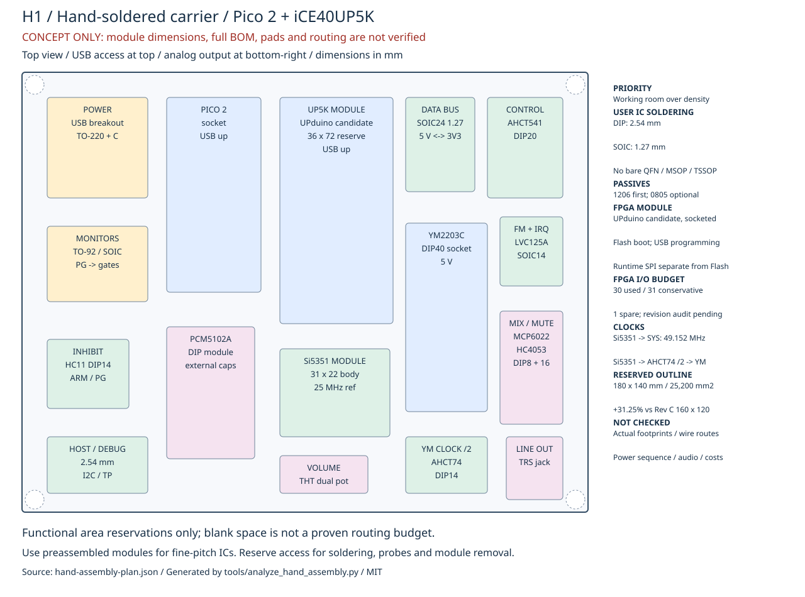

> 履歴資料：細ピッチ回避を優先したH1案。現在は[M1](MODULE-HAND-SOLDERED.md)で狭ピッチSMDの手実装を許容し、Si5351／DACモジュール必須の条件を解除した。

# 手はんだを優先する別案 H1

2026-11-14。Pico 2とiCE40UP5Kを維持する**構成・配置の検討案**。回路図、製造用BOM、フットプリント、PCB配線、RTLの完成版ではない。業者SMTの[Economic案](ECONOMIC-BOM.md)を置き換えず、比較用に残す。

## 1. 今回の結論

ユーザーが難しいと感じたRev CのU2・U3は、`74LCX245FT`のTSSOP20、端子ピッチ0.65 mmだった。一方、Rev Cの抵抗・コンデンサは1206（インチ表記、3216メートル）を使っており、こちらの作業は難しくなかったという経験を設計条件にする。

**細ピッチICをユーザー自身で実装しない構成は検討できる。** 主基板ではDIP、2.54 mmのモジュール端子、1.27 mmのSOIC、1206のR/Cを基本にする。面積はまず**180×140 mm**を予約し、小型化よりも、こて先・ピンセット・テスターを入れやすいことを優先する。

ただし「すべて手はんだ」は、**購入した実装済みモジュールを含め、主基板への組立をこてで行う**という意味になる。UP5KのQFN48と底面放熱パッドまで、裸ICからこてだけで組み立てる案にはしない。市販の未実装QFN変換基板では問題を移すだけなので、FPGA・電源・設定Flashまで実装済みのボードを使う。Pico 2自体も従来どおり実装済みモジュールを使う。

小さなSOICで作業感を確認するため、SN74LVC125ADと1206の練習用小基板を本基板前に使う。1.27 mmでも難しい場合は、同ICを実装済みの変換モジュールへ変更してから主基板のフットプリントを確定する。未実装のSOIC→DIP基板を買うだけでは、細ピッチ作業はなくならない。

## 2. 部品構成の候補

型番末尾は重要。以下のD／DW／N／P等と、PW／DB／DGV等を取り違えない。部品の機能名だけで発注せず、パッケージ図と注文型番を照合する。以下は購入リストではなく、電源条件・在庫・実寸を確認する前の候補表。

| 機能 | H1の候補 | ユーザーがはんだ付けする部分／注意 |
| --- | --- | --- |
| MCU | Pico 2＋ソケット | 2.54 mm。USBプラグとBOOTSELにアクセスできる配置 |
| 音源 | YM2203C＋DIP40ソケット | 2.54 mm。手持ち音源を挿す |
| FPGA | UPduino v3.1等の**実装済みUP5Kボード** | 2列ヘッダーをソケット接続。後述のI/O・電源・版確認を条件とする |
| 可変クロック | Adafruit Si5351A classic #2045等の実装済みボード | 2.54 mmヘッダー。25 MHz基準・3出力。49.152 MHzとYMの2倍クロックを生成する案 |
| YMクロック分周 | SN74AHCT74N、PDIP14 | 2.54 mm。5 V駆動、TTL入力でSi5351の約3.3 Vクロックを受け、1/2分周してYMへ供給 |
| データ書込み・読出し | SN74LVC4245ADW／ADWR、SOIC24 | **1.27 mm**。A=5 V、B=3.3 V。A3＋U2の統合候補。旧U2とピン互換ではない |
| YM制御の3.3→5 V変換 | SN74AHCT541N、PDIP20 | 2.54 mm。5 V駆動のTTL入力。単電源なので無給電動作とOE制御は別途検証 |
| FM入力3本＋IRQ | SN74LVC125AD／ADR、SOIC14 | **1.27 mm**。3.3 V駆動、入力5.5 V許容。FM3本はFPGA、IRQはPicoへ分岐 |
| FM DAC | Rev CのAE-PCM5102A DIP化キット | 2.54 mm。IC実装済みを使用。C13〜C21等の外付け回路は主基板に必要。完成DAC基板AE-DAC5102とは区別 |
| 独立許可回路 | SN74HC11N、PDIP14候補 | 2.54 mm。HOST_ARM・電源成立・FPGA許可を外付けで合成 |
| 基準電圧・アナログ合成 | MCP6022-I/P、PDIP8 | 2.54 mm。Rev Cと同じアナログ構成から始める |
| ラインミュート | CD74HC4053E、PDIP16候補 | 2.54 mm。Rev Cの機能を維持。調達可能性を再確認 |
| DAC等の3.3 V電源 | LD1117V33等のTO-220候補 | 2.54 mm級。安定用C・ESR・放熱・逆流条件を確認。FPGAコア電源はモジュール内 |
| 電源監視 | MCP120系のTO-92／SOIC8候補 | 5 V／3.3 Vの閾値とパッケージを確定する。TO-92の端子順が複数あるため要注意 |
| ミュート・OE用トランジスター | TO-92のNPN候補 | MMBT3904のSOT-23から形状変更。B/C/Eを再割当し、機械的な互換品とは扱わない |
| 電源入口 | Rev CのAE-USB2.0-TYPE-C等 | 2.54 mm。細ピッチUSB-Cコネクターを主基板へ直接載せない |
| 抵抗・局所C | **1206を基本**、必要時0805 | 作業できた大きさを維持。容量・耐圧・音声特性の都合でラジアルCも残す |
| 音量器・TRSジャック・HOST端子 | Rev CのTHT部品を基準 | 機械荷重を受ける部分。基板端へ配置 |

SOIC24のデータ変換器が、この案で最もはんだ付け点数の多い裸SMD ICとなる。ピッチは旧U2/U3の約1.95倍だが、簡単に実装できると保証するものではない。1.27 mm用の広めのtoeとフラックス・吸取り線を使える余白を設ける。

SN74LVC4245Aの5 V側入力条件と制御入力条件を確認し、DIRの3.3 V駆動、5 Vプルアップの/OEを引き下げるTO-92回路、電源順序を検証する。AHCT541は8T245と同じ双電源・隔離特性を持つ部品ではない。外部許可、入力プルダウン、YM側プルアップ／リセットプルダウンを含めて設計する。FMはTTLレベルを受けられるLVC125Aへ入れ、5 V信号をFPGAへ直結しない。

## 3. FPGAモジュールの端子不足を避ける

UPduinoの製作者は通常GPIO32本を公表している。RGB専用端子、構成Flash用SPI、RESET/DONE、発振器用端子を、すべて独立した自由GPIOとして加算しない。v3.0の公式pinoutではgpio_20がオンボード12 MHzと共用される。H1ではこの1本を**使えないものとして予約**し、通常GPIOは31本の保守的な予算で検討する。v3.1の購入版で同じ条件が成立することは、回路図・実物照合前には確定しない。

直接実装案の34本から、次の分担変更で**30本**へ減らす。

| 信号群 | 本数 |
| --- | ---: |
| YMデータD0〜D7 | 8 |
| A0、CS、WR、RD、RESET許可 | 5 |
| データ変換器DIR・OE | 2 |
| FM SD・CLK・SH | 3 |
| I2S | 3 |
| Picoとの実行時SPI | 4 |
| HOST_ARM入力・FAULT出力 | 2 |
| 49.152 MHz外部SYS入力 | 1 |
| DAC許可・LINE許可 | 2 |
| **計／保守的な利用枠** | **30／31、予備1** |

変更点は、IRQをPicoへ移す（−1）、電源監視をPicoと外付け許可へ移す（−1）、YM用2倍クロック入力と分周後の出力を外付けAHCT74へ移す（−2）。レジスタの時刻実行、BUSY待ち、バスFSM、FM受信・復号・補間・I2SはFPGAに残り、ソフトウェアを回路化する主題は維持する。

外部SYSはグローバルクロック入力を候補にする。オンボード12 MHzを49.152 MHzだと読み替えたり、独立した発振器からYMとI2Sを作ったりしない。Si5351で共通基準の2系統を作る点は直接実装案と同じ。AHCT74の/Q→Dで2分周し、電源成立まで/CLRをアサートする案とする。周波数変更はYMリセット・消音中に行い、再開時の最初の周期も確認する。

H1では**モジュール上のFlashから起動**する。初期書込みはモジュールのUSBプログラマーを使い、Picoからの毎起動Slave SPIロードは初期スコープから外す。実行時SPIはGPIO4本を別に使い、FlashとFTDIがつながる構成用SPIを共用しない。PicoはARMを下げたまま、設定済みFPGAのID・版・状態を読んでから有効化する。更新時はPicoファームとFPGA bitstreamの互換性も照合する。

これらは**信号の分担案と本数確認**であり、物理pin、bank、Pico GP番号は未割当。GPIOの変更を実装済み・承認済みとは扱わない。予備1本で2個目のYMを追加できるという意味でもない。

### モジュール採用前の条件

- 注文したv3.1のヘッダー・グローバルクロック入力・Flash起動と、公開v3.0資料との差を照合する。品名だけで3.0/3.1を同一視しない。
- 公開販売ページの在庫・ヘッダー実装オプションを確認してから購入候補を確定する。在庫保証や購入はしていない。
- モジュール基板寸法、ヘッダー列間、USBプラグの占有、下面高さを測る。配置図の36×72 mmは実測値ではなく予約領域。
- FPGA内1.2 Vの立上げ、IO電源、内部監視の有無を確認する。主基板の5 V／3.3 V監視だけで、モジュール内コア電源も検査したことにはしない。
- 外部5 VとモジュールUSBを同時接続した場合の逆給電を確認する。未確認の間はプログラム時の給電切替をジャンパーで分離する案とし、単に5 V同士を短絡しない。
- Pico USBだけON時、モジュールOFF時のSPI／ARM／FAULT／IRQ／I2Cの回り込みを確認する。プル抵抗のみで全状態が隔離されるとは扱わない。

## 4. 基板レイアウト

**180×140 mm、25,200 mm²、Rev C比で31.25%増**の機能領域を仮置きした。これはフットプリントを置いて配線したPCBではない。160×120 mmへ収めることも、180×140 mmで必ず完成することも、まだ確認していない。直接実装100×100／120×100 mm案の面積計算とは別に管理する。

- 上側：USB電源とPico 2。中央：FPGAモジュール。右側：データ／制御変換器とYM。下側：クロック、DAC、アナログ合成、音量、ライン出力。クロックと高速配線をジャック周辺へ通さない。
- FPGAのUSBとPicoのUSBを上辺から抜き差しできる向きへする。モジュールの正確なUSB位置・向きは実物照合後に決める。コネクター前方の基板外ケーブル領域も筐体設計で確保する。
- FPGAを横断する長いYMバスを避ける。FMのSD/CLK/SHはまとまった短い経路にし、SYS・I2Sの直近に戻り電流の経路を保つ。必要なら直列抵抗で波形を調整する。
- 部品本体間は原則3 mm、SOICのこて先進入側にはランド端から3 mm、背の高いソケット・電解CからSOICまでは5 mm程度を**配置目標**とする。予約図では個別ランド端を検査していない。
- SOICのランドをメーカー推奨値から検討し、手作業用toeをおおむね0.8〜1.0 mm確保する方向で調整する。ブリッジしやすい過大パッド、隣接ネットの露出銅、無検討の兼用パッドは避ける。
- R/Cは上面へ統一する。モジュール・ソケット直下は原則部品禁止にし、局所デカップリングは電源端子の外側に近接配置する。裏面はTHTはんだ面と測定アクセスを優先。
- GNDはアナログ／デジタルを無理にスリットで分断せず、連続面を保ったうえで部品・電流経路を区分する。2層を第一候補とするが、配線でGNDが細切れになるなら4層も比較する。手実装と層数は別の判断。
- 1番ピン、極性、IC番号、モジュール挿入方向、電源電圧を読める位置に印刷する。ピンソケット外側へ抜取り余白を置く。
- TPは5 V、3.3 V、GND、PG、ARM、RESET、SYS、YM CLK、FM CLK/SH、I2Sへ確保する。密集部ではなくクリップやプローブを当てられる位置へ出す。
- 四隅にM3取付領域を仮置きする。図の半径3 mmは予約円で、穴径・ランド・ねじ頭・スペーサー・筐体の確定寸法ではない。

配置正本は[hand-assembly-plan.json](hand-assembly-plan.json)。解析は[tools/analyze_hand_assembly.py](tools/analyze_hand_assembly.py)で、領域の範囲・重複、穴予約との干渉、I/O本数と図／JSONの再現性を確認する。**配線、SI、電源安定性、全BOM、実装の容易さを証明する検査ではない。**

## 5. 電源・消音と組立順

外付けの許可回路を残し、`HOST_ARM AND POWER_GOOD AND FPGA許可`がそろうまでRESET/DAC/LINEを開かない。電源監視をFPGA端子節約のためPicoへ移しても、POWER_GOODから外部ゲートへの直結条件は残す。FPGAが未設定、SPI無応答、Picoリセット中ならARMは外付けプルダウンでOFFにする。

電源をTO-220化する場合は、主基板の専用3.3 VとPico／FPGAモジュールの3.3 V出力を無条件に接続しない。LD1117系の出力Cの容量・ESR、負荷電流・放熱、電源断時の逆流を確認する。MCP120等の監視出力をまとめる場合も、片側無給電時の出力絶対最大定格を照合し、単純なwired-ANDでよいとは決めない。電流制限・保護・5 Vの立上りを含む電源回路は、H1用に別途確定する。

1. 電源入口・保護・レギュレーター・監視と外付け消音回路から組み、モジュールやYMを挿す前に電圧と初期状態を測る。
2. SOICと1206、低い部品を実装し、拡大確認と導通・電源短絡検査を行う。続いてソケット、背の高い電解C、端子類を付ける。
3. FPGA/Pico/クロックモジュールを挿し、ARM=OFFでクロックとSPIを確認する。FPGA bitstream未書込み・不一致でも発音しないことを検査する。
4. YMとDACを挿して無音検査、単音、6声、STOP・通信断・再接続を順に確認する。全曲再生はその後に行う。

## 6. 業者実装案との比較と次の判断

| 項目 | Economic・裸IC案 | H1・手はんだ案 |
| --- | --- | --- |
| ユーザーの細ピッチIC作業 | 業者へ委託 | 0.65 mm以下と底面端子は実装済みボードへ集約 |
| 主基板のSMD | 0603、TSSOP、MSOP、QFN等 | 原則1206と1.27 mm SOIC |
| 外形の検討目安 | 100×100／120×100 mm | 180×140 mm |
| FPGA設定 | Picoから毎起動ロード | モジュールFlash起動、USBで初期更新 |
| 部品削減 | モジュール／ヘッダーを減らす | 作業性優先でモジュール、ソケット、外付け分周器を増やす |
| 費用 | 業者段取り・実装費、裸部品代 | モジュール代・送料、大きいPCB、手作業。安いとは未確定 |

現段階では、**H1を手作業向けの第一比較案**とする。先にSOICの作業感、FPGAモジュールの調達・端子・外部クロックを確認し、回路図へ進む。小型化・部品点数削減はEconomic案、作りやすさと交換・学習はH1が有利になりやすいが、費用や完成面積を確定したものではない。新GPIOの実割当・回路実装はそのレビュー後に行う。

## 7. 一次資料

確認日：2026-11-14。下記資料へのリンクと独自の検討結果だけを保存し、回路図や第三者基板CADのコピーは取り込まない。

- [UPduino製作者の仕様](https://upduino.tinyvision.ai/)、[公式pinout（v3.0、共用端子に注意）](https://upduino.readthedocs.io/en/latest/features/specs.html)、[v3.1販売ページ](https://tinyvision.ai/products/fpga-development-board-upduino-v3-1)。v3.1の正式採用には購入版照合が必要。
- [TI SN74LVC4245A](https://www.ti.com/product/SN74LVC4245A)、[Rev. Kデータシート／DW機械図](https://www.ti.com/lit/ds/symlink/sn74lvc4245a.pdf)。5 V／3.3 V、入力閾値、Ioff、SOIC24を確認。
- [TI SN74LVC125A](https://www.ti.com/product/SN74LVC125A)、[SN74AHCT541](https://www.ti.com/product/SN74AHCT541)、[SN74AHCT74](https://www.ti.com/product/SN74AHCT74)。D／DW／NのパッケージとTTL入力条件を確認。
- [Adafruit Si5351A #2045](https://www.adafruit.com/product/2045)。25 MHz基準、3出力、ヘッダー、基板31×22 mm。H1では端子I2C側を3.3 Vへ合わせる給電・接続条件を回路図で確認する。
- [秋月 AE-PCM5102A](https://akizukidenshi.com/catalog/g/g111836/)。IC実装済みDIP20キットを選び、未実装変換基板と区別する。
- [ST LD1117](https://www.st.com/en/power-management/ld1117.html)、[Microchip MCP120](https://www.microchip.com/en-us/product/MCP120)、[MCP120/130データシート](https://ww1.microchip.com/downloads/en/DeviceDoc/11184d.pdf)。TO-220／TO-92等の候補確認。注文型番、閾値、無給電時接続の確定は未了。

Rev CのU2/U3とR/Cの形状は[正本design.json](../ym2203-single-board/rev-c/design.json)、基板外形160×120 mmも同ファイルを参照した。
