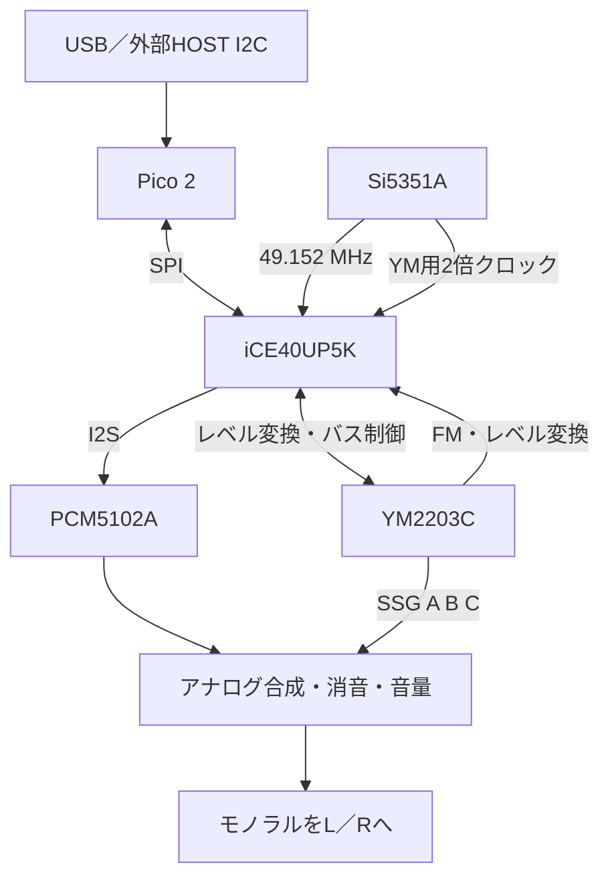

> 履歴資料：以下は裸UP5K・直接実装を中心に検討した時点の内容。現在の主案は[M1](MODULE-HAND-SOLDERED.md)。本文中の「今回」「未導入」等は当時の条件を指す。

# YM2203次期基板：iCE40UP5K構成検討（Rev D案）

2026-11-14。**構成検討段階。回路図・PCB・RTL・新ファームウェアは未実装で、製造用データではない。**
実音源YM2203Cを残し、Rev CでPico 2がソフトウェア処理していた演奏時刻管理、バス操作、FM受信・PCM変換を、iCE40UP5K上の回路へ移すことを主題にする。

ユーザーの方針は、可変クロック、実装部品の削減に加えて、FPGAによる新しい回路設計と学習・製作の面白さを重視すること。多少の余裕や挑戦を許容し、ソフトウェアのハード化を優先して検討する。基板・HDL・Picoファームウェアは、この`asamomijijp-code`プロジェクト内で管理する。サイト記事は別プロジェクトへ引き継ぎ済み。

基点は`f94356c7df7281e6a237b79000840a4c2bdaaa7a`の受入済みRev CとC版0.5.0-alpha.4。既存の[Rev C](../ym2203-single-board/README.md)と[ファームウェア](../../firmware-c/README.md)を復帰・比較基準として保持する。この案をRev CのGPIO、回路、UF2へ適用したとは扱わない。

## 1. 今回の推奨構成と判断

最新の比較対象として、[H1：手はんだ向け構成・180×140 mm配置案](HAND-SOLDERED.md)を追加した。Pico 2とUP5Kを維持し、FPGA・クロック・DACは実装済みモジュール、その他のICはDIPまたは1.27 mm SOIC、R/Cは1206を基本とする。以下の裸IC・Economic委託案と並列に検討し、既存の直接実装BOMをH1へ流用しない。H1は別のI/O分担・Flash起動を持つ検討案で、回路図・新GPIO・PCBを実装したものではない。

| 項目 | 主案 | 判断理由・残る確認 |
| --- | --- | --- |
| 制御マイコン | Pico 2を継続 | USB-MIDI/CDC、外部HOST I2C、曲データ検査を既存資産から移せる |
| FPGA | iCE40UP5K-SG48候補 | 5,280 LC、30 EBR、4 SPRAM、8 DSP。48ピンQFNの端子予算を先に確認 |
| FPGA設定 | PicoからSlave SPIで毎起動ロード | 設定データをPico側フラッシュへ含め、開発初期の外付け設定Flashを省く。起動不能時は消音 |
| 可変クロック | Si5351A-Bの10-MSOP候補＋25 MHz水晶 | YMと固定音声系を同じ基準から作り、FPGA内での粗い周波数近似を避ける |
| YMデータバス | 双電源・TTL入力対応の双方向トランシーバー1個 | Rev Cの書込みA3＋読出しU2の2個をまとめる候補 |
| 制御信号／FM入力 | 方向に適したバッファーを各1個 | UP5Kへ5 Vを直接入れない。起動・無給電・内部プルアップも含めて選定 |
| 起動・異常時の消音 | FPGA外の小ロジック1個を維持 | 未設定FPGAやPicoリセット時にもDAC/LINE/RESETを無効化する |
| 音声出力 | PCM5102Aを直接実装し、既存アナログ合成を継続 | FMはFPGAからI2S、SSGはYMの実アナログ出力を使う |

主要IC／モジュールは、初期の14〜15個という予算から、Economic候補BOMの具体化で**17配置**となった。専用3.3 V LDO、コア電源・IO順序、監視を個別に予算化した結果であり、部品総数の削減はまだ証明していない。[Economic候補BOM v0.1](ECONOMIC-BOM.md)に、29委託品種のライブラリ表示と、2 mm以上の自前実装区分をまとめた。

### 委託案の実装と小型化の方針

Pico 2はモジュールのまま維持する。その他はDIP化基板・ブレークアウトを使わず、元のICと必要な周辺回路を主基板へ直接実装する。YM2203C自体は現物のDIP40＋ソケットであり、表面実装品へ変更するという意味ではない。

片面SMTを業者へ依頼し、Pico／YMソケットに加え、手実装しやすい端子ピッチ2 mm以上のヘッダー、音量器、ジャック、ラジアルC等を自前実装する。抵抗と局所CはBasicの0603を委託する候補とした。小型化目標は100×100 mm、比較案は120×100 mm。Rev Cの160×120 mmに対して面積約48%／38%減の**検討目標**で、配線・取付穴・全周辺部品まで収まると確認した寸法ではない。

見積りが高い場合は、同じ基板でFPGAと起動に必要な周辺だけを業者実装し、残りを手実装する。0805（インチ、2012メートル）とSOICを優先し、QFNを普通のこてだけで実装できるとは扱わない。[実装・面積・費用の検討](ASSEMBLY-AND-SIZE.md)に仮配置図、部品の実装区分、費用比較と切替条件をまとめた。

現在は**5枚・片面SMT・2 mm以上の自前部品を含むE5案**の[部品選定](ECONOMIC-BOM.md)を進める。Pico 2とUP5K-SG48を維持し、委託29品種はEconomic表示あり、Extended16／Basic13と照合した。ただし、在庫・全回路・CPL・工程の最終受託は未確認。[ソケットだけ自前のS比較](FIVE-BOARD-COST-COMPARISON.md)と[全委託U](UPPER-COST-ESTIMATE.md)は過去条件の基準として残し、新BOMの実費へ読み替えない。

### ブロック構成



この図のYM用クロックはFPGA内の1/2分周器を通ってYMへ出る。主電源と独立許可回路は図から省略した。SSGをFPGA内でエミュレートする構成ではない。

## 2. ソフトウェアをどの回路へ移すか

| Rev Cでの処理 | 次期版の回路／担当 | 検証する性質 |
| --- | --- | --- |
| USB、外部I2Cの要求解析、CRC、ファイル検査 | Pico Cファームウェア | 不正入力、制御権、再送、通信期限 |
| 先読みしたイベントの保持 | FPGA内イベントFIFO | 満杯・枯渇、順序、件数、STOP後の破棄 |
| 時刻を見て1件ずつYMへ書く処理 | FPGA時刻回路＋実行器 | 同時刻の順序、BUSY待ち、実行遅れ |
| GPIO方向切替、アドレス／データストローブ | FPGAバスFSM | データバスの非重複駆動、setup/hold、タイムアウト |
| PIOのFM受信 | FPGA同期・エッジ認定・24ビット受信器 | 短いCLK揺れ、SH同期、SD取込位置、フレーム欠落 |
| Cの指数／仮数復号 | FPGA整数PCM復号器 | 受入済みC復号との全コード照合、不正指数の停止 |
| 125→108固定補間 | 可変比率の位相回路・補間演算器 | 時間連続性、負数の丸め、クロック変更時の初期化 |
| 利得、クリップ数、PCM送信 | FPGA演算器＋I2S送信器 | 飽和と集計、フレーム周期、無音送信 |
| ARM、ゲート、安全な初期状態 | FPGA状態機械＋外付け許可回路 | 構成前、MCUリセット、電源異常、FPGA再設定 |

FPGAの中心は`spi_link → event_fifo → timeline → ym_bus`と、`fm_rx → pcm_decode → rate_converter → i2s_tx`の二経路とする。Picoを通らずに連続する音声経路を作り、バス操作と音声処理が並行動作する構成を学習・実装の主題にする。

Picoが行う処理も明確に残す。USBデバイス処理、外部I2C、WYM1の解析、MIDIノートからレジスタ値への変換、クロックICの設定、FPGAローダー、状態表示を担当する。YM音源のソフトウェアエミュレーションへの変更はこの案に含めない。

## 3. 可変クロックを固定音声クロックから分ける

### 主案の周波数系

Si5351のPLLAとPLLBを使い分ける。スペクトラム拡散は無効。数値は公称25 MHzの基準に対する計算値で、水晶の誤差・負荷容量・温度変化・ジッタを実測した値ではない。

| 系統 | 計画 |
| --- | --- |
| PLLA | VCO 786.432 MHz、出力分周16でCLK1=49.152 MHzを固定 |
| FPGAシステム | CLK1をグローバルクロック入力へ供給。初期案では内部PLLを使わない |
| I2S | 32 bitスロット×2、BCLK 3.072 MHz、LRCK 48 kHz。49.152 MHzの整数分周で生成 |
| PLLB | 選んだYM周波数の2倍をCLK0へ出す。600〜900 MHzのVCOと偶数整数出力分周を選ぶ |
| YM | CLK0をFPGAで2分周し、必要なレベル変換後に供給 |
| CLK2 | 初期案では無効。予備出力を常時駆動しない |

I2SはRev Cの16 bitスロットから**32 bitスロットへ変更する案**。左チャンネルの上位16 bitにPCM、下位16 bitと右チャンネルは0とする。使用DAC出力はOUTLのまま。DACでの形式・極性・左右・ミュートの再確認が必要。

最初の実機確認対象は1.5、2、3、3.579545、3.9936、4 MHz。0.7〜4.2 MHzは**計算検討範囲**で、YMの分周条件を含むデータシート上の範囲を参照したもの。全域の実機対応を宣言しない。最初の実装は通常の分周設定だけを対象とし、プリスケーラ変更レジスタ0x2D〜0x2Fは引き続き拒否する。

解析ツールでは、8周波数（上記6＋境界2）と10 kHz刻み351ケースについて、PLLBのVCO、整数出力分周、PLL帰還比の分母制約を調べる。初期候補には近似を必要としない組合せがある。これは周波数の算術確認であり、Si5351の全レジスタ、起動手順、PLLロック、出力品質を検証したものではない。

### 同一基準を使う理由と監視

通常分周時のFMフレーム周波数を`fYM / 72`として、入力を48 kHzへ変換する。例えば4 MHzでは55,555.556 Hz、3 MHzでは41,666.667 Hzとなり、両方で同じ48 kHzのI2Sを出す。

YMと音声系を同じ基準水晶から作ることで、二つの独立発振器の周波数差によるFIFOの継続的な増減を抑える設計とする。ただし、PLL分周の近似誤差、実際のYMフレーム周期、起動位相、短い揺れ、入力フレーム欠落は別に監視する。共通基準だけで欠落しないと保証しない。

FPGAはフレーム数と経過システムクロックから入力レートを観測する。公称値と一致しない場合、音程を黙って変える補正ではなく消音して理由を返す。許容範囲と測定窓は実機値を得て確定する。現行C版の4 MHz±約0.5%という監視を、そのまま広域対応へ流用しない。

### 周波数を変える手順

1. PicoのARMを下げ、FPGAへSTOPを送り、YMリセットと音声ゲートOFFを確認。
2. イベント・音声FIFOと位相状態を破棄。前のセッションからのPUSHを世代番号で拒否する。
3. PLLAは維持し、YM側出力を停止してPLLBを設定。安定・ロック状態を確認する。
4. YMの2分周器を既知状態に戻し、受信フレーム周期を確認。FPGAを自己クロック待ちで停止させない。
5. 変換比率・MIDI音程計算・監視条件を更新する。YMクロックを再開してからデータシートのリセット時間を満たし、YMを初期化して無音PCMを準備。
6. 新しい明示的PLAY／Note Onでだけ発音を許可。再接続やクロック設定だけでは演奏しない。

可変クロックIC用I2Cは**Picoがマスターの私設バス**とし、外部HOSTがマスターの既存バスとは分離する。バスの役割切替や複数マスターを前提にしない。

### 比較案：クロック生成までFPGAへ取り込む

外部の固定基準＋FPGA PLL／NCOでYMクロックを作る案も比較対象に残す。部品削減とハード化の題材にはなるが、49.152 MHz上の単純な位相アキュムレーターでは、エッジ配置の粒度は約20.35 nsとなる。平均周波数の一致と周期ジッタは別に評価する。任意周波数の品質を確認する前にSi5351を削除する判断はしない。

## 4. 音声処理の具体案

### 受信と同期

SD・CLK・SHを同じ49.152 MHzの領域へ同期し、安定したCLKの変化を認定してから24 bitを組み立てる。FM CLKを安易に新しい内部クロックへ使わず、初期案ではオーバーサンプリングしてシステムクロック領域へまとめる。通常分周・4.2 MHz時のFM CLKは約1.4 MHzで、約35システム周期／CLK周期の計算になる。

2段同期器を置くだけで関連する3信号の関係が保証されるわけではない。SDのサンプル位置、SH境界、同期器間のずれ、短パルス除外を、任意の入力位相を振ったシミュレーションと実測で確認する。Rev Cの受信で経験した指数0や短いCLK揺れの記録を回帰条件に使い、物理原因を確定済みとは書かない。

### 復号とレート変換

PCM復号は現行`firmware-c/src/wym1.c`の指数・仮数・符号処理を基準とする。正常な13 bitコードを全列挙して照合し、無効コードはカウンター記録後に停止する。

入力位相の進みは`P/Q = fYM / (72 × 48000)`を既約分数へしたもの。48 kHzの出力ごとに位相へPを加え、Qを越えた回数だけ入力サンプルを進める。4 MHzでは125/108となる。入力と出力の大小関係を決め打ちせず、1出力当たり0〜2入力の消費を扱う。

初期補間は、`a + floor((b-a) × phase / Q)`とし、負数の切捨てをC版へ合わせる。任意Qの除算を1クロックで作る必要はなく、1出力に1,024システム周期あることを利用して、乗算器を時分割し、逐次除算する。Qが最大22 bit、差分が17 bitとなるケースを含め、積・符号・オーバーフロー幅を明示する。補間用DSP2個、ゲイン用1個は設計予算であり、合成で確認した使用数ではない。

初期4 MHzモードは受入済みCの線形補間・利得・飽和と照合する。線形補間だけで高品質なアンチエイリアス処理ができるとは扱わない。可変レート時の高域折返しは別途測定し、FIR追加の必要性を判断する。FIRは今回の予算に実装済みとして数えない。

### FIFO・遅延

RAW、PCMとも256×16 bitのFIFOを予算化する。初期の出力準備は16 PCMサンプルを目標とするため、48 kHzでの蓄積時間だけなら約0.333 ms。ただし受信同期、補間用先読み、演算、I2S、DAC、アナログ経路を含む可聴遅延ではない。

FIFO全域を埋めてから出力する設計にはせず、正常時の水位と総遅延を測定する。アンダーラン、オーバーラン、入力フレーム停止、無効コードは消音対象。初期の入力停止検出目標は5 msだが、これは未検証の設計値。

## 5. 演奏時刻とYMバスを回路にする

### イベントと時刻

内部イベント案は64 bit（曲先頭からのµs時刻48 bit＋レジスタ8 bit＋値8 bit）。WYM1の32 bit msをPicoでµsへ変換しても48 bitへ収まり、元の時刻精度がµsへ改善したとは扱わない。元の順序は維持する。

イベントFIFOは1,024件、Pico側の先読み目標は768件。SPIの受理ACKはFIFOへ格納したことを示し、YMへの実行完了数とは分ける。各パケットの全件検査とCRC確認後に書込み位置を公開し、不正パケットの途中だけを適用しない。

49.152 MHzから1 µsの時刻更新イネーブルを作ると、更新間隔は49／50システム周期となる。48 bit時刻比較やカウンターを無条件に1段へ詰め込まず、タイミング解析結果で分割する。同一時刻のイベントはBUSYとバスの制約に従って逐次実行し、完全同時にはならない。

SPI内部形式は新しい版付きリンクとして設計し、外部I2C v2の要求フレームをFPGAが直接解析する構成にはしない。8 MHz SPI・32件×8 byte＋ヘッダー／CRC計16 byteなら、送信だけで272 µs、理想約117,647イベント／秒。ACK、CPU処理、外部I2C、YMの実書込み時間は含まず、実機処理能力の保証ではない。

### YMバスFSM

状態案は、待機→BUSY確認→アドレス設定→アドレスストローブ→データ設定→データストローブ→完了。読出しでは、OEを無効化→FPGAデータ出力をHigh-Z→DIRを切替→待機→OE有効化→RDストローブ→取得→OE無効化の順序を守る。向きが確定する前にトランシーバーを有効化しない。

最初は現行Cの保守的なµs単位の待ちを回路へ移し、実測後に短縮する。例えば49.152 MHzで1 µs以上は50周期、2 µs以上は99周期となる。FPGAが速いことを理由にYMのアクセス時間を省かない。BUSY停止、実行遅れ、キュー枯渇には理由・最後のレジスタ・予定時刻・実行時刻を記録する。

### STOP・所有権・通信期限

PicoがUSB/I2C/MIDIの所有権を管理する。FPGAはセッション世代番号と明示的なRUN状態を持ち、古いセッションのデータを拒否する。

STOPはFIFO・受信途中のパケット・補間状態を破棄して出力を閉じる。STOPのACKを返す時点でゲートが閉じていることを条件とし、物理バス途中の場合は安全にアクセスを解放する。状態読出しやSPI再接続だけで再開しない。

既存の外部1秒リースに加え、FPGA自身にもPicoからの有効な継続通知を監視するウォッチドッグを持たせる。外部リースの失効はPicoからのSPI補充だけで隠さず、必ずSTOPへ伝える。無効要求・読出しだけで演奏期限を延長しない。

## 6. 端子・メモリー・演算の予算

具体的なPico GP番号・SG48端子番号・bank割り当ては未割当。**Rev Cの承認済みGPIOを変更したものではない。** 回路実装前に信号表と起動状態をレビューする。

| 項目 | 初期予算 | 容量・注意 |
| --- | ---: | --- |
| FPGAの通常I/O | 34本 | 総39本からRGBのオープンドレイン専用3本を除いた36本に対し残り2本 |
| 専用構成端子 | CRESET_B・CDONEの2本 | 上の39本とは別枠。実際のpinout資料で再照合 |
| Pico GPIO | 13本 | 外部I2C、私設I2C、共用SPI、構成、許可、異常、電源状態 |
| イベントFIFO | EBR 16個 | 1,024×64 bit。実際の1,024×4モードで幅を並列化 |
| RAW／PCM FIFO | EBR各1個 | 各256×16 bit |
| SPI受信・状態作業領域 | EBR 2個 | 256×32 bit |
| EBR合計 | 20／30個 | bit数だけでなく対応する縦横構成で丸める |
| 診断用FM履歴 | SPRAM 1／4個 | 8,192×16 bitを1ブロックへ。単ポートの競合を制御 |
| DSP | 3／8個 | 補間2、利得1の割当予算 |
| LUT | 3,696以下を設計目標 | 5,280の70%。実使用量・Fmaxは未測定 |

SPIの4信号は、構成時と実行時で共有する案。専用CDONEを常時構成完了表示に使い、任意のユーザー信号へ転用しない。通常I/O39本をすべてプッシュプル出力に使えるとは数えない。

固定SPIピン、グローバルクロック入力、bank電源、オープンドレイン専用端子、使用できる配置の制約が残るため、本数が収まるだけで配線可能と結論しない。YM2203を2個載せる案は追加CSとFM入力などが必要で、残り2本で実現できるとは扱わない。

## 7. 電源・設定・ハードウェア許可

UP5Kはコア／PLL用1.2 VとI/O用電源が必要。I/Oを3.3 Vとし、5 V直結は不可。主電源5 VとPico USBの経路を区別し、音源側5 Vがないときは発音を禁止する。

今回の具体候補は、専用3.3 V LDO、1.2 V LDO、IOロードスイッチの3個と、TPS3808G01監視2個。Picoの3V3出力とは分離する。熱・電流・PG・無給電状態は未検証で、[BOMの電源候補](ECONOMIC-BOM.md)を正本とする。次の2案は初期比較の記録として残す。

- **少部品案**：独立したenable等を持つシーケンス可能な電源ICへまとめる。候補未選定で、存在と条件を確認するまで1個で成立すると確定しない。
- **実装の基準案**：1.2 V LDOと、FPGAのI/O・クロック側3.3 Vを遅らせるロードスイッチを分ける。データシートの立上げ順序、Pico信号からの先行給電、PGを検証する。

電源順序はコア／VCCPLL→SPI_VCCIO1→VPP_2V5を基本とし、SPI_VCCIO1とVPP_2V5を同じ3.3 Vへ結ぶ条件をチェックリストで確認する。VPPという名前だけで別の2.5 Vレギュレーターを追加しない。最初はSlave SPI SRAM構成とし、NVCMの書込みは対象外。プログラミング時の電圧範囲を通常運転と混同しない。

コアとPLLのフィルター、各電源端子のデカップリング、Si5351水晶の負荷、5 V監視、ゲートの外付けバイアスは削減数へ必ず含める。消費電流はPower Calculatorと合成結果を使って算出し、現段階でPicoの3.3 V出力だけで全負荷を賄えると断定しない。

### FPGA未設定でも消音する

外付けの3入力AND×3回路を候補とし、次をハードウェアで作る。

```text
YM_RESET_RELEASE = HOST_ARM AND POWER_GOOD AND FPGA_RESET_RELEASE
DAC_XSMT         = HOST_ARM AND POWER_GOOD AND FPGA_DAC_ALLOW
LINE_RUN         = HOST_ARM AND POWER_GOOD AND FPGA_LINE_ALLOW
```

FPGA出力とHOST_ARMの許可入力には外付けプルダウンを置く。PicoがリセットされてもARMは下がり、FPGAの構成前・再設定中はFPGA側許可がHigh-Zになっても消音する。LINE_RUNから5 Vのミュート選択へは、Rev CのQ1を含む回路を維持して検討する。

POWER_GOODは5 V／必要な電源の成立を監視した信号とし、FPGA自身の「準備完了」だけで代用しない。監視閾値・応答時間・複数電源のまとめ方は未確定。FPGAのCLKが失われた場合にRTLだけで停止を保証せず、Picoからの状態応答監視と外付け許可で消音する。

トランシーバーのOE、DIR、CS/WR/RD、YMリセットは、5 VだけON、3.3 VだけON、FPGA IOだけOFF、Pico USBだけONを含む状態表で検証する。3.3 VがYMの論理Highを満たすことと、YM側内部プルアップによる5 Vの回り込みがないことは別問題。これを確認せず制御バッファーを削除しない。

### 起動順序

1. 外付けバイアスにより消音・リセットを維持したまま電源を立ち上げる。
2. Picoが電源状態を検査し、私設I2CでSi5351を設定。固定SYSと既定4 MHz用クロックを準備。
3. Picoが版・長さ・ハッシュを確認した構成データをSlave SPIでロード。CDONEと必要な後続クロックを確認。
4. SPIを実行時モードへ切り替え、FPGA ID・版・機能・自己検査結果を照合。
5. YMリセット／初期化、FM入力周期、PCM無音、I2S動作を検査。
6. READYを表示するが出力は閉じておく。明示的な再生操作でだけARMとゲートを許可。

失敗時はARMを上げず、設定失敗・クロック異常・電源異常を分けて表示する。電源ONで曲を自動再生しない。

## 8. 部品削減の評価

[bom-comparison.csv](bom-comparison.csv)はRev CのA/U部品15個を漏れ・重複なく対応付けた比較表。[architecture.json](architecture.json)を正本とし、解析ツールで再生成する。

| 対象 | 方針 |
| --- | --- |
| U4・U5・U6・U7 | FPGAへ集約するため主基板上の4個を削除候補にする |
| U10 | FPGA未設定時の許可を残すため、外付けゲート1個へ再設計 |
| A3＋U2 | 双方向変換1個へ統合。単に全端子5 Vの8T245へ交換するとYMのTTL出力Highを満たさない場合があり、閾値も確認 |
| A4・U3 | 各1個を予算化。モジュールから裸ICへ変えるだけでは主基板の実装点数削減にならず、周辺Cも数える |
| X1 | 水晶基準へ置換し、別にSi5351を1個追加。発振器1個がそのまま消えるとは数えない |
| FPGA | 1個追加。設定FlashはPicoからのロードで省略する案 |
| 電源 | 具体候補は3.3 V／1.2 V／IOスイッチの3個と監視2個。初期1〜2個＋監視1個から増加 |
| DAC・合成・消音 | 機能と利得を維持し、DACはTSSOP、合成・消音はSOIC候補を直接実装。FPGAにアナログ回路が内蔵されるとは扱わない |
| R/C・抵抗アレイ | 配線と電源が確定してから集計。FPGAの内蔵pull-upだけを起動前の保護へ使わない |

Rev Cの設計定義106件にはTP12件・固定穴4件が含まれ、それらを除く90件もモジュールを1個として数えた配置候補数。モジュール内部のIC/R/Cやコネクターのはんだ点数を含む実装総数ではない。

主案は機能統合とFPGA化を優先し、総配置数が減らない可能性も明示する。削減の次候補は、シーケンサーを含む電源の統合、制御バッファーの安全な統合、合成／消音用ICの再選定。消音性能や音量バランスを崩して数だけを減らす判断はしない。

現時点の採用方針は、Pico 2だけをモジュールとして維持し、UP5Kを含む他ICは主基板へ直接実装すること。委託費が高い場合は、まず同じPCBでの部分SMT委託へ切り替える。全面手実装はQFNの露出パッドまでリフロー・検査できる設備を条件とする。評価基板はRTLの先行検証に利用できるが、FPGA子基板を製品側の主案にはしない。子基板へ戻す場合は面積・総部品数・電源・コネクターを別のPCB案として再計算する。

## 9. 既存ソフトウェアとの境界

WYM1の既存ヘッダーは音源クロックを持つため、ファイル形式を直ちに変える必要はない。現行HOSTとC版には4 MHz以外を拒否する検査が複数あるので、次期版の機能照会に従う処理が必要。MIDIの音程表も選択クロックへ合わせる。

外部I2Cについては、(A) v2の包絡を保って機能照会を追加する案、(B) 新署名・新majorを持つ次期APIに分ける案を比較する。Aは既存HOSTの利用を続けやすいが状態拡張の余地が小さく、Bはクロック・FPGA実行状態を明示しやすいがHOST更新が必要。本段階では**新しい機能を識別してから使う方針まで**を決め、opcodeやGPIOは固定しない。実装前に公開APIと移行方法をレビューする。

将来のソース置場は`fpga/up5k/`のRTL・テストベンチと、`firmware-fpga/`のPico SDK側を候補とする。今は空のRTLや動作しないトップを用意して実装済みに見せず、現行`firmware-c`とは別ターゲットとして開始する。

## 10. 実装・検証の順序と合格条件

| 段階 | 実装するもの | 次へ進む条件 |
| --- | --- | --- |
| 0：今回 | 構成、周波数計算、端子／メモリー予算、部品比較 | 解析再生成が一致し、未確定事項が明示される |
| 1：開発環境 | macOS上の合成・配置配線・シミュレーション・設定 | 使用版とコミットを固定し、評価基板で版照会と消音起動ができる |
| 2：制御の回路化 | SPI、イベントFIFO、時刻、YMバス、STOP | BUSY、重複、満杯、枯渇、STOP境界、時刻ラップ、通信期限をRTLで検証 |
| 3：音声の回路化 | FM受信、復号、初期4 MHz変換、I2S | 受入済みCの全正常コードとPCMベクトル一致、短パルス・異常時消音、資源とタイミング合格 |
| 4：可変クロック | 周波数設定、可変P/Q、固定48 kHz | 指定6周波数で音程・フレーム周期・I2S周期・FIFO水位・切替消音を確認 |
| 5：基板設計 | ピン割当、電源、直接実装部品、100／120 mm仮配置、回路図／PCB | GPIO・APIレビュー、電源状態表、全BOM、ERC/DRC、片面SMTと部分委託の見積り比較を確定 |
| 6：実機受入 | 自作診断曲、既存の所有者管理データ | 全件・順序・CRC、STOP、通信休止、復帰、MIDI所有権、音質・総遅延・継続運転を測定 |

合成前にLUT使用量やFmaxを実測済みとは書かない。今回の環境にはyosys、nextpnr-ice40、iverilog等の実行ファイルが見つかっておらず、今回の検討では導入・合成を行っていない。macOS向けの開発経路があることと、この環境で書込みまで完了したことを区別する。

既存Rev Cの全受入結果を次期版へ転用しない。楽曲BIN／VGM／曲入りUF2はGit管理外のまま維持し、RTL回帰は自作波形・レジスタ列を基本にする。

## 11. 再計算と今回の検証範囲

プロジェクト直下から実行する。Python標準ライブラリだけを使用する。

```sh
python3 hardware/ym2203-fpga-board/tools/analyze_architecture.py --write
python3 hardware/ym2203-fpga-board/tools/analyze_architecture.py
python3 hardware/ym2203-fpga-board/tools/analyze_layout.py --write
python3 hardware/ym2203-fpga-board/tools/analyze_layout.py
python3 hardware/ym2203-fpga-board/tools/analyze_cost.py --write
python3 hardware/ym2203-fpga-board/tools/analyze_cost.py
python3 hardware/ym2203-fpga-board/tools/compare_socket_cost.py --write
python3 hardware/ym2203-fpga-board/tools/compare_socket_cost.py
python3 hardware/ym2203-fpga-board/tools/analyze_bom.py --write
python3 hardware/ym2203-fpga-board/tools/analyze_bom.py
git diff --check
```

実施結果は[verification/README.md](verification/README.md)を参照。

[verification/architecture-check.json](verification/architecture-check.json)に、入力資料のSHA-256、部品の対応、I/O予算、EBRの縦横丸め、DSP予算、周波数計算、SPIの理想線上時間を記録する。これは回路シミュレーション、合成、タイミング検証、電源設計、ERC/DRC、実機受入の代替ではない。

## 12. 参照した一次資料

| 資料 | 使用した箇所 |
| --- | --- |
| [iCE40 UltraPlus Family Data Sheet、FPGA-DS-02008-2.4](https://www.latticesemi.com/view_document?document_id=51968) | 資源、SG48、電圧、起動順序、SPI構成、RGB専用端子。特に§2、§3.2、§4.1〜4.6、§5 |
| [iCE40 Hardware Checklist、FPGA-TN-02006](https://www.latticesemi.com/view_document?document_id=47779) | 電源・PLLフィルター・構成端子の設計確認 |
| [iCE40 Programming and Configuration、FPGA-TN-02001](https://www.latticesemi.com/view_document?document_id=46502) | PicoからのSlave SPI構成。実装時にロード手順と必要クロックを固定 |
| [Si5351A/B/C-B Data Sheet](https://www.skyworksinc.com/-/media/SkyWorks/SL/documents/public/data-sheets/Si5351-B.pdf) | 10-MSOP、電源、2系統PLL、出力条件 |
| [Si5351 AN619](https://www.skyworksinc.com/-/media/SkyWorks/SL/documents/public/application-notes/AN619.pdf) | VCO範囲、帰還／出力分周の周波数計画。16-QFN用手順と混同しない |
| [SN74LVC4245A](https://www.ti.com/product/SN74LVC4245A) | 5 V／3.3 V双方向、入力閾値、OE/DIR、無給電時の隔離条件 |
| [SN74AHCT541](https://www.ti.com/product/SN74AHCT541) | 制御出力用のTTL入力バッファー候補。採用確定ではない |
| [SN74HC11](https://www.ti.com/product/SN74HC11) | 独立した3入力AND×3の許可回路候補 |
| [PCM510xAデータシート](https://www.ti.com/lit/ds/symlink/pcm5102a.pdf) | I2S、32 bitスロット、出力条件。新しい送信器で再確認 |
| [Yamaha YM2203データシートの保存資料](https://bitsavers.org/components/yamaha/YM2203_198911.pdf) | 入力クロックと分周条件。現物YM2203Cとの適合を実装時に再確認 |
| [Pico 2データシート](https://datasheets.raspberrypi.com/pico/pico-2-datasheet.pdf) | 維持するモジュールの21×51 mm外形。ソケット・ケーブルは別に見込む |
| [JLCPCB実装能力](https://jlcpcb.com/capabilities/pcb-assembly-capabilities)／[価格の内訳](https://jlcpcb.com/help/article/pcb-assembly-price) | 片面／両面、部品種別と初期費用の比較。特定型番の調達・価格を保証しない |
| [YosysHQ/nextpnr](https://github.com/YosysHQ/nextpnr) | iCE40対応・macOSの開発経路。今回のツール導入や動作確認ではない |

仕様値は2026-11-14に確認した資料に基づく。メーカー資料をリポジトリへ複製せず、リンクと設計上の判断を記録する。設計文書・解析コードはプロジェクトのMITライセンスに従う。
