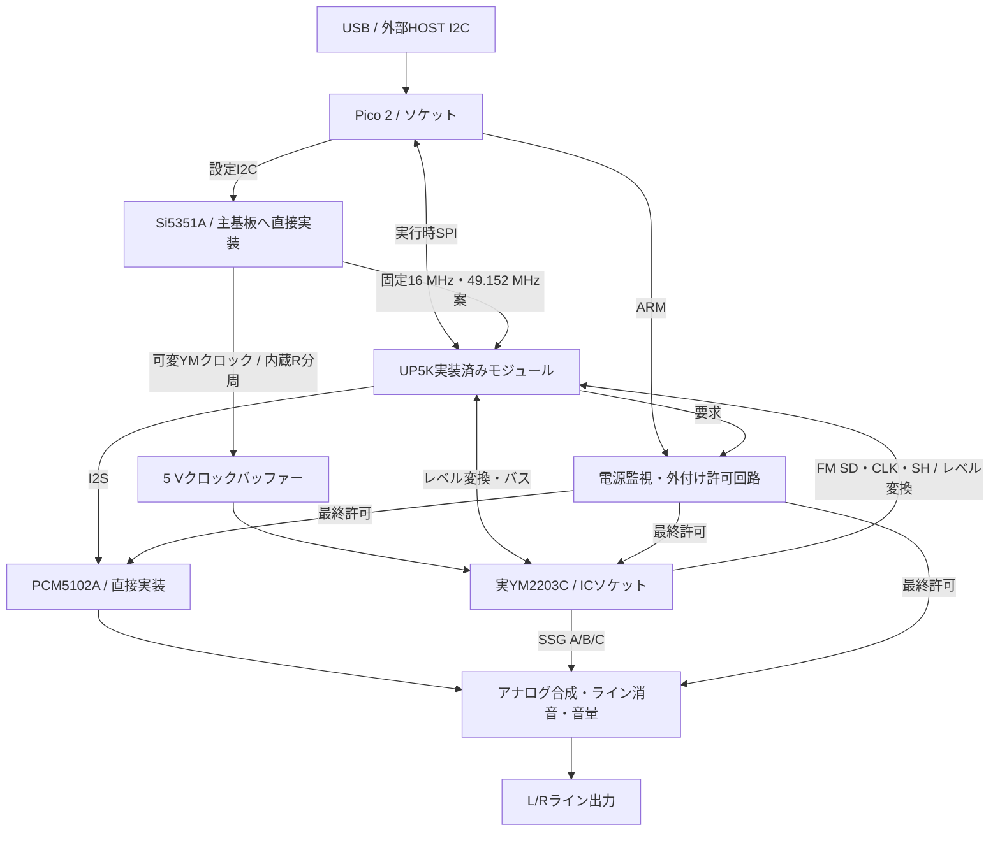

# M1：実YM2203・UP5Kモジュール・狭ピッチSMD手実装

2026-11-14のPico維持案M1。現在は比較資料。主案は[F1：FPGA単独制御](FPGA-STANDALONE.md)。
構成と算術の検討であり、回路図・製造用BOM・PCB・この構成向けの完成RTLではない。
管理は`asamomijijp-code/projects/ym2203-sound-module`で続ける。

## 採用する製作条件

| 項目 | M1の方針 |
| --- | --- |
| 音源 | 実YM2203Cを使い、DIP40 ICソケットへ挿す |
| MCU | Pico 2を維持し、ピンヘッダー＋ピンソケットで交換可能にする |
| FPGA | iCE40UP5Kを搭載した実装済みモジュール。主基板へ裸QFNを載せない |
| FPGAの取付け | モジュールもヘッダー＋ソケットを推奨。USB書込み端子へアクセスできる配置 |
| 可変クロック | Si5351Aと水晶を主基板へ直接実装 |
| その他のIC | DAC、電圧変換、アナログ回路等を主基板へ直接実装 |
| 実装方法 | 主基板は自前手はんだ。TSSOP/MSOP等の狭ピッチを許容し、1.27 mm以上という制限を置かない |
| 受動部品・機械部品 | R/Cは作業実績のある1206を基本にし、端子・ソケット・音量器・ジャックは必要に応じTHT |

同機能なら端子が見えるSOIC/TSSOP/MSOPを優先し、単に狭くするためにパッケージを変更しない。
FPGAの小電源・設定Flash等はモジュール内の実装を利用する。
業者SMT案・細ピッチ回避案H1・JT03音源内蔵案は比較資産として保持する。

## 機能の分担

| 担当 | 機能 |
| --- | --- |
| Pico 2 | USB CDC／MIDI、外部HOST I2C、WYM1解析・補充、MIDIからのYMレジスタ生成、Si5351設定、FPGA版／状態確認、起動管理 |
| FPGA | SPI、CRC、イベントFIFO、実行時刻、外部YMバス制御・BUSY待ち、FM受信・エッジ認定、指数／仮数復号、48 kHzへの可変比率変換、PCM FIFO／CDC、I2S、ゲイン・飽和、通常運転時の消音／異常監視 |
| Si5351A | 基準水晶から固定制御クロック・固定音声クロック・可変YMマスタークロックを生成 |
| 外付け回路 | 5 V／3.3 V変換、アナログDAC、実SSGとFMのアナログ合成、ライン消音・音量、電源・監視、FPGAから独立した最終許可回路 |

FPGA化の中心は、従来PicoのソフトウェアとPIOが担っていた処理を並列の回路にすること。
実YMのSSG A/B/Cはアナログ出力なので、Rev C型の合成回路を残す。
SSGをFPGAへ取り込んでデジタル合成するにはADC等が増えるため、M1では採用しない。

5 V信号の受入れや出力振幅の変換は、FPGAのロジックだけでは代替しない。
また、未設定FPGAでもYMリセット・DAC／ライン消音が成立するよう、最終許可は少数の外付けロジックと監視回路で行う。

## ブロック構成



バッファーはSi5351の3.3 V出力からYM側の必要な電圧振幅へ変換する。
制御バッファーの空きチャンネルにまとめられるかを部品選定で調べ、独立した分周ICの追加を避ける。
この図はネットリストや承認済みGPIO割当てではない。

## FPGAモジュールとI/O予算

第一候補はUPduino v3.1。製作者はUP5K、通常GPIO32本、設定Flash、USB-SPIプログラマー、
3.3 V／1.2 V電源を公表している。[製作者資料](https://upduino.tinyvision.ai/)

[公開pinout](https://upduino.readthedocs.io/en/latest/features/specs.html)ではGPIOとオンボード発振器・
構成SPI等の共用条件がある。v3.0資料を購入版v3.1の検証済みpinoutに読み替えない。
RGB専用端子・設定SPIを余分な自由GPIOとして数えず、発振器共用1本も保守的に予約する。
設定用Flash／USB-SPIと実行時SPIは分け、初期案はモジュールのFlashから起動する。

| 論理信号群 | FPGA GPIO本数 |
| --- | ---: |
| YM D0～D7 | 8 |
| A0・CS・WR・RD・RESET要求 | 5 |
| データ変換器DIR・OE | 2 |
| FM SD・CLK・SH | 3 |
| I2S | 3 |
| Pico実行時SPI | 4 |
| ARM_OK入力・FAULT出力 | 2 |
| 固定制御・音声クロック入力 | 2 |
| DAC許可・LINE許可 | 2 |
| **計／保守的な通常GPIO枠** | **31／31** |

YM IRQはPicoへ、電源成立はPicoと外付け許可へ渡す。
ARM_OKには電源成立を含む許可を使う。Si5351→YMクロックはFPGAのI/Oを経由しない。

本数上は入るが予備はない。2本のクロック入力をグローバル入力へ置けること、
モジュールの共用端子・電源・起動条件が成立することを、正式採用前に確認する。
FPGA内処理を単一49.152 MHzへ統合できれば30本に減らせるが、タイミング検証前の比較案とする。
物理pin・Pico GP番号はここでは割り当てない。

## Si5351Aの3出力を使うクロック案

25 MHz基準、スペクトラム拡散なしを候補とする。
10-MSOPの3出力と内蔵R分周は[公式データシート](https://www.skyworksinc.com/-/media/SkyWorks/SL/documents/public/data-sheets/Si5351-B.pdf)・
[AN619](https://www.skyworksinc.com/-/media/Skyworks/SL/documents/public/application-notes/AN619.pdf)を参照。

| 出力 | 供給先 | 周波数／計算案 |
| --- | --- | --- |
| CLK0 | 電圧変換後に実YMへ | PLLB→偶数整数MultiSynth→内蔵R=2→要求YM周波数 |
| CLK1 | FPGAの音声・FM受信側 | PLLA=786.432 MHz／16=49.152 MHz |
| CLK2 | FPGAの制御側 | PLLA／(6144/125)=16 MHz |

旧案の「2倍クロックを出して外で2分周」を、Si5351内蔵R分周で処理する案。
FPGAのクロック入出力2本や、H1のAHCT74を使わずに済む。
CLK1は整数分周、CLK2は分数分周。すべて同じ水晶を基準にする。
分周計算が成立することと、実波形のジッタ・デューティ・切替動作の合格は区別する。

初期実測候補は1.5／2／3／3.579545／3.9936／4 MHz。
0.7～4.2 MHzは分周と仕様の計算検討範囲であり、任意周波数・全域の実機対応を保証しない。
変更時は消音・YMリセット・FIFO初期化を行い、CLK0／PLLB設定と安定確認後に明示的に再開する。
初版はYMの通常プリスケーラのみを扱う。

## 外付けとして残す部品

| 機能 | 残す理由・候補の扱い |
| --- | --- |
| Si5351A＋水晶 | 専用の周波数合成。10-MSOPの直接実装を基本候補にする |
| 双方向データ変換器 | YM出力のTTL閾値、DIR／OE、無給電・電源順序まで適合する品種を選ぶ |
| 制御／FM入力バッファー | FPGAへ5 Vを直結せず、方向に合った電圧と入力閾値にする |
| PCM5102A＋周辺部品 | I2Sからアナログへの変換。TSSOP品の直接実装を候補にする |
| オペアンプ・アナログスイッチ | 実SSGとDACの合成、基準電圧、ライン消音。Rev Cの特性を比較基準にする |
| 電源・監視・最終許可 | FPGA設定前・リセット・クロック停止を含めて出力を制御する |

Si5351／DACのDIP化モジュールを必須とするH1の条件は解除する。
ただしモジュール内の電源出力、Picoの3.3 V、主基板の3.3 Vを、確認なしに並列接続する構成にはしない。
電源・逆流防止・USBと外部5 Vの給電経路を回路図で確定する。

モジュールを使う分、FPGA・設定Flash・コア電源の実装作業は主基板から減る。
システム全体のIC個数まで減るという意味ではない。製造用BOMと削減個数は回路図から数え直す。
基板外形は未固定。Rev Cの160×120 mmを配置検討の基点にし、H1の180×140 mmや
直接実装案の100×100 mmをそのまま採用しない。

## 既存成果の使い方と次の作業

SPI／CRC／FIFO／時刻管理／音声CDC／I2S／安全停止の設計とテストは再利用候補。
一方、JT03用バスは内部接続であり、外部YMのバス方向切替・読出し・電気的タイミングとは異なる。
実FMの24 bit受信・復号・可変比率変換も別途実装・検証する。

JT03入り構成の4,850 LCという結果を、M1の資源・タイミング合格として使わない。
過去のWAV・合成・検証結果を保管し、M1向けトップレベルを別に用意して測定する。
再利用元のRTLライセンスも維持する。

1. モジュールの版・端子と2本のクロック入力、31本の信号分担を実回路で確認する。
2. 電圧変換・電源・独立消音を含む部品候補と回路図を具体化する。
3. 外部YMバスとFM受信／復号をRTL化し、受入済みCのベクトルと照合する。
4. Si5351レジスタ生成、周波数ごとの可変変換、合成・配置配線を確認する。
5. ピン割当ての確認後にPCBへ進み、まず4 MHz、次に可変クロックを実測する。

## 正本と算術確認

[active-plan.json](active-plan.json)が主案の入口、
[module-hand-soldered-plan.json](module-hand-soldered-plan.json)が構成データ。
[verification/module-hand-check.json](verification/module-hand-check.json)にI/Oと分周の再計算を残す。

```sh
# projects/ym2203-sound-module から実行
python3 hardware/ym2203-fpga-board/tools/analyze_module_hand.py --write
python3 hardware/ym2203-fpga-board/tools/analyze_module_hand.py
```

これらは算術と資料の整合確認であり、Si5351のレジスタ生成、実物pinout、
M1向けRTLの合成、回路図ERC／PCB DRC、実機受入は未実施。
