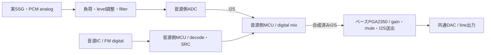

# P2：音源基板側ADC・デジタル合成・電源分離の比較

> 採用後の追記（2026-11-16）：現在は[音源側MCU合成I2S / review B](digital-module-review-b/README.md)が主案。
> PGA2350はbaseの1枚のみ、音源MCUはCore2350B0、ADCはPCM1863、共通32接点を選定した。
> 以下は方式選定前の比較記録で、「未採用/現行60接点」は当時の状態を示す。

2026-11-16。[SPI制御案](P2-SERIAL-CONTROL-OPTIONS.md)に対する追加比較。
**方式選定前の調査で、現行60接点回路・40接点SPI候補・GPIO・firmwareは変更しない。**

## ADCでできること

SSGや外部PCMのanalog出力をADCへ入れ、デジタルのFMと合成してI2S出力にすることは可能。
ADCだけではYM固有のFM serialをI2Sへ変換しない。FMのdecode/SRCと、ADC出力との合成処理が別に必要。
SSGのDC bias・負荷・入力level・filterもADCの入力条件へ合わせる。

| 方式 | 音源基板 | ベースPGA2350 | 特徴 |
| --- | --- | --- | --- |
| A：ベースで合成 | SSG等をADC化、FMはraw serialのまま返す | FM decode/SRC＋ADC I2S受信＋デジタル合成＋DAC向けI2S出力 | これまでのbaseの音声処理を維持しやすい。音源固有の受信線が残り、ADCを足すだけでは大きなpin削減にならない |
| B：音源基板で合成 | SPI bridge用MCU等でFM decode/SRC、SSG等のADC受信、合成I2S生成 | 合成I2S受信、volume/全体mute・必要なDSP、共通DAC向け送出 | moduleごとに音声形式を吸収でき、コネクタの共通化・削減に有利。baseのFM専用decodeはmoduleへ移る |
| C：analog全体をADC化 | YM専用DAC等でFMもanalog化、SSGとanalog mixしてADC | 受信I2Sを再生 | 元のanalog回路の音を取り込む用途にも使えるが、FMをD/A→A/D→D/Aと通し、moduleの部品と変換段が増える |

コネクタ削減を第一にするなら**Bを有力な比較対象**とする。
前案の小型MCUをSPI bridgeだけでなく音源処理にも使う案で、MCUの性能・PIO/DMA・メモリ・割込負荷を再評価する。
特定の小型MCUで全音源/PCMが動くことを確認した意味ではない。
base PGA2350はUSB/外部HOST・再生制御・所有権・停止・DAC出力を残せるが、従来と同じFM decodeを担当する構成ではなくなる。
baseにFM decodeを残すことを優先する場合はAを選ぶ。

Bの信号の流れ：

FMとADCのI2S data線を電気的に接続しても加算にはならない。
同じsample時刻へ揃えたPCM値を加算し、headroomを確保する処理を入れる。
ADCのfilter遅延とFM/SRC/buffer遅延の差も補正する。
現在のFM固定4MHz用変換は125/108比のSRCを含むため、別clockで同じ比率を固定利用しない。

## ADCの候補例

| 候補 | メーカー仕様の要点 | 検討上の注意 |
| --- | --- | --- |
| PCM1808 | 2ch、24bit、最大96kHz、analog5V＋digital3.3V、I2S、TSSOP14 | analog full scale3Vpp。SSG直結とはせずbias/level/filterを設計。SCKIとBCK/LRCKの同期が必要 |
| PCM1863 | 2ch、3.3V動作、I2C/SPI設定、内蔵PLL、対応条件でBCKからclock生成可能 | analog入力端子が複数あっても同時ADCは2ch。設定用busとfirmwareが必要 |
| PCM1864/1865 | 同familyの4ch ADC候補 | SSG A/B/Cを個別captureするなら3ch以上が必要。I2Sの通常2ch枠では足りず、TDM等の受信を検討 |

資料：[TI PCM1808](https://www.ti.com/lit/ds/symlink/pcm1808.pdf)、
[TI PCM186x](https://www.ti.com/lit/ds/symlink/pcm1863.pdf)（比較表とBCK input slave PLL節）。
あくまで候補例で、選定・調達・回路化・実機評価は未実施。
3つのSSGを一旦mono/stereoへmixするなら2ch ADCでも足りるが、後から3voiceを個別処理することはできない。
追加のanalog PCM L/Rまで同時captureする場合は、事前mixか多channel ADCかを決める。

## クロックとpin数

Aではraw FM線に加え、ADC DOUTとBCK/LRCK、機種によってMCLKが必要。
analog線を消した本数だけ減るとは限らない。
Bではraw FM/SSG/AUXをコネクタへ出さず、I2SのBCK/LRCK/DATA（必要ならMCLK）へまとめられる。
SPI・reset/alert・音源clock・power/GND・keyを含む**24〜32接点級**を比較できるが、具体的pin表とSIは未設計。
Si5351Aをbaseに置いて複数chip clockを渡すか、moduleに持つかでも変わり、24接点を確定したものではない。

音声clockのmasterは1箇所に決める。
例えばPCM1808ではSCKIとLRCKの同期が必要で、baseのfree-running48kHzと別発振源のMCLKを
公称周波数だけ合わせて接続してよいわけではない。
PCM1863等でBCK由来PLLを使う方式も、対応するratio/設定を確認する。
現在のbase I2S送信へ新しいI2S受信を追加する場合は、PIO/DMAの空き・data遅延・clock方向を再設計する。

## 電源分離とlevel変換は別の問題

別regulatorや別電源へ分けても、5V信号は3.3V信号にはならない。
給電railの分離、signalの電圧互換、GNDの絶縁を区別する。

| 方策 | 得られること | level変換との関係 |
| --- | --- | --- |
| baseとmoduleでregulator/電源配線を分け、GNDは共通 | 負荷・noiseの回り込みを管理しやすい | 5V logicと3.3V logicの接続条件は別に確認する |
| module内部で5VのYMと3.3VのMCU/ADCを処理し、外へ3.3V SPI/I2Sだけ出す | コネクタを3.3V digitalへ統一できる | **基板間**のlevel変換を省ける可能性。module内部のYM接続は依然別評価 |
| GNDも分けて電気的に絶縁 | ガルバニック絶縁を構成できる | SPI/I2S/resetもisolator等が必要。単に別AC adapterへ替えるだけでは絶縁の成立を保証しない |

共通5V入力からbase用・音源analog用・module digital用のregulator/filterを分岐し、
GNDは適切な共通基準にする構成を第一比較対象にする。
これはisolated電源ではなく、配電とnoise管理の分離である。
ADCやmodule MCUの消費を従来の20mA IO枠へ足さず、新しく予算・thermal・起動時の動作を計算する。

### RP2350のFT入力を利用する省略余地

[RP2350公式datasheet](https://pip-assets.raspberrypi.com/categories/1214-rp2350/documents/RP-008373-DS-2-rp2350-datasheet.pdf)
14.8/14.9には、**FT typeの端子はIOVDD=3.3V通電中に5.5Vまで受けられる**条件がある。
無電源時の許容は同じではなく、ADC共用等のstandard typeにも一律適用できない。
5V出力ができるという意味でもない。RP2040へ同じ性質を適用しない。

従ってRP2350を選び、対象pin・電圧閾値・負荷・電源順序・reset/無電源時を満たせれば、
FMやreadbackの一部bufferを削れる余地はある。
Yamahaの以前取得したYM2203原資料では、通常入力のVIH minimumは2.0Vとされており、
3.3V側からの出力についても電圧上だけで5Vへの昇圧が必須とは限らない。
ただしbufferは遮断/OE・方向切替・駆動も担っているため、定常時のVIHだけで撤去しない。
**省略の根拠になるのはI/O仕様と電源制御の成立であり、電源を分けたこと自体ではない。**
現行SN74LVC8T245等の回路はこの比較では変更しない。
Yamaha原PDFのendpointは当日403のため、今回の新規取得成功とは記録しない。

## 停止・音量と互換性

全音をI2Sへmixしてから1個のDACへ出す場合、そのDACのhardware muteはFM/SSGすべてを止める。
FMだけをmuteしてSSGを残す操作は、mix前のFM gainを0にする等で実現する必要がある。
旧試験の「DAC muteならSSGだけ残る」という物理経路を、そのまま新構成の仕様にはしない。
現行C I2C v2の公開opcodeはPING/STOP/BEGIN/PUSH/PLAY/KEEP/SEALであり、そのwireは変更せずに保つ方針。

STOP/lease/owner変更時は、baseの最終出力を直接muteし、moduleのFIFOと遅延bufferを無効化する。
SPI依頼だけに頼らず独立reset/禁止線を維持し、ADC/PLL/SRC異常でも全音を止める。
ADCがclock停止後に復帰する時の整定期間やゼロ以外の初期sampleを出力へ流さず、明示再生まで無音にする。
module MCUを再起動した後に古いbufferやsampleから自動復帰しない。

既存HOST/YM2203×1・4MHz互換、UNO R3、USB CDC/MIDIは外部要件として維持できるが、
ADC・digital mix・PIO/DMA・gain・遅延の変更後に実機受入をやり直す。
部品やfirmwareが減る保証はない。baseのanalog合成は減らせても、moduleにADC・入力調整・clock/電源と処理が増える。

## この段階の結果

メーカー資料・現在の音声/公開opcodeソースを照合し、A/B/Cと電源方式を比較した。
現行review A、40接点候補、GPIO、firmware、受入記録は未変更。
ADC回路、pin割当、SRC/混合実装、信号品質、消費電流、実音は未検証。
