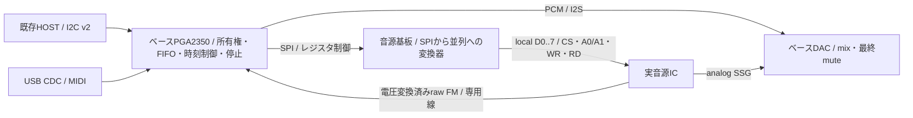

# P2共通コネクタ：SPIで制御線を減らす比較案

> 採用後の追記（2026-11-16）：現在は[音源側MCU合成I2S / review B](digital-module-review-b/README.md)が主案。
> PGA2350はbaseの1枚のみ、音源MCUはCore2350B0、ADCはPCM1863、共通32接点を選定した。
> 以下は方式選定前の比較記録で、「未採用/現行60接点」は当時の状態を示す。

2026-11-16。[分離回路review A](modular-review-a/README.md)に対する比較案。
**採用・回路化・firmware実装はまだ行わず、既存GPIOと60接点回路は変更しない。**

## 推奨する分離

YMへのレジスタ制御をSPIコマンドにし、音源基板側で並列busへ戻す。
FMのSD/CLK/SH等は専用線でベースへ返し、PGA2350のPCM/SRC/I2Sと共通DACを維持する。
SSGの3音と将来のAUX L/Rはanalogのままbase mixerへ渡す。

ベースの最終muteと、音源へ直接効くreset/禁止線はSPIへ集約しない。
SPIの受信待ちやbridgeの異常時にも、baseで音を止める経路を維持する。
音源基板のSPI bridgeの内部処理と、HOSTから見えるI2C v2は別層である。

## どこまで減らせるか

現行は60接点で、GND17本、未配線予約9本、key1本、power4本を含む。
並列制御16本はD8＋A0/CS/WR/RD4＋DIR/data OE/control OE3＋RESET1。
これをSPI4本＋独立reset1本＋状態通知1本の**6本**にすると、制御群だけで10本減る。
状態通知はopen-drainの`MODULE_ALERT_N`候補とし、LをREADYとFAULTの両方の意味にはしない。
ready/busy/fault/FIFO空き/完了数はSPI応答で区別する。Hだけで起動完了と判定しない。

| 案 | 接点数 | 条件 |
| --- | --- | --- |
| 現行review A | 60 | パラレル制御、予約端子、各信号群のGNDを含む |
| SPI制御の拡張重視案 | **40** | raw audio6本、clock3本、SSG3＋AUX2、GND13本、予備2本とkeyを保持する算術 |
| 小型優先の簡略案 | **32程度** | 独立audio/clock/予備/groundを絞る必要。pin表・SIは未設計、全候補を収容する案ではない |

40接点案の内訳：SPI4＋reset/alert2＋raw audio6＋clock3＋SSG3＋AUX2＋power4＋GND13＋予備2＋key1=40。
SPI化だけで20本減るのではない。別I2C2本のSPIへの統合、未配線予約の整理、GNDの再配置も行う。
新しいGND配置で信号品質を確認したわけではない。

物理案は2列×20・pitch2.54mm。接点grid長は48.26mm（現行2列×30の73.66mmから短縮）。
メーカーbody長・嵌合・key・固定穴は未選定。
40接点の候補表は[p2-spi-link-options.json](p2-spi-link-options.json)に保存する。
GPIO欄は全てnullで、回路や承認済みpin表へは反映しない。

raw audio6本は、まずYM2203×1の3本を使用し、残りを予約する案。
YM2203×2の独立3線×2を収容する余地を残すが、decoder・PIO・clock同期の動作確認は別工程。
他の音源のframe方式や複数stereo出力をすべて同じ6線で扱える保証ではない。

## 音源側の変換器の比較

| 方式 | 利点 | 負担・注意 |
| --- | --- | --- |
| SPI I/O拡張IC / shift register | 追加firmware不要。比較的小さい回路から始められる | 1回のYM書込に複数SPI転送が必要。WR/RD pulse、入出力方向、BUSY待ちはbase側で管理。読取りとdefault遮断も必要 |
| **小型MCU**（RP2040級等） | SPIコマンドを受けてlocal bus timing・BUSY待ち・複数chip/port選択を処理できる。module IDも返信可能 | MCU、電源/Flash等、SPI受信/応答、firmware更新が追加。FIFO/時刻/STOPの意味を定義して検証する必要 |
| CPLD/FPGA | bus pulseと応答を回路で作れ、複数chipやFIFOへ展開しやすい | device/電源/configuration/RTL検証が追加。FPGAなしの現在案とは別の選択として比較 |

Microchipの[MCP23S17](https://www.microchip.com/en-us/product/mcp23s17)は16-bit SPI I/O拡張、
[メーカー資料](https://ww1.microchip.com/downloads/en/DeviceDoc/20001952C.pdf)ではSPI最大10MHz。
ただしI/O幅やSPI周波数だけで本用途のthroughputを判断しない。
YMのdata8本にA0/A1、複数CS、WR/RD、reset、方向/OEを足すと16bitに収まらない構成もある。
必要なcontrol信号とbus cycleのSPI操作回数を先に数える。
shift register単体には、レジスタの意味・BUSYの自動判定・安全なpulse生成機能はない。
SPI化は5V/3.3V変換を不要にする方法でもない。

今回の候補群を広く扱うなら、小型MCUのbridgeを主比較対象にする。
部品数を優先する場合は単純なshift register案も比較し、回路・面積・時間予算を見て決める。
**コネクタのpin削減と、全体の部品数削減は同じではない。**

## UNOと既存API

RP2350の[SPI pin mux表](https://pip-assets.raspberrypi.com/categories/1214-rp2350/documents/RP-008373-DS-2-rp2350-datasheet.pdf)と
[現行P2 pin manifest](carrier-p2/pins.json)を照合した。
現在のD0..D3用GP0..3はSPI0のRX/CSn/SCK/TXを選べるため、並列を廃止すれば内部SPI候補になる。
UNOに割り当てたSPI1（GP8..11）とは別系統であり、UNOのSPIを取り上げる必要はない。
これは割当可能性の確認で、GP0..3を実際に変更したものではない。
実装前にGPIO変更表を提示して確認する。

HOST 0x42 /100kHz、YM22S002、CRC/sequence、FIFO/STOP/1000ms lease、USB所有権を外部仕様として維持し、
base firmwareのYM bus backendだけを内部SPIへ変更する方針。
既存HOSTが無変更で済むには、baseのstatusと実行数の意味も維持する必要がある。
内部busを変えただけで、新しい複数chip/PCMをWYM1で表現できるようにはならない。

## timingと停止の設計条件

- 最初はbaseを共通の再生時刻の正本とする。即時bus実行型ならSPI転送とYM write完了の時間を加算して測る。
- moduleへ未来時刻付きFIFOまで渡す場合は、両MCUの時刻同期と、STOP後の旧session破棄を追加設計する。
- ACKは「SPIで受信した」と「YMに書き終えた」を区別し、HOSTのexecutedは後者で進める。
- 内部SPIにもversion・length・sequence・CRCと応答timeoutを用意し、単なるbyte垂れ流しにしない。
- STOP/lease/USB所有権切替は、baseで即時DAC/LINE mute、SPI DMA/待機要求の取消、module queue破棄を行う。
- 独立reset/禁止線はYM reset等へ直接効かせる。module firmwareへの停止依頼だけで代用しない。
- reset/再接続後は明示的な再初期化と新sessionまで無音。遅れて届いた旧コマンドを実行しない。
- module IDをSPI返信へ移せば、コネクタ上のservice SDA/SCLは不要にできる。
  MCU内部Flash等へIDを持つ案なら外付けID EEPROMも省けるが、programming/復旧手順が別途必要。
- module MCU/engineの電源をbaseの20mA IO枠へ追加しない。5Vからのlocal3V3と逆流/電圧変換を再計算する。

例として8byteのframeはSPI4MHzならwire時間16us、10MHzなら6.4us。
header・応答・chip BUSY・firmware待ち等を含まない算術で、保証throughputではない。
平均だけでなく1ms/10ms/1s窓、同時刻burst、遅延・FIFO不足を、Ys IIと将来曲で確認する。
I2C100kHzから来るから内部SPIは必ず間に合う、とも判断しない。

FM音声自体のSPI転送も原理上は可能だが、moduleでの連続capture・buffer・欠落検出が必要になる。
baseでPCM/I2Sを行う余地は残るものの、latencyとclock/sample数の扱いが増えるため、初期案では制御だけをSPI化する。

## この比較での確認範囲

現行60接点の分類、40接点の足し算・pin重複・予約区別、SPI0/UNO SPI1のmux資料を照合した。
新しい回路/ERC/PCB/bridge firmware/速度/実機試験は未実施。
現行review Aと過去の受入結果は保存する。採用後に別reviewとして回路化する。

## ADC・電源分離の追加比較

[音源側ADCとdigital合成の比較](P2-ADC-POWER-OPTIONS.md)へ、base/moduleでの合成位置、
I2S clock、電源分離とlevel変換、RP2350のFT入力条件を整理した。採用・回路変更は未実施。
