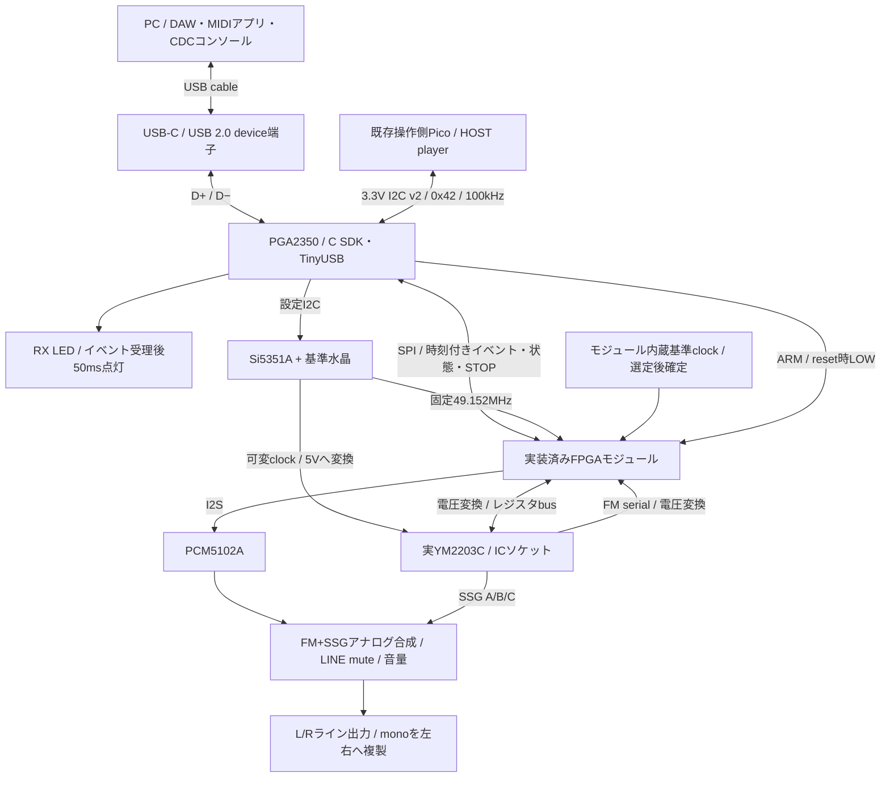

# P1：PGA2350＋FPGAの試作基板構成案

2026-11-15。現在の主案。PGA2350を採用し、外付け監視・許可ゲートを簡略化する。
従来重視していた「ソフトウェアのハード化」を継承し、USB／操作側はPGA2350、
YMバス・FM音声側は実装済みFPGAモジュールへ分担する案とした。
PGA2350一台だけの案は比較として残すが、本案のブロック図はFPGAを含む。

本書は構成案。P1専用ファームウェア・SPI RTL・ピン割当て・回路図・BOM・PCB・
合成／配置配線・実機受入はまだない。F1のKiCad回路図を部品未実装だけでP1として使わない。
[active-plan.json](active-plan.json)が主案の入口、[pga2350-plan.json](pga2350-plan.json)が構成データ。
旧[F1](FPGA-STANDALONE.md)と[回路図レビューA](carrier-f1/README.md)、RTL検証記録は比較・再利用資産として保持する。

## 要件と分担

| 担当 | P1での機能 |
| --- | --- |
| 実YM2203C | FM3声＋SSG3声。DIP40 ICソケットで交換可能 |
| PGA2350 | USB CDC／USB-MIDI、既存HOST I2C v2、要求検査、所有権、MIDIのYMレジスタ化、FPGAへのSPI転送、状態表示、Si5351設定、内蔵watchdog |
| FPGAモジュール | イベントFIFO、時刻順実行、YMバスとBUSY、FM SD/CLK/SH受信、PCM復号、可変比率変換、I2S、ゲイン・飽和、STOP／内部通信期限監視 |
| Si5351A＋水晶 | YM用可変clockと音声用固定49.152MHz。初期YM 4MHz |
| PCM5102A | 48kHz I2SからFMアナログ出力への変換 |
| 外付け回路 | 必要な電圧変換、SSGとFMのアナログ合成、起動時reset／mute、音量とL/Rライン出力 |

PGA2350・FPGAモジュール・YMをソケット接続する。その他は狭ピッチSMDも手実装可能とする。
実装済みFPGAモジュールは未確定。F1で評価したECP5／ULX3Sは移植比較の基準にし、
USBをMCUへ移したP1の資源とタイミングを測ってから小型品を選ぶ。UP5Kへの収容は未確認。
Rev Cの承認済みGPIO・既存HOSTライブラリ／player・受入記録は変更しない。

## PCからのMIDI：USBへ直接接続

**基板自身をUSB-MIDI 1.0＋CDCの複合デバイスにする。外付けUSB-MIDI変換器は不要。**
PCがUSBホスト、PGA2350がUSBデバイス。市販USB-MIDI I/Fをさらに基板のUSB端子へ
挿す構成は初版に含めない。一般的なUSB-MIDI I/Fもデバイスなので、接続には別のUSBホストが必要になる。
USB-UART変換モジュールも、そのままUSB-MIDIの代用にはしない。

既存Rev C C版のTinyUSB CDC＋MIDI処理を再利用候補にし、FPGA転送先へ接続し直す。
MIDI ch1..3をFM CH1..3、ch4..6をSSG A..Cへ対応させ、各ch単音・計6声を初期仕様とする。
Note On/Off、velocity、既存対応CCとpanicの範囲を継承し、GM音色・全MIDI仕様対応とはしない。
PCアプリから基板のMIDIポートを選択する。USB AudioによるPCM録音／再生は本案に含めない。
Ys等のWYM1は従来どおり外部HOST I2Cで送り、MIDIファイルとレジスタ列は区別する。

| 端子周辺 | 構成案 |
| --- | --- |
| PC接続 | USB-C receptacle、USB 2.0 Full-Speed device。USBホスト用Type-Aは設けない |
| Type-C設定 | CC1/CC2に各5.1kΩ Rd。CCを相互接続せず、PD機能は初版不要 |
| USB信号 | PGA2350のU+/U−へ短く配線。PGA2350回路図の直列抵抗を照合し、必要抵抗を二重追加しない。低容量ESD保護を端子付近へ配置 |
| VBUS | 外部5Vと直結せず検出専用。分圧・電源断時保護を回路図で確認し、USB切断を検出 |
| 書込み・デバッグ | 同じUSB端子とBOOTSEL端子、RUN reset、SWDテスト点を用意 |

USBはPCの5Vを音源基板へ給電する主電源にしない。外部5VからPGA2350のVBへ供給する。
USB側VBUSとの逆流・直結を避け、自己給電descriptorとVBUS不在時detachを整合させる。
USB-Cの取付け強度・接地・差動配線、信号抵抗の実装位置は回路図／レイアウトで確定する。
USB VID/PIDはプロジェクトの既存試作条件と使用権を確認し、新しい割当てを取得済みとは扱わない。

## 音声データ受信パイロットランプ

基板上に緑のRX LEDを1個設ける。「音声データ」は外部からの演奏イベントを指す。
USBのSOFやYMからの常時FM serialを表示対象にすると待機中も点灯するため、対象にしない。

| 項目 | 初期仕様 |
| --- | --- |
| 点灯トリガー | I2C v2 APPEND内の1件以上のイベントをFIFOへ新規受理した時、または所有権を満たすMIDIの演奏／音色イベントを受理した時 |
| 点灯時間 | 最後の受理から50ms。追加受信で期限を延長し、連続受信では連続点灯 |
| 点灯対象外 | status読出し、KEEP、USB SOF、無効／拒否要求、重複再送、無関係なMIDI realtime |
| 停止時 | STOP・panic・fault・reset・対象所有者の切断で消灯。STOPと同時に届く点灯要求より消灯を優先 |
| 駆動 | PGA2350のGPIO→1kΩ抵抗→緑LED→GNDを暫定候補。起動時OFF、必要なら100kΩ pull-down。GPIO番号は未割当て |
| 実装 | 手実装しやすい3mm THT LED。明るさ・VF・端子駆動条件を見て抵抗を確定 |

LEDは音量計でも「現在発音中」の表示でもない。先読みでFIFOに入れた後は、演奏中でも消える。
LED処理は時刻比較で行い、sleep・ビジーループ・ログ出力を演奏経路に追加しない。
50msは表示上の値で、演奏データの時刻・ACK・リース期限を変更しない。

## 試作向けの回路簡略化

F1の部品番号は比較用。P1へ同じref／netをそのまま流用する意味ではない。

| F1回路 | P1での扱い | 失う性質／代替 |
| --- | --- | --- |
| U2/U3 TPS3808外付け電源監視 | 初期試作では省略 | 外部5V低下を厳密な閾値で止める保証を外す。安定電源と投入／切断実測で確認。MCU内蔵監視だけでYM 5Vを監視できるとはしない |
| U4 MAX6369独立watchdog | 省略、RP2350内蔵watchdogへ | MCU clock／電源異常を含む独立強制停止は保証しない。主処理とFPGA状態の進行を確認してfeedする |
| U5/U6/U7/U11 許可DFF・強制AND | 外付けは省略 | 許可状態・通常STOPはMCU/RTLへ。MCU出力／FPGAが固着した際に必ず外から消音できる保証は外す |
| U10 単純反転 | GPIO／RTL極性変更で吸収 | OE無効側のpullと電源投入時の極性、バス方向切替を確認 |
| X1/U15 USB用12MHz発振器・整形 | F1と同じ追加回路を初版の必須品にしない | USBはPGA2350内蔵水晶系へ。FPGAにはモジュール内蔵基準clockを候補にし、選定後P&R。入力波形条件を満たせない場合はbufferを追加 |
| U14 YM clock電圧変換 | 維持 | Si5351の3.3V clockをYM側へ適合。U15の削減と混同しない |
| bus/FM電圧変換、default reset、DAC/LINE mute | 維持 | FPGAへ5V直結しない。デバイス無給電時も含めて電気条件を守る |

起動前はYM reset、translator OE無効、DAC XSMT LOW、LINE muteを抵抗・必要なtransistorで定める。
単に外付けゲートを未実装にして入力を浮かせない。5V側resetとline switchには従来同様の電圧適合が必要。
手動RUN resetボタンを設け、再起動ではFIFOと所有権を破棄し、明示PLAY/Note Onまで無音にする。
内蔵watchdogは初期目標1秒とし、debug停止・処理停滞の確認後に値を確定する。
内蔵watchdogまで止まる故障では手動reset／電源切断が必要になる。販売品相当の故障封じ込めは初期要件にしない。

## クロック・電源・アナログ

- PGA2350のUSB／MCU基準はモジュール内蔵水晶。Si5351起動やYM clock変更から独立させる。
- Si5351のYM clockはまず4MHz。非4MHzでは停止中設定・安定確認・SRC比変更を必須とし、
  既存v2の4MHzファイルを別clockで黙って再生しない。既存8profileの再利用はP1で検証する。
- FPGA制御clockはモジュール選定後に確定。USB撤去後に48MHzが必須とはしないが、既存F1の
  48MHz／49.152MHz配置配線結果を別clockのP1へ読み替えない。49.152MHzは音声用に保持する。
- PGA2350のPSRAMは必須にしない。利用時はGP47のCS共用を予約し、RAM容量をGPIO数と独立に見積もる。
- 外部5VでYMとアナログ部を給電。PGA2350・FPGAの3.3V regulator出力を並列接続しない。
  PGA2350の3.3V出力上限300mAをFPGA module全体の給電能力とはみなさず、rail分担と総負荷を確定する。
- アナログ合成は受入済みRev C/F1のPCM5102A・SSG各1kΩ load・4入力各100kΩ・帰還22kΩを基準にする。
  初期FM gain 100%。monoを左右へ複製するライン出力であり、ヘッドホン直結駆動は含めない。

## 既存HOST互換・所有権・SPI境界

外部wireは0x42／100kHz／YM22S002のRev C I2C v2を維持し、既存HOST／playerを無変更で使う。
PGA2350への受付場所変更と内部SPI追加は新しい実装であり、互換達成は回帰後に判定する。
SPIには時刻付きイベント、sequence／CRC、FIFO空き、実行済み件数、fault、優先STOPを用意する。
具体的フレームは未実装。外部HOSTが受けたACKとSPI転送失敗で受理件数が食い違わないこと、
同一sequence再送の二重実行防止、receivedとexecutedの区別、CRC集計を境界条件として固定する。
曲全体をPSRAMへ載せる方式に変えず、まず有界FIFO＋backpressureを使う。

| 状況 | 動作要件 |
| --- | --- |
| 電源投入／MCU reset／FPGA未設定 | 無音・YM reset・所有者なし。状態照合と音声prime完了前にARMを出さない |
| I2C BEGINとMIDI | 既存の排他規則。所有者以外のNote Onを蓄えて後から発音しない |
| STOP／panic | STOPはFIFO空きに依存しない経路。ARM解除・FIFO破棄・全声停止を指示し、停止後に成功応答 |
| 外部HOST通信断 | 既存I2C lease 1000ms。readだけではlease更新しない。後続予定音も破棄 |
| MCU→FPGA SPI断 | FPGA側に別のkeepalive期限1000msを初期目標とし、FIFOが残っても消音。通常MIDI保持音はMCUのkeepaliveで維持 |
| MCU watchdog reset | reset中ARMがLOWになるpullとFPGA状態機械を設ける。次の起動で自動再演奏しない |
| USB切断／reset／suspend | MIDI所有時は消音・保留破棄。I2C所有時はI2C演奏を継続。CDCを閉じただけでI2C演奏を止めない |
| USB再接続／外部HOST再接続 | 状態読出しだけで演奏を再開せず、新しい明示操作で開始 |

内部SPI leaseは外付け独立watchdogではなく、FPGA clockが動く場合の機能。
外部HOST leaseと内部keepaliveを分離し、MCUが内部keepaliveを送っていても外部HOST通信断を隠さない。
PGA2350の内蔵watchdogもこの内部通信期限も、F1の独立停止と同じ故障範囲を保証しない。

## 次の具体化と受入項目

1. FPGAモジュール候補とPGA2350の物理端子・電源・SPI帯域・clockを確定。Rev Cの承認済みGPIOとは別表でレビューする。
2. 外付け監視を除いたP1回路図・BOMを作り、LED、USB-C／VBUS、BOOTSEL／RUN／SWD、default muteを接続する。
3. USB-MIDI／CDCとI2C bridgeを移植し、内部SPIとFPGA topを実装。TinyUSB／SDKの版を固定する。
4. 既存HOSTを無変更で、フレーム／ACK／再送／CRC、所有権、STOP、二つのlease、切断／再接続をモデル回帰。
   LEDはKEEP/read/拒否で点灯しないこと、50ms延長と停止優先を確認する。
5. P1 topの合成・配置配線、クロックとI/O制約、回路図ERC・PCB DRCを実施する。
6. 実機でUSB列挙（Windows/macOS）、6単独音・6声・panic、I2Cとの切替、USB切断中I2C継続を確認する。
7. 外部HOSTから受入済みWYM1を全曲再生し、LEDの先読み時表示、FM/SSG balance、無音終了を確認する。
   電源投入／切断・BOOTSEL／RUN・意図的なMCU停止とSPI休止後の停止／再開も記録する。

現段階で実装や試験の合格を主張しない。既存Rev C実機結果、F1モデル／P&R、P1予定を分けて記録する。

## 一次資料

- [Pimoroni PGA2350](https://shop.pimoroni.com/en-us/products/pga2350)：48 GPIO、16MB Flash、8MB PSRAM、GP47、2.54mm端子、内蔵水晶、USB端子を別途接続。
- [Pimoroni PGA公式定義](https://github.com/pimoroni/pga)：board定義とpinout。実配線は製作者の回路図・機械図と照合する。
- [TinyUSB](https://github.com/hathach/tinyusb)：CDCとMIDI device class。既存Rev Cの固定依存版を移植元とし、本書作成だけで依存を更新しない。
- [Pico SDK hardware_watchdog](https://www.raspberrypi.com/documentation/pico-sdk/hardware.html#hardware_watchdog)：内蔵watchdog。
- [Hardware design with RP2350](https://datasheets.raspberrypi.com/rp2350/hardware-design-with-rp2350.pdf)：USB・電源・resetの回路レビュー資料。

独自構成案はプロジェクト既定のMIT。外部資料の図・回路図・コードは本変更で複製しない。
