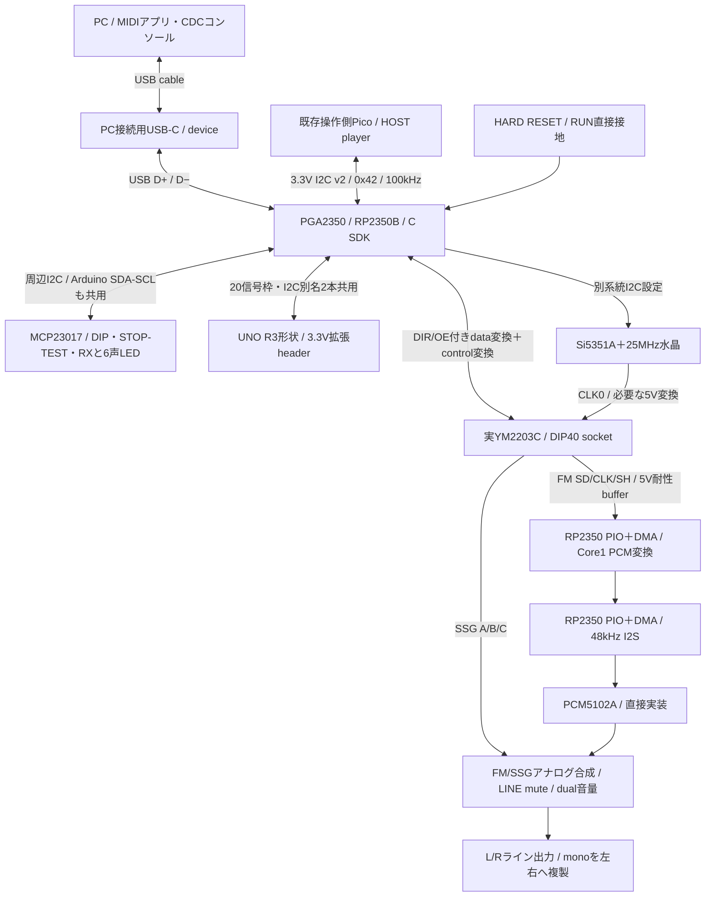

# P2：PGA2350＋実YM2203C＋Si5351A（FPGAなし）

> 2026-11-16：この文書は一体型revision 2.1の保存資料。現在の主案は
> [ベース＋交換式音源基板](P2-MODULAR.md)。下記のPCB・検証値は交換式設計の結果ではない。

2026-11-15、revision 2.1。ユーザー指定により、PGA2350一台で通信・YM制御・FM音声処理を担当する案を主案にする。
FPGA、設定Flash、FPGA電源・module socket、MCU–FPGA間SPIとそのkeepaliveは本案に含めない。
実YM2203C・専用Si5351A・USB-MIDI・RX LED・既存HOST player互換を維持する。
組立はPGA2350とYMをソケット接続し、その他は狭ピッチSMDも手実装する。管理先はasamomijijp-code。

**revision 2.1 review Bで電源・ソケットの見直しと配線済みPCB候補を作成した。P2用ファームウェア、実組立・実測・製造リリースは未完。**
Rev CのGPIO／UF2／HOSTと受入結果を変更しない。P1/F1のファイルと固定検証記録は保存する。
[active-plan.json](active-plan.json)が現主案の入口、[構成データ](pga2350-standalone-plan.json)、
[Rev C部品比較CSV](pga2350-standalone-revc-changes.csv)が本書に対応する。

## 追加要件（revision 2.1）

[拡張構成](PGA2350-EXTENSIONS.md)に、UNO R3形状・IOREF=3.3Vヘッダー、4極clock DIP、
RUN直結hard reset、STOP/TESTの独立ボタン、6声LED、USB CDC経由WYM1再生を追加した。
低速操作表示はMCP23017×1へ集約し、RX LEDも移す。GPIOは基板直結29本＋拡張追加18本=47本。
FPGAなし・既存HOST wire維持。DIP全OFF=4MHz、適用はreset時のみ。
[回路図レビューA](carrier-p2/README.md)で47 GPIOのpin mux、PGA2350の実端子、UNOの38接点位置を具体化した。
KiCad 13ページ・158部品、全netlist照合とERC違反0件、未配線の配置確認用PCBを用意した。
基本P2と拡張の旧検査記録は保存し、今回の回路検査記録を別に管理する。

## ブロック構成

PIO・Core1はPGA2350内の機能であり追加モジュールではない。
USBはPCがhost、基板がdevice。外部操作側PicoをHOSTと呼ぶこととUSB host機能を混同しない。

## 通信と音声処理の分担

| 担当 | 初期構成 |
| --- | --- |
| Core0 | USB CDC／MIDI、I2C v2フレーム・CRC・sequence、1024件FIFO、時刻実行、YM GPIO bus/BUSY、所有権、Si5351設定、LED、watchdog調整 |
| Core1 | FM受信DMAの管理、指数／仮数PCM復号、gain・飽和、サンプルレート変換、I2S DMAの管理 |
| PIO | FM receiverに1 SM、I2S transmitterに1 SMを基準。Rev Cと同じく別PIO instanceを第一候補 |
| DMA | RX2本＋TX2本の計4本を基準。chain再起動とRP2350-E5対策を維持 |
| 内蔵SRAM | 有界イベントFIFO・音声ring・状態。音声／転送の締切処理をPSRAMへ依存させない |
| Flash／PSRAM | PGA2350内蔵Flashを利用。8MB PSRAMは初期必須にしない。全曲をRAMへ展開しない |

移植元は[受入済みRev C C版](../../firmware-c/README.md)。SDK/TinyUSBの固定版、
PIOエッジ認定、DMAの再起動、長時間I2S分周追従の修正を継承する。
4MHz固定の実績をPGA2350への移植・可変clock・新配線の合格に読み替えない。
Core1が止まってもCore0がwatchdogをfeedし続けないよう、両処理の進行を確認する。

## USB-MIDI・CDCとRX LED

PC接続用USB-CからRP2350のnative USBを使用し、USB-MIDI 1.0＋CDC複合deviceにする。
外付けUSB-MIDI I/F、DIN5、USB host用Type-A、USB-UART変換器は不要。
Type-C CC1/CC2は各5.1kΩ Rd、USB低容量ESD保護、VBUS検出、BOOTSEL/RUN/SWD点を用意する。
USB直列抵抗27.4ΩはPGA2350製作者回路図でモジュール上の実装を確認した。キャリア側へ二重追加しない。
USBは自己給電。外部5VをPGA2350のVBへ供給し、PC側VBUSは給電netへ直結しない。
USB切断を検出し、VBUS不在時のdetachとdescriptorの給電属性を整合させる。

MIDIはRev C C版の既存範囲を維持する：ch1..3=FM3声、ch4..6=SSG3声、各ch単音。
Note On/Off、velocity=0のNote Off扱い、CC120 panic、CC123のch停止、System Reset panic。
音量velocity・音色Program Change・Pitch Bend・SysEx・MIDI送信・USB Audioは初期仕様に含めない。
[既存midi.c](../../firmware-c/src/midi.c)が実際の受理範囲の照合元。

RXは緑LED1個、3.3V→1kΩ候補→LED→MCP23017 GPA7のsink駆動。ネイティブGPIOを消費しない。
**新規I2C opcode3 PUSHまたはUSB WYM1イベントをFIFOへ受理した時**と、所有権を満たすMIDI Note On/Off／
CC123の状態変更時に50ms点灯し、追加受信で延長する。既存v2の名称はPUSHでありAPPENDではない。
KEEP・read・USB SOF・拒否要求・同一要求再送・無関係なMIDI realtimeでは点灯しない。
STOP、MIDI所有時のpanic、fault、reset、所有者の切断で消灯を優先する。
連続受信では連続点灯、先読み完了後は発音中でも消灯し得る。音量計／発音中表示とはしない。
LED更新は時刻比較で行い、sleep・演奏中印字・IRQ内の長い処理を追加しない。

## 既存HOST playerとの互換条件

[既存wire v2](../../firmware-c/protocol-v2.md)と
[HOST player](../../firmware-c/host/lib/ym2203_revc_player.py)を変更しない。
0x42、100kHz、署名YM22S002、64-byte状態、最大32 events/PUSH、1024件FIFOを初期基準にする。
CRC・sequence・同一要求再送の非二重実行・PUSHの原子的受理・received/executedの区別を維持する。
WYM1を変換し直さず、時刻とレジスタ順を保持する。選曲／repeat／連続再生とCtrl+C STOPを回帰する。

- MIDI所有時のBEGIN拒否、I2C所有時のMIDI Note On拒否を維持する。
- I2C/CDC STOPは全体停止、MIDI panicはMIDI所有分を停止。拒否されたノートを後で再生しない。
- I2C leaseは1000ms、readで更新せず、失効時は予定イベントも破棄する。
- MIDIのUSB detach/reset/suspendでは消音。I2C所有中はUSB切断・CDCを閉じてもI2C演奏を継続する。
- 電源投入・BOOTSEL・reset・再接続だけでは発音せず、新たな明示操作を待つ。
- FPGAとの内部SPIがなくなるので、P1で予定した内部SPI leaseは不要。外部HOST leaseと内蔵watchdogは残る。

## 可変clockの段階導入

Si5351A CLK0をYM PHIへ、3.3V→5V clock変換を介して接続する。初期値4MHz。
CLK0のprofileは4極DIPでreset時に選択する。全OFF=4MHz、未対応・予約値は無音。
CLK1/CLK2は初期未使用。FPGA用制御clock・49.152MHz音声clock・追加12MHz発振器／整形は不要。
USB/CPUはPGA2350の内蔵水晶系、I2SはPIO生成を基準にする。

最初はRev Cの4MHz用125入力→108出力と公称48kHz／drift追従を移植し、従来の音と比較する。
[既存音声コード](../../firmware-c/src/audio.c)の4MHz固定変換比や入力タイムアウトをそのままにして、
Si5351だけ変更する実装にはしない。次段階で入力周期に応じる可変比率SRC、buffer／timeout、
USB負荷とFM受信余裕を実装・検証する。初期profile候補範囲は1.5..4MHz、任意周波数全域を保証しない。

clock変更は停止中のみ、LINE/DAC mute→YM reset→FIFO破棄→Si5351設定／readback／PLL確認→
音声再初期化／primeの順序とし、その後も明示PLAYまで無音にする。
既存v2のclock=4MHz宣言は維持する。非4MHz設定では4MHz BEGINを拒否し、
非4MHzは新USB streamのfile-clock検査／能力通知へ分ける。既存HOSTの意味を変えない。

## 試作向け電源・停止と電圧変換

外付け電源監視IC、MAX6369、許可DFF／ANDゲートは初期必須にしない。
RP2350内蔵watchdog（目標1秒）、音声進行監視、software lease、default reset/muteで構成する。
MCU clockや電源異常で監視自体が動かない場合は自動消音を保証せず、手動RUN reset／電源切断で復旧する。

電源投入・プログラム書込み中はYM reset、data/control translator OE無効、DAC XSMT LOW、LINE mute。
PGA2350が出力を駆動していない間も抵抗・必要なtransistorで状態を定める。
反転・ARMゲートIC削除と、これらの初期状態や5V reset/line muteの電圧適合を削除することを混同しない。
USB VBUS逆給電防止、デカップリング、信号の電圧・時序適合は試作でも維持する。

dataは双方向SN74LVC8T245×1、controlはSN74LVC8T245×1、FM入力はSN74LVC125A×1、
YM clockはSN74LVC1T45×1を保守的な候補にする。GPIOの5V入力耐性に頼ってbufferを全廃する案にはしない。
dataの読書きではまずOE無効、両側駆動停止、DIRとGPIO方向切替、settle後にOE有効とする。
一連のbus処理を単一所有者で行い、IRQ／別coreが同時に方向を変えない。

3.3VはPGA2350の出力上限300mAと自身の消費を含め負荷計算し、足りなければ電源構成を変える。
別regulator出力は並列接続しない。PicoのVSYS向け旧D1配線をPGA2350 VBへ無検証で流用しない。
アナログ部はPCM5102A・MCP6022・4053による受入済みFM/SSG合成定数を基準にし、FM100%から評価する。
monoを左右へ複製するライン出力を維持し、ヘッドホン直結driverは含めない。

## Rev Cから削減・置換する部品

参照元は[Rev C BOM](../ym2203-single-board/rev-c/ym2203-single/bom.csv)と
[Rev C netlist](../ym2203-single-board/rev-c/ym2203-single/netlist.xml)。
以下のrefはすべて旧Rev Cの番号で、P2の実装番号ではない。Rev C実基板から抜いて改造する手順でもない。

| 旧Rev C部品 | P2の扱い | 理由・注意 |
| --- | --- | --- |
| U4 HC04、U5 HC00、U6 HC32、U10 HC08 | **4個のゲートICを削除** | 反転、OE_READ/WRITE、ARMゲートをGPIO／方向制御へ移す。独立ARM強制禁止の保証は外す |
| U7 HC74 | **分周ICを削除** | Si5351内蔵分周を使う。ただし新clock IC・水晶・電圧変換は必要 |
| DIP14 socket×5 | **不要** | 上記5個のICを実装しないため |
| C7/C8/C9/C10/C12 | 旧HC用5個は不要 | 新IC側のdecouplingが増えるため、総数の純減5とはしない |
| X1 8MHz oscillator | Si5351A＋25MHz水晶へ置換 | 固定clockから可変へ。clock系全体の点数は再集計 |
| U2 LCX245 read buffer | **専用ICを統合削減候補** | A3相当のdata変換器をDIR/OE付き双方向へ変え、読出しも同じICを使う |
| A3/A4変換モジュール | 裸LVC8T245各1個へ | 変換機能／IC2個は残る。モジュールとsocketの削減をIC削減と数えない |
| U3 LCX245 FM/IRQ buffer | LVC125A 1個へ | 4chでFM3本と必要ならIRQ。機能を残す置換で、IC個数は減らない |
| A1 Pico 2 | PGA2350 1個へ | MCU module数は1個のまま。新moduleはPSRAM等も含み、内部部品総数が減るとは限らない |
| A2 DACモジュール | PCM5102A＋周辺回路を直接実装 | DAC IC・charge-pump capacitor・decoupling等は残る |
| U8 opamp、U9 switch、Q1、合成R/C | 同等機能を維持 | 5V側line mute極性変換・SSG/FM balanceを保つ |
| RN1/2/3/4/6、R3/R5/R6、R7/R8/C11等 | 信号ごとに組み直す | pull・終端・decouplingの役割を一括削除しない |
| 電源soft-start U11、PTC、逆流対策 | 電源再設計で判断 | 独立監視を省くことと突入／逆給電対策を省くことは別 |

**確実な構成上の削減対象は汎用HCロジック5個と、そのDIP14 socket 5個。**
U2統合も方針だが、新bus方向制御の成立を検証する。追加はSi5351A／水晶／clock変換、RX LED／抵抗、
PC接続用USB-C／CC／ESD／VBUS周辺、起動時reset/muteの必要部品。
追加のMCP23017×1とswitch／声LED／UNO headerは[拡張仕様](PGA2350-EXTENSIONS.md)で別計上する。
新旧回路図・BOMが揃うまで、キャリアの総実装点数やmodule内部込み総点数の純減数は確定しない。
P1からはFPGAモジュール・socket・SPI／FAULT／ARM間配線が不要になる。
F1の165refから旧ICだけ引いた値をP2 BOMとして示さない。

## 論理I/O・実装見通し

基本30 GPIOからRX LED直結を外して29本。Arduinoの20signalのうち2本は周辺I2Cと共用し追加18本。
**PGA2350合計47本、GP47をPSRAM CSへ予約して48本を使い切る。**
DIP4＋STOP/TEST2＋RX1＋声LED6=13bitはMCP23017×1へ集約する。
[拡張仕様](PGA2350-EXTENSIONS.md)と[Arduino信号表](pga2350-arduino-header.csv)を参照する。

旧案の予備17本／任意IRQ・5V観測2本は今回の拡張では残らない。
任意IRQはbuffer後のエキスパンダ予備input候補、5V ADC観測は拡張ADCとの排他等を別途検討する。
USB D+/D−・RUN・BOOTSEL・SWDはGPIO小計に含めない。
本数・PIO window・native SPI/UART/PWM・ADC pin muxは[review A](carrier-p2/README.md)で静的照合済み。
P2用の実端子割当を追加したが、Rev Cの承認済みGPIOは変更しない。

## 実装・検証の順序

1. 物理GPIO表・回路図・BOM・UNO配置確認枠をreview Aで作成済み。review Bでソケット・電源容量を計算し、配線済みPCB候補を検査した。
   実物嵌合、電流・温度・USB特性の実測と製造条件確定を次に行う。
2. DIP/STOP/TEST/LEDとUSB stream仕様を確定し、Rev C C0.5 alpha4を移植し、4MHz固定でFM音声・I2C全曲・MIDI・排他・切断と長時間待機を回帰する。
   GPIO方向切替・読書きbus・BOOTSEL/RUN時の無音と、LED受理条件／50ms／STOP優先を確認する。
3. Si5351の起動設定・readback・clock停止／不成立時の消音を追加する。
4. 可変SRCと停止中profile切替を実装し、各周波数の受信・PCM・buffer締切と実音を検証する。
5. PCB化後に電源投入切断、USB切断中I2C継続、4MHzで既存HOST player全曲／repeat／Ctrl+Cを受け入れる。

今回は実端子・pin mux、KiCad全netlistとERC（違反0件）、フットプリントのピン番号、
UNO座標の静的検査まで。P2用build、音声試験、電気実測、製造用PCB DRCは未実施。
旧[F1 RTL](../../fpga-standalone/README.md)の資源／timing・可変SRC検証は参考資産で、P2 MCUへの移植済みとはしない。

## 一次資料と来歴

- [Pimoroni PGA2350](https://shop.pimoroni.com/en-us/products/pga2350)：48 GPIO、16MB Flash、8MB PSRAM／GP47、2.54mm端子、内蔵水晶、USB connectorなし、3.3V regulator上限300mA。
- [Pico SDK 2.2.0 PIO](https://github.com/raspberrypi/pico-sdk/blob/2.2.0/src/rp2_common/hardware_pio/include/hardware/pio.h)：RP2350BのPIO GPIO window。新依存の追加・更新はしない。
- [Si5351A-B datasheet](https://www.skyworksinc.com/-/media/SkyWorks/SL/documents/public/data-sheets/Si5351-B.pdf)：MSOP10三出力、25MHz水晶、3.3V出力のclock generator。
- [SN74LVC8T245](https://www.ti.com/product/SN74LVC8T245)、[SN74LVC125A](https://www.ti.com/product/SN74LVC125A)：dual-rail変換、5V耐性受信候補。

独自構成案・部品比較はMIT。外部資料・楽曲・製造binaryは追加しない。

## P2 revision 2.1 / PCBレビューB

[レビューB](carrier-p2/pcb-review-b/README.md)に電源容量・ソケット高さの検討と、
164部品の回路図・配線済み4層PCB候補を追加した。DACとUNO 3V3供給を500mA AUX LDOへ分離し、
PGA2350内蔵300mA電源の設計予算を259.4mAとした。一般2列ソケット4個は端部が干渉するため、
64本の単端子ソケットを候補にし、実物の挿入・保持・高さ確認を残す。
47 GPIO、UNO接点座標、既存HOSTは変更しない。回路・DRCの結果はBの検査記録を参照。
P2専用ファームウェア、実組立、電流・温度・USBインピーダンスの確認、製造リリースは未完。
レビューAの回路図と検査記録は履歴として保存する。
