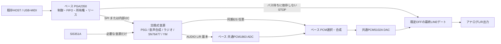

# P2 共通コネクタ review E：アナログ基本・I2S任意

2026-11-17 / revision 3.2-interface-review-e。個人の実験用、1スロット、電源OFF交換を前提とする**仕様案**。
回路図・PCB・GPIO・firmwareへ未反映。review DのERC/DRC合格やRev C受入をEの合格として扱わない。

共通ADCをベースへ移し、音源基板の標準出力をアナログL/Rにする。PSG・音声合成・DSPラジオ・
SN76477では、音源側MCU/ADCを一律には載せない。YM2203だけはFM変換用Core2350B0を残せる。
PGA2350は引き続きベース1枚。専用clock Si5351A、UNO R3 3.3V、USB CDC/MIDI、HOSTと操作/LEDを維持する。



## 接点と互換範囲

2×16、2.54mm、計32接点を維持。ベース嵌合面からA列=奇数、B列=偶数。
音源基板の裏面実装は左右反転するため、PCBではpin1とKEYを再照合する。
Samtec SSW-116-02-G-D / TSW-116-07-G-Dを継続候補とし、32は抜きピン/塞ぎ穴KEY。
旧未接続の25・27～30だけを再定義し、それ以外27接点（GND・KEY・将来clockも含む）の機能・信号電圧・方向を維持する。
ただし**D/E全機能の差し替え互換を意味しない**。D基板はアナログADC経路も新電源も持たない。
旧digital-onlyカードの再利用は、別途明示した対応profileと回路確認を条件とする。

| pin | 信号 | 方向 | 種別 |
| --- | --- | --- | --- |
| 1 | V5_MODULE | base_to_module | power |
| 2 | GND | none | ground |
| 3 | V5_MODULE | base_to_module | power |
| 4 | GND | none | ground |
| 5 | MOD_SPI_SCK | base_to_module | digital |
| 6 | GND | none | ground |
| 7 | MOD_SPI_MOSI | base_to_module | digital |
| 8 | MOD_SPI_MISO | module_to_base | digital |
| 9 | MOD_SPI_CS_N | base_to_module | digital |
| 10 | GND | none | ground |
| 11 | MOD_ENABLE | base_to_module | digital |
| 12 | MOD_ALERT_N | module_to_base | digital |
| 13 | MOD_I2S_BCK | base_to_module | digital |
| 14 | GND | none | ground |
| 15 | MOD_I2S_LRCK | base_to_module | digital |
| 16 | GND | none | ground |
| 17 | MOD_I2S_DATA | module_to_base | digital |
| 18 | GND | none | ground |
| 19 | SOUND_CLK0 | base_to_module | digital |
| 20 | GND | none | ground |
| 21 | SOUND_CLK1 | base_to_module | digital |
| 22 | GND | none | ground |
| 23 | SOUND_CLK2 | base_to_module | digital |
| 24 | GND | none | ground |
| 25 | V3V3_MODULE_AUX | base_to_module | power |
| 26 | GND | none | ground |
| 27 | AUDIO_L | module_to_base | analog |
| 28 | AUDIO_R | module_to_base | analog |
| 29 | MOD_I2C_SDA | bidirectional | digital |
| 30 | MOD_I2C_SCL | bidirectional | digital |
| 31 | GND | none | ground |
| 32 | KEY | none | key |

完全な機械可読仕様は[connector.json](connector.json)、配線表は[connector.csv](connector.csv)。
方向はベース視点。SDA/SCL/ALERTは3.3V open-drain、その他digitalは3.3V CMOS。
未使用SPI MISO/ALERT/I2S DATAはベースで既定値を持たせ、未使用カード出力はNC/Hi-Z。
MOD_ENABLEはactive-highの動作許可、ベースpull-downで初期L。ALERT_Nは任意の異常通知であり、発音許可ではない。

## 音声・制御・電源の契約

詳細は[architecture.json](architecture.json)と[安全停止・互換仕様](SAFETY-AND-COMPATIBILITY.md)。

- モノラルはLだけを使用し、ベースで左右複製。RはNC。ステレオはL/Rを別々にADCへ入れる。
- アナログ入力はベース側AC結合。設計目安1Vrms、0dB ADC設定で最大2Vrms、音源出力Zは1kΩ以下を目標。
  これは音量契約で、IC絶対最大定格の代わりではない。PCM1863の入力20kΩはtyp値で最低保証ではない。
  10kΩ負荷での振幅・歪み確認を音源側試験に含め、抵抗/RC/容量と未通電時電流は回路化時に確定する。
  PSG電流出力の負荷・声部mix、音声合成PWMのLPFは各音源基板に必要。スピーカー出力は直結しない。
- 共通ADCはPCM1863DBT候補1個。48kHz slave/BCK PLL、I2C=0x4A（AD=L）。ADCはSTOPで電源断しない。
  デジタル入力のないモードではI2S音源枝を無効化する。未搭載端子の浮遊データを合成しない。
- オプションI2Sはベースmaster固定。48kHz、2ch、32bit slotに有効signed24bitを上詰め、下位8bit=0。
  1bit遅延の標準I2S、LRCK L=0、BCK下降で更新/上昇で取込、64fs=3.072MHz。
  非同期masterカード、任意sample rate、TDM、自動SRCは初期対応に含めない。MCLK専用線は設けない。
- YM2203候補はFMのみI2S、SSGのみアナログLのhybrid。SSGを二重合成しない。
  ADCとFMの遅延・音量を測定し、ベースのbuffer/係数で合わせる。初期合成係数は各0.5、飽和処理あり。
  Rev CのFM100%との対応値は実機校正後に確定し、0.5を同じ音量と呼ばない。
- 制御はSPI0の1CS、または内部I2C1（100kHz）。複数SPI ICのCS生成はカード側で局所化する。
  パラレルPSGは小さなラッチ/バスbridgeが必要で、全ICを線だけでSPI接続できるわけではない。
- 内部I2C1はGP42/43のSi5351A・panel・UNO A4/A5と共用し、HOSTのI2C0 GP20/21から分離。
  ベース予約address=0x20/0x4A/0x60。カード/シールドとの衝突は起動前にprofile設定で拒否する。
  追加I2C muxは置かず、pull-upはベース3.3Vへ集約。シールドのpull-up/速度/容量も確認する。
  JP_SDA/JP_SCLを開くとclock・panel・ADC・カード制御が切れるため、その状態では音源再生を許可しない。
- 電源はベース5Vと共通GND。音源5V枠500mA、pin25の任意3.3V補助電源枠100mAを設計候補とする。
  補助3.3Vはベース側補助LDOから取り、PGA2350 onboard3.3Vを使わない。
  小型3.3VカードはLDOを省略可能。Core/YMカードは5V→ローカル3.3Vとしpin25をNCにする。
  ローカルLDO出力とpin25を結ばず、カード別外部電源を使わない。総電力/熱はE回路化で再計算する。
  Dの電源計算・BOMでそのまま購入できる変更ではない。

## 音源ごとの最小構成

| profile候補 | 返送音声 | 音源基板に残るもの | MCU/ADC |
| --- | --- | --- | --- |
| YM2203×1 | FM I2S＋SSGアナログL | 実YM・5V bus変換・SSG抵抗mix | FM decode用Core、ADCなし |
| AY/YM系PSG | アナログL（必要ならL/R） | IC・負荷/mix・SPI/parallel bridge | 原則必須にしない |
| SN76489系 | アナログL | IC・WE/READY対応ラッチ・電圧変換 | 原則必須にしない |
| ATP3012系音声合成 | アナログL | I2C音源・PWM LPF・必要なclock | 追加MCU/ADC不要な案 |
| Si4732系DSPラジオ | アナログL/R | tuner・アンテナ・RF受動部品 | 追加MCU/ADC不要な案 |
| SN76477 | アナログL | R/C音源・VCO DAC・限定したR/C bank | 小MCUは必要時のみ、ADCなし |
| native I2S音源 | 同期I2S | 音源固有初期化回路 | 必須にしない |

[profiles.json](profiles.json)は候補と制約の一覧で、driver実装や購入確定BOMではない。
ATP3012の入力は音声記号列、I2C ready pollは10ms以上。DSPラジオのaddress/strapは品番確定時に検証する。
SN76477は[別途検討](../P2-SN76477-CANDIDATE.md)の単音・校正付きpresetを入口とし、全R/Cの電子可変化を必須にしない。
部品移動と削減の範囲は[BOM-DELTA.md](BOM-DELTA.md)に整理した。

## GPIOと残作業

[GPIO候補](gpio-proposal.json)は共通ADC DOUTに空きGP5を追加する**未承認・未反映案**。
既承認[C pins.json](../digital-module-review-c/pins.json)は変更しない。
I2S TX1＋RX2のPIO使用を仮置きし、既存UNO/HOST/USB/ボタン/LEDに割込みを割り当て直さない。
実装前にGPIO承認、続いてベースADC入力・電源計算・E回路図/ERC・配置配線/DRC・firmware・実機確認が必要。
特にアナログ線とclock線の隣接、基板間接触、ADC遅延、電源投入/解除のポップ音は未測定。

検査（Python標準ライブラリのみ）:

```sh
python3 verify.py
python3 -m unittest -v test_contract.py
```

静的な仕様整合・旧使用中pin維持・既存C wire定数照合・不正仕様の拒否を検査する。
通信や音声の実機試験ではない。結果は[verification.json](verification.json)。
部品の一次資料と設計判断の区別は[sources.json](sources.json)。プロジェクトMITを継承する。
