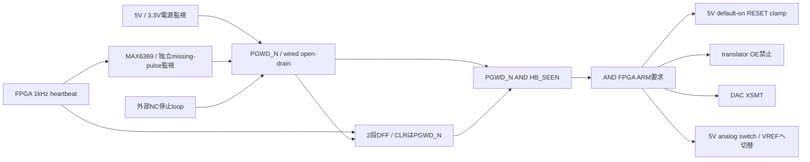

# F1 ULX3S 85Fキャリア：回路図レビューA

2026-11-15。ULX3S 85F PCB v3.0.8＋実YM2203C＋Si5351A＋PCM5102Aの
**ピン単位の接続・部品定数・footprintを持つKiCad回路図**を具体化した。
165部品／110net／11sheet。MCUを置かず、既存F1の49pad割当てとI2C v2 HOSTを維持する。
FPGAとYM2203Cはソケット接続、その他の狭ピッチSMTも手ハンダする前提。
この版は回路レビュー用で、PCB・製造データ・実機受入はまだない。

入口は[KiCad project](schematic/f1-carrier.kicad_pro)と
[親回路図](schematic/f1-carrier.kicad_sch)。KiCad 10.0.5で生成・export・ERCを確認した。
`F1C.kicad_sym`は独自の物理ピン全表示symbol。隠し電源pinを使わず、global labelでsheetを接続する。
ICのsymbolはpinbox表示で、部品のゲートや内部回路を写したものではない。

- [部品表](schematic/bom.csv)：実装候補IC、定数、footprint、datasheet参照。
- [module改造・socket等の追加部材](schematic/assembly-extras.csv)。165refとは別にmoduleと実装用部材を数える。
- [接続の正本](design.py)と[全ピン・全net JSON](schematic/circuit.json)。
- [exported netlist](schematic/netlist.xml)と[ERC](schematic/erc.json)。
- [固定検査記録](verification/carrier-20261115.json)。
- [FPGA端子・clock](../../../fpga-standalone/BOARD.md)と
  [Diamond準備](../../../fpga-standalone/boards/ulx3s/diamond/README.md)。

## 回路の分担

| sheet | 具体化した内容 |
| --- | --- |
| 01-connectors | ULX3S J1/J2各40pin、OLED1.3 PLL入力、HOST、VBUS tap |
| 02-power | 外部5V、PTC、bulk、VBUS検出、5V/3.3V監視 |
| 03-safety | 独立watchdog、2段の許可latch、NC外部停止、RESET clamp |
| 04-ym-bus | 双方向data／片方向control変換、OEの外付け強制禁止 |
| 05-clock-ym | YMソケット、Si5351A、水晶、12MHz XOとbuffer、5V clock変換 |
| 06-dac | 5V serial受信buffer、PCM5102A、I2S、analog rail filter |
| 07-analog | Rev Cと同じFM/SSG合成定数、独立line mute、左右volumeとline出力 |

USBのD+/D−・ESD・抵抗網はULX3SのUS2を使用し、キャリアへUSB配線を引き回さない。
ULX3S内蔵ESP32/FTDIは音源制御に使わない。新キャリアにPicoは置かない。

## 電源とUSB VBUSの分離

**従来のBOARD.mdの暫定案を、この回路図では次の配線へ具体化した。**
US2はデータとVBUS検出専用で、本体へのUSB給電経路を残さない。
対象基板の実装revision・シルク・導通を確認してから改造する。標準状態のまま外部5Vを接続しない。

| ULX3S位置 | このキャリアでの条件 |
| --- | --- |
| D8 / US1 | US1→内部5VのSchottkyが実装され、直結bridgeではないことを確認 |
| **D9 / US2** | **bridgeを開放し、diodeも実装しない**。USB側padからJVBUS.1へ検出線だけを引く |
| D51 / IN5V | bridgeを切断し、STPS2L30AF候補をIN5V→内部5V方向へ実装。向き・pad適合を現物照合 |
| D52 / OUT5V | **開放・未実装**。J2.39はキャリアでも未接続 |
| J2.40 / IN5V | PTC後のキャリア5Vを入力。module内部5VとUSB VBUSを同じnetにしない |

**V5_CARRIER（PTC後）で5.00V±1%**を初期条件とする。外部電源は5V系／1.5A以上。
PTCの最大抵抗・負荷時降下を含めてこの条件を満たす電源／保護部品を確定する。
JPOWERへ5.00Vを接続しただけではPTC後の下限を保証しない。YM側5.25Vを超えないこと、
許容ripple・突入・実消費・閾値との余裕を計測し、条件を満たせなければ保護部品／閾値を再選定する。
キャリアの5VはYM・5V translator・アナログ回路へ供給し、D51を介してmoduleも給電する。
3.3VはULX3Sから取り、Si5351・XO・buffer・DAC logicとFPGAの電源順序をそろえる。
使用bankのVCCIOはすべて3.3V。5V信号を直接FPGAへ接続しない。
US1からのみ給電された状態では、YM側5V監視が許可を出さず、音源出力を禁止する。

VBUSは47kΩ/68kΩ各0.1%で分圧し、100pFとSN74LVC1G17DBVRを通して
J2.15 / D18へ入れる。分圧値はVBUS 4.4〜5.25Vで約2.60〜3.11V。
bufferの5V耐性・Ioffを使い、FPGA無給電時にVBUSから本体へ給電しない。
FPGA側は100kΩでLOWへ保持する。D9より**USB側**から採らないと切断検出にならない。
分圧後の振幅・USB抜去時の放電・浮遊VBUS・無給電電流を実測する。

D9開放によりUS2抜去時も本体電源は外部5Vで継続する。
RTLは既存どおり、MIDI所有時のUSB切断は全音停止、I2C所有時はI2C再生を継続する。
端子の基準は[上流v3.0.8の固定版](https://github.com/emard/ulx3s/tree/6a92cec6b177191c5b0f80e260013a1f8ec147dd)。
上流回路図そのものは再配布せず、派生接続事実と改造条件を記録した。

## FPGAに依存しない停止経路



TPS3808G01DBVRを2個使い、5Vは110kΩ/10kΩ、3.3Vは66.5kΩ/10kΩ、各0.1%で監視する。
CT開放で公称20msの解除待ち。referenceを保守的に0.400〜0.410Vとして計算すると、
tripは5V側約4.790〜4.929V、3.3V側約3.055〜3.142V。
5Vの下限／rippleとの余裕を含め、実部品の精度・hysteresis・release delayを初回実装前に確認する。
供給が閾値以上というだけで電源PVT適合を認定しない。

[MAX6369KA+T](https://www.analog.com/media/en/technical-documentation/data-sheets/max6369-max6374.pdf)
のSET2/1/0=001で、起動待ち・missing-edge timeoutは10〜30ms、WDO LOW pulseは100〜300ms。
1kHz heartbeatの両edge間隔0.5msを監視する。停止検出上限は最終edgeから30ms＋外付け伝搬。
heartbeatはpermitに依存せず動作し、起動の循環待ちを作らない。

電源監視とWDOはopen-drainでPGWD_Nへまとめる。
10kΩ pull-upはNC外部停止loopを通し、100kΩ pull-downを付ける。
loop開放／抜去でもLOWになり、短絡で停止を回避する構成ではない。
SN74LVC74Aの両CLRをPGWD_Nへ接続し、解除後に**新たなheartbeat立上り2回**を要求する。
WDO pulseが終了してHIGHに戻っただけではHB_SEENは戻らない。
PGWD_NとHB_SEENのANDをFPGAへpermitとして返し、その先でもARM/DAC/LINE/RESET要求をANDする。

5V側はMMBT3904のdefault-on clampでYM RESETをLOWに保持する。
許可時だけ別のtransistorでclampのbaseを落とすため、FPGAや3.3Vが先に失われてもreset禁止側になる。
translatorのOEはpull-upでdisable、許可時のみtransistorでLOWへ落とす。
DAC XSMTはpull-down、line switchは5V側pull-upでVREFを選ぶ。
これらの停止経路はFPGA clockを必要としない。アナログmuteにはswitch／RC／DACの応答時間がある。

モデルではpower-low、NC開放、watchdog timeout、WDO pulse終了、再heartbeat、各要求の組合せを検査した。
実際の電源ramp、gate遅延、latchのrecovery/removal、metastability、transistor飽和、クリック音は別途計測する。
heartbeatはcontrol clockの動作証拠であり、全FSMの正常性や安全規格認証ではない。
通常のSTOP・1秒lease・音声clock監視・再生開始前primeは既存RTLが担当する。
停止解除から自動再演奏する機能は追加しない。

## バス・可変clock・音声

dataとcontrolはSN74LVC8T245PWR各1個。**bare ICのOEはpin22、DIRはpin2**で、
Rev Cの変換モジュール端子番号を流用しない。VCCA=3.3V、VCCB=5V。
FM serial受信は5V耐性SN74LVC125Aを3.3Vで使う。
Si5351 CLK0→YM PHIはSN74LVC1T45で5Vへ変換する。

Si5351A-B-GT（blank設定、MSOP10）＋25MHz CL10pF水晶を用いる。
既存RTLの内蔵10pF設定に合わせ、外付けload capacitorを加算しない。
CLK0はYM用1.5〜4MHz、CLK1は音声49.152MHz固定、CLK2未使用。
初期値4MHz・FM100%。既存HOSTの4MHz宣言を別clockで黙って受け入れない。

USB/control用は独立12MHz XO ASV-12.000MHZ-EJ-T＋CDCLVC1102PWR＋22ΩでOLED1.3/P3へ入れる。
Si5351の起動や可変clock変更がUSB referenceへ影響しない。
bufferのdatasheet最大0.8nsは**20–80%測定**で、P3の10–90% 1ns以内を保証する値ではない。
XO精度±50ppm以下、PLL reset幅1ms以上、実P3エッジ・jitter・負荷を実測し、必要ならbufferを再選定する。
部品候補を置いた段階をclock電気適合PASSとしない。

PCM5102AはRev C同様にI2S 48kHz、片側出力をmono mixへ入れ、左右へ複製する。
SSG各1kΩ load、4入力各100kΩ、帰還22kΩと47pF、FM470Ω＋2.2nFを引き継ぐ。
MCP6022＋CD74HC4053でVREFへのline mute、4.7µF bipolar AC結合、外付けdual A10k volumeとline出力。
FM/SSGの受入済みバランスを設計の基準にするが、新配線の聴取結果はまだない。

## HOST互換と検査の再現

既存の操作側PicoはGP0=SDA、GP1=SCL、GND共通、100kHz。
JHOSTは電源pinを持たず、各線に3.3Vへの2.2kΩ pull-up。配線容量150pFなら計算rise time約280ns。
実ケーブル・追加pull-upを含む値は実測する。
wire v2（0x42、YM22S002）、BEGIN排他、global STOP、lease、USB切断時の所有権規則を変更しない。
既存の機能合格記録と現在のRTL・HOST・C照合元のSHAが一致することを
[Diamond準備検査](../../../fpga-standalone/boards/ulx3s/diamond/test_prepare.py)でも照合した。
本変更で過去のP&R合格記録やRev C実機受入記録を書き換えない。

プロジェクトルートから実行する。Python3、KiCad CLI 10.0.5を使用した。

```sh
python3 hardware/ym2203-fpga-board/carrier-f1/generate.py --check
python3 hardware/ym2203-fpga-board/carrier-f1/check.py --output outputs/f1/carrier-check-01.json
kicad-cli sch export pdf -o outputs/f1/carrier-review.pdf hardware/ym2203-fpga-board/carrier-f1/schematic/f1-carrier.kicad_sch
```

生成対象はこのnative CAD・独自symbol・BOM・netlist・ERC・接続JSONとして明示的にGit管理する。
`design.py`から再生成し、CADだけを編集して正本と食い違わせない。
ERC違反0件、exportした全pin/netと正本の完全一致、7モデル／静的検査を確認した。
ERCはdatasheet適合やアナログ動作を証明しない。
PDF、Windows用bundle、配置配線／合成binaryやlogは`outputs/f1/`へ置き、Git管理外とする。

## PCB化前の残項目

- D8/D9/D51/D52の実装、module revision、縦型headerの向き・間隔・裏面高さ・取付穴の現物確認。
- PTC、connector、100µF bulk、bipolar 4.7µF、25MHz水晶の正確なMPN／body高さ／定格／供給性を確定。
  bulkは6.3mm径・2.5mm pitch、bipolarは5mm径・2mm pitchの暫定footprintで、0805に置かない。
- 5V supply精度・ripple、module3.3V許容、監視閾値、Ioff／逆流、電源順序、全停止応答の実測。
- Diamondの実合成・全corner STA、外部IO予算確定、P3 edge／clock jitter／USB信号品質の測定。
- 四層GND面、DAC charge-pump短配線、clock return、FM serial整合、アナログ領域、手ハンダ用padとprobe点の配置。
  基板寸法・価格・DRC・製造発注はこの回路図段階では確定しない。

独自回路／symbol／生成器はMIT。参照ICの文書を転載せずBOMにリンクする。
[TPS3808](https://www.ti.com/lit/ds/symlink/tps3808.pdf)、
[SN74LVC8T245](https://www.ti.com/lit/ds/symlink/sn74lvc8t245.pdf)、
[Si5351](https://www.skyworksinc.com/-/media/SkyWorks/SL/documents/public/data-sheets/Si5351-B.pdf)、
[CDCLVC1102](https://www.ti.com/lit/ds/symlink/cdclvc1102.pdf)、
[PCM5102A](https://www.ti.com/lit/ds/symlink/pcm5102a.pdf)を参照した。
