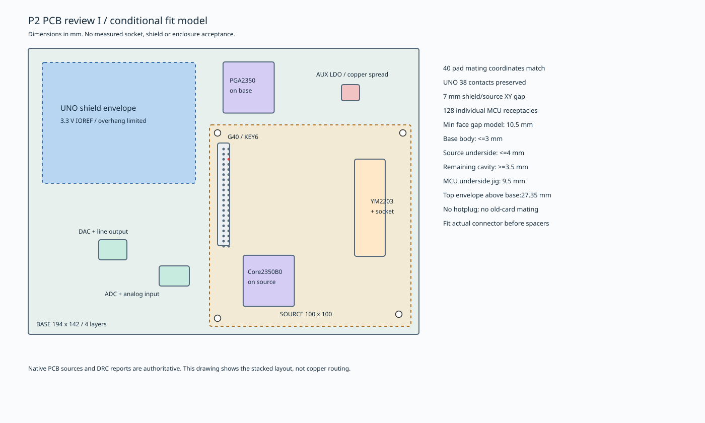

# P2 review I：review Hの配置・配線済みPCB

2026-11-18 / revision **3.6-pcb-review-i**。
[review H](../clean-sheet-schematic-review-h/README.md)の全228参照・値・footprint・pin/netを維持し、
ベースとYM2203×1音源の4層PCBを作成した。旧レビューとRev Cの実機受入は変更しない。
**未製作の候補。DRC0は、電源・USB・音質・熱・実物の嵌合の保証ではない。**

| 対象 | 外形 | 電気部品参照 | 検査した物理pad | 配線segment | via | ERC / DRC / 未配線 / 回路図差分 |
| --- | --- | ---: | ---: | ---: | ---: | --- |
| [ベースPCB](base/p2-base-i.kicad_pcb) | 194×142mm | 152 | 571 | 1777 | 207 | 0 / 0 / 0 / 0 |
| [音源PCB](module/p2-ym2203-i.kicad_pcb) | 100×100mm | 76 | 376 | 1160 | 150 | 0 / 0 / 0 / 0 |

[ベース回路図](base/p2-base-i.kicad_sch)・[音源回路図](module/p2-ym2203-i.kicad_sch)、
[検証記録](verification.json)、[電源・配線](POWER-ROUTING.md)、[組立・高さ](ASSEMBLY.md)。
部品参照数に加えてbase12/source4の取付穴がある。完成MCUモジュール内の部品を展開した集計ではない。
native PCBは編集可能なCAD正本。探索途中のDSN/SES・ルーター実行環境は管理しない。



[ベース表面銅箔](base/preview-top.svg)・[音源表面銅箔](module/preview-top.svg)は確認用。
裏面・内層を含む全配線はnative PCBで確認する。
取付座標は[base](base/placement.csv)/[source](module/placement.csv)、部品表は[base](base/bom.csv)/[source](module/bom.csv)。
これらはHの回路BOMであり、128個のMCU用単端子ソケットや完成モジュール・YMソケットの購入単位は[組立資料](ASSEMBLY.md)で補う。

## 配置と機構

- UNO R3はベース左上。公式由来の38接点座標を維持し、IOREFと信号は3.3V。
- 音源のベース上原点は(90,38)mm。UNOシールド予約範囲の右端83mmから7mm離す。
  全種類のシールドの外側への張出しまで保証する範囲ではない。
- G40はベース表面の雌／音源裏面の雄。40位置すべての嵌合座標を照合。KEY6の雄を抜き、雌を塞ぐ。
- 基板対向面間の公称モデル11.05mm、検査下限10.5mm。
  baseの下敷きSMT部品3mm以下、sourceの裏面突出4mm以下なら残り3.5mm。
- PGA/Coreは各64個の単端子ソケット。MCU下面の治具高さ9.5mm、下面部品3.6mm以内なら5.9mmの余裕。
  一般的な2列ソケット4個で代用しない。角で樹脂が干渉する。
- **6か所のSMT近傍ビアは先埋め・平坦化してから実装する。** 座標と手順は[組立資料](ASSEMBLY.md)。

高さは[条件付きモデル](mechanical-review.json)。部品図面の最終確認と各1組の現物嵌合が必要。
取付スペーサーの長さを先に固定して、コネクタを押し曲げない。

## 電源・音声・外部との互換

HのPGA2350＋共通PCM1863/PCM5102A、source Core2350B0＋実YM2203C、Si5351A、
3.3V/5V変換、受動SSG mix、DAC_XSMTのAND、MOD_ENABLE/RUN、TX禁止の接続は変更しない。
4層のIn1.CuはGND面専用、signalはF.Cu/In2.Cu/B.Cu。
5VはIn2補助面、MCU 3.3VはB.Cu補助面、AUX regulatorは表面放熱銅箔を用意する。
Hの電源予算・ADC入力制限・4ms mute guardを継承し、Hで未実装のfirmware動作をPCB検査で合格にしない。

既存HOSTのopn1・4MHz、I2C0x42/100kHz、YM22S002、64byte STATUS、PUSH32、FIFO1024、1000ms leaseを維持する要件。
USB-MIDI/CDCとI2C所有権、通信断停止、再接続では無音、新PLAY/Note Onのみ再開する契約も保持。
UNO外部端子・panel・受信/6声LED・DIP/RUN/STOP/TESTを維持する。
**P2 firmware移植・新PCB上のHOST/MIDI/STOP実機回帰は未実施**。既存HOST、C firmware、UF2は未変更。

## 検証と編集

KiCad/pcbnew10.0.5、KiCad付属Python3.9.13で検証した。pcbnewを使えるPythonで実行する。

```sh
kicad-cli sch erc --format json -o base/erc.json base/p2-base-i.kicad_sch
kicad-cli sch erc --format json -o module/erc.json module/p2-ym2203-i.kicad_sch
kicad-cli pcb drc --refill-zones --save-board --schematic-parity --format json --exit-code-violations -o base/drc.json base/p2-base-i.kicad_pcb
kicad-cli pcb drc --refill-zones --save-board --schematic-parity --format json --exit-code-violations -o module/drc.json module/p2-ym2203-i.kicad_pcb
python3 verify.py --output .
# 検査のみ（レポートを上書きしない）
python3 verify.py
```

全947物理padのnet、40嵌合位置、38 UNO接点、64 Core接点、4支持点、ソケット径と穴、
GND面にsignalを置かないこと、積層域の背高部品なしを検査した。
12契約の正常系と12件の拒否変異検査が成功。DRC個別除外0。
KiCad既定でignoreの5検査はそのまま記録し、違反を隠すための追加ignoreは行っていない。
標準ライブラリのmissing courtyard等は別の実体/高さモデルで補う。

`circuit.json`のpartsはHと一致する。Iのメタデータと回路図ファイル名だけを更新した。
KiCadで回路・PCBを同期して編集し、両DRC・等価性・`verify.py`を再実行する。
`place.py`は初期配置の参考生成器で`placed.kicad_pcb`を作る。最終PCBを再現する生成器ではなく、
最終の個別配線修正・面・手実装ビア処理はnative CADを正本とする。
来歴・ツールは[preservation.json](preservation.json)/[toolchain.json](toolchain.json)/[sources.json](sources.json)。

次の工程は、最終購入部品の寸法照合と嵌合試作、負荷電圧/温度/入力過渡の測定、
PGA/Core firmware移植、音量・遅延校正、既存曲とHOST/USB-MIDI/停止の実機受入。
製造用Gerber・発注確定・実機合格とは区別する。
