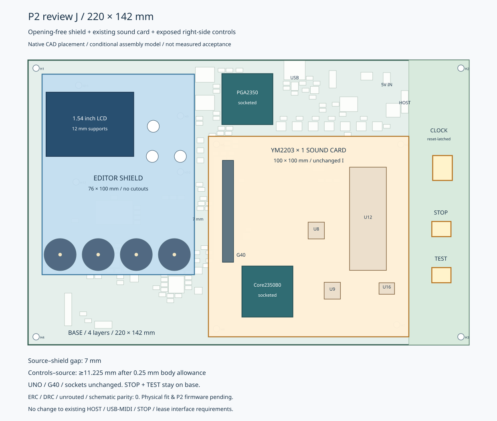

# P2 review J：220×142mmベース・右側操作部

2026-11-18 / revision **3.7-pcb-review-j**。
[review I](../clean-sheet-pcb-review-i/README.md)のベースを右へ26mm拡幅し、DIP・STOP・TESTを音源基板の右へ移した。
[開口なし76×100mmシールド](../editor-shield-review-b/pcb-review-b/README.md)と音源基板の位置・形状は維持する。
**未製作のCAD候補。高さ・リード突出は組立条件であり、現物の嵌合・操作性の受入ではない。**



| 対象 | 外形 | 電気部品 | 物理pad検査 | segment / via | ERC / DRC / 未配線 / 回路図差分 |
| --- | --- | ---: | ---: | --- | --- |
| [新ベースPCB](base/p2-base-j.kicad_pcb) | 220×142mm・4層 | 152 | 571 | 2055 / 229 | 0 / 0 / 0 / 0 |
| [音源PCB（Iをそのまま再利用）](module/p2-ym2203-i.kicad_pcb) | 100×100mm・4層 | 76 | 376 | 1160 / 150 | 0 / 0 / 0 / 0（Iの記録） |
| [シールド（Bをそのまま利用）](../editor-shield-review-b/pcb-review-b/p2-editor-b.kicad_pcb) | 76×100mm・2層 | 46 | 159 | 674 / 28 | 0 / 0 / 0 / 0（Bの記録） |

電気部品数とは別にベース12穴・音源4穴・シールド7穴がある。
ベース回路図は[こちら](base/p2-base-j.kicad_sch)、購入単位のBOMは[base](base/bom.csv)/[source](module/bom.csv)と[組立資料](ASSEMBLY.md)。
MCU単端子ソケットは合計128個。新たな電気部品の追加・削除はない。
表面/裏面配線図は[表](base/preview-top.svg)・[裏](base/preview-bottom.svg)。全内層配線はnative PCBを参照する。

## 変更と配置

基準はベース左上(0,0)mm、部品座標はfootprint原点。基板面積は約13.4%増加する。

| 対象 | Iでの座標(mm) | Jでの座標(mm) |
| --- | --- | --- |
| SWCLOCK（4bit DIP） | 64,76 | **203,50** |
| SWSTOP | 13,84 | **203,82** |
| SWTEST | 7,108 | **203,105** |
| H2 / H3（右端支持穴） | 190,4 / 190,138 | **216,4 / 216,138** |

他の全footprint・物理pad座標・向き・表裏は維持。UNO原点(10,10)、音源原点(90,38)も維持する。
DIPとボタンの高さでシールド下面を避ける必要がなくなり、搭載した状態で右から操作できる配置となる。
操作部の部品包絡へ0.25mmを加えても音源基板まで最小11.225mm、ベース端まで最小8.055mm。
これは部品同士の間隔であり、指・工具・筐体込みの操作余裕を実測した値ではない。
シールド右端83mmと音源左端90mmの間は7mm。

G40の40位置・UNO38接点・Core64接点・音源支持4点とシールド32接点/支持3点をnative CADで照合した。
シールドは外周4直線、開口・切欠き0。裏面リードとbase ICSPの重複0。
対向面間10.5mm以上、シールド裏面3mm以下、base SMT高さ3mm以下なら空間4.5mm。
音源下の空間3.5mm、MCU下面空間5.9mm等のソケット条件はIを継承する。
[積層・組立条件](ASSEMBLY.md)と[機械検証](stack-verification.json)を参照する。

## 配線と互換性

DIP1_N～DIP4_N・STOP_N・TEST_Nの6入力netのみ引き直した。抵抗/入力先/GPIOは変更しない。
In1.Cuの連続GND面を右端219.5mmまで延長し、右操作部のGND接点を接続。
5V/3.3V補助面は従来領域に保持。入力線は0.18mm幅、全長は分岐込み約170～221mm。
USB・音声・クロックを含め**それ以外の全track/viaのUUID・幾何・幅・netはIと一致**する。
[電源・配線](POWER-ROUTING.md)に長さと実測課題を記録した。

Hの部品・値・footprint・pin/net、G40/KEY6、UNO R3/3.3V、USB-MIDI/CDC、受信/6声LEDを維持。
既存HOSTのopn1/4MHz、I2C0x42/100kHz、YM22S002、64byte STATUS、PUSH32、FIFO1024、1000ms leaseを維持する要件。
I2C/MIDIの制御権切替、STOP、通信断停止、再接続時の無音、新しいPLAY/Note Onによる再開も変えない。
DIPはreset時に取得、STOP優先・20ms debounce、TESTは無所有時のみというHの契約を継承する。
**HOST・Rev C firmwareは未変更。P2用firmware・新PCBのHOST/MIDI/停止実機回帰は未実装・未実施。**

## 検証・再編集

KiCad/pcbnew10.0.5、KiCad付属Python3.9.13。pcbnewをimportできるPythonで実行する。

```sh
kicad-cli sch erc --format json -o base/erc.json base/p2-base-j.kicad_sch
kicad-cli pcb drc --refill-zones --save-board --schematic-parity --format json --exit-code-violations -o base/drc.json base/p2-base-j.kicad_pcb
python3 bind_reports.py
python3 verify.py --output .
python3 test_stack.py
# 保存済み記録を変更せず照合
python3 verify.py
```

音源側はIのnative CAD/回路図/ERC/DRCをbyte単位で保持したコピー。シールドBも変更しない。
変更する際はそのレビューの手順で検査し直す。古い結果を新しい基板の実機受入として扱わない。
[検証記録](verification.json)：947padの電気照合、12契約/12拒否変異と、積層18契約/18拒否変異。
追加の6試験では正しい積層のほか、STOP旧座標・誤net・G40ずれ・無関係な銅箔変更・操作部の裏面配置を拒否した。
DRC個別除外0、既定ignore5種類はIから変更なし。35入力のSHAでnative CADと保存レポートを結び付ける。

旧IとシールドBの全資料を[preservation.json](preservation.json)で固定して保存。
[toolchain.json](toolchain.json)/[sources.json](sources.json)に来歴を記録する。
`place.py`は初期配置のみ。最終配線はnative CADが正本であり、初期生成器からの再生成で上書きしない。
製造用Gerber・部品購入確定・筐体・実機受入は今回の範囲に含まない。
