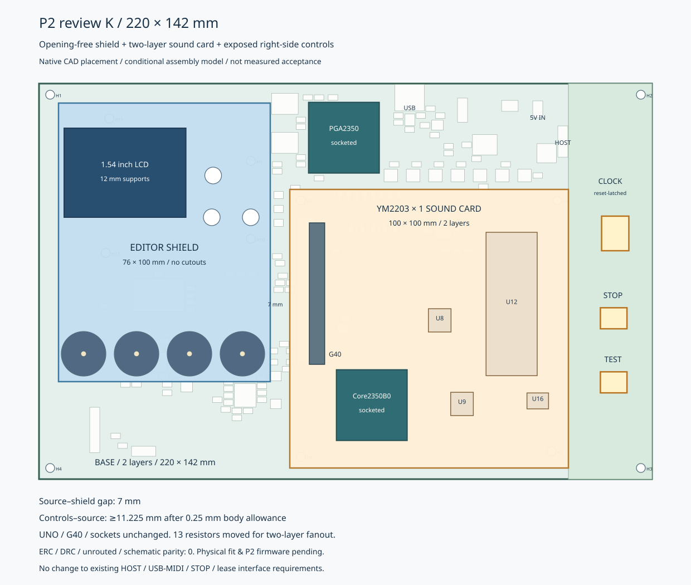

# P2 review K：ベース2層・音源2層の比較用リビジョン

2026-11-18 / **revision 3.8-pcb-review-k**。review Jとは別のCADを作成し、両方をF.Cu / B.Cuの2層へ再配線した。
主案は引き続きベース4層・音源2層。Kの音源基板はJのベースと同じG40・支持位置で組み合わせられる設計とし、
Kのベース＋Kの音源を2層／2層の比較候補とする。現物の嵌合確認は未実施。
J/Iの回路・PCB、開口なしシールドB、従来の製造データ・見積・受入記録は変更しない。



## CADと維持した仕様

| 対象 | 外形・厚さ | 銅層 | 電気部品 | CAD |
| --- | --- | --- | ---: | --- |
| ベースK | 220×142×1.6mm | F.Cu / B.Cu | 152 | [PCB](base/p2-base-k.kicad_pcb) / [回路図](base/p2-base-k.kicad_sch) |
| YM2203音源K | 100×100×1.6mm | F.Cu / B.Cu | 76 | [PCB](module/p2-ym2203-k.kicad_pcb) / [回路図](module/p2-ym2203-k.kicad_sch) |
| 開口なしシールドB（既存） | 76×100×1.6mm | 2層 | 46 | [既存PCB](../editor-shield-review-b/pcb-review-b/README.md) |

部品の追加・削除やジャンパー線の追加はない。Hの全228参照・値・footprint・pin/net、947物理padを照合する。
2層の配線空間を確保するため、ベースのRBD0～7・RBCTL0～3・RALERTの13個を空き領域へ並べ直した。
それ以外の全footprint位置・向き・表裏、MCU単端子ソケット128個、G40/KEY6の40接点、UNO R3の38接点、Coreの64接点を維持。
[配置変更の座標](base/placement-changes.json)を固定して照合する。
GPIO・USB回路・アナログ回路・クロック回路・STOP回路に機能変更はない。BOMは[ベース](base/bom.csv)・[音源](module/bom.csv)。
表裏の実配線は各PCBと`preview-top.svg` / `preview-bottom.svg`で確認できる。

既存HOSTのopn1/4MHz、I2C 0x42/100kHz、YM22S002、64byte STATUS、PUSH32、FIFO1024、1000ms leaseを維持する要件。
USB CDC/MIDI・I2Cの所有権切替、STOP優先、通信断停止、再接続後の無音、新しいPLAY/Note Onでのみ再開する契約も維持する。
**HOST・Rev C firmwareは未変更。P2 firmwareと新PCBの実機受入は未完。既存Rev Cの受入をKの合格として流用しない。**

## 4層版との差

内層の専用GND・電源補助面を廃止し、信号と電源を表裏へ引き直した。表裏の共通GND銅箔をビアで接続する。
配線・ビア数、信号長、GNDの分断は4層版と異なる。[電源・配線の評価](POWER-ROUTING.md)を参照。
2層化による基板代の低減可能性と引き換えに、帰路・USB・音声ノイズ・熱の実測を重視する比較案である。
[製造用Gerber・送料込み比較K](../manufacturing-review-k/README.md)を追加した。主案4/2と比較2/2を各5枚・部品1セットで比較する。
発注は未実施。従来の4層用見積を2層用の確定額として扱わない。

## 組立と検証

G40の対向面間は下限10.5mm、ベースSMT高さ3mm以下・音源下面突出4mm以下なら空間3.5mm。
UNOシールド下面リードは3mm以下、ベースSMT高さ3mm以下で空間4.5mm。
音源とシールドのXY間隔7mm、右側DIP/STOP/TESTと音源の間隔は最小11.225mm。
[Jの高さ条件](../clean-sheet-pcb-review-j/ASSEMBLY.md)を継承するが、ビア先埋め箇所はKの[手実装ビア一覧](hand-assembly-vias.json)を使う。
ソケット・スペーサーの高さ、MCU下面、LCDリード、ネジ頭は現物合わせが必要。

KiCad/pcbnew 10.0.5を使用。native CADを正本とする。既存CADを層数だけ変更して再生成する手順ではない。
検証の更新はKiCadの`kicad-cli`と`pcbnew`をimportできるPythonで行う。

```sh
python3 validate_native.py --kicad-cli kicad-cli
python3 bind_reports.py
python3 verify.py --output .
# 保存済みのCAD・レポート・旧設計保存を再照合
python3 verify.py
```

[検証JSON](verification.json)と[レポート結合SHA](native-binding.json)でERC/DRC・電気・取り付け条件を照合する。
最終PCBの配線セグメント／ビア数はベース4306／983、音源1267／301。ビア数にはGND接続用を含む。
手実装ビアはベース2か所・音源4か所。U8-7・U9-4はパッド内の穴を先に埋めて平坦化する。

DRCの個別除外は0。既存の既定ignore項目は継承し、検査基準を緩めて0件にしていない。
netlist export時にはHと同じannotation警告が出る。Hの参照名を維持し、出力netlistとPCBの全pin/netを別途照合している。
DRC0はUSB信号品質・電源温度・音声ノイズ・実物嵌合の受入ではない。
製造リリース、部品購入確定、P2 firmware移植、実機比較は未実施。
