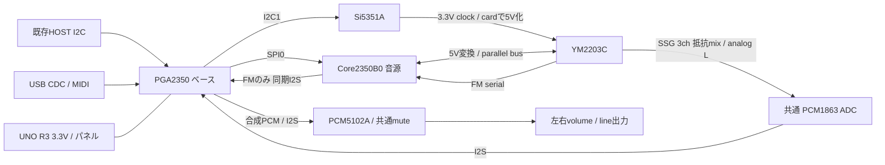

# P2 接続済み回路図レビューH

2026-11-18 / revision **3.5-schematic-review-h**。旧基板との物理互換を撤廃した
[Gの40接点・連続GPIO案](../clean-sheet-interface-review-g/README.md)を回路図にした。
ベースはPGA2350、音源はCore2350B0＋実YM2203C。FPGAは使用しない。
**製造用リリースではない。PCB、P2ファームウェア、実機受入は未実施。**

| 設計ファイル | 回路図上の部品参照数 | 回路図ページ | native ERC |
| --- | ---: | ---: | ---: |
| [ベース](base/p2-base-h.kicad_sch) | 152 | 14 | 0件 |
| [YM2203×1音源](module/p2-ym2203-h.kicad_sch) | 76 | 9 | 0件 |
| 合計 | 228 | 23 | 0件 |

[KiCad検査記録](native-verification.json)、[静的検証記録](verification.json)、
[ベースBOM](base/bom.csv)、[音源BOM](module/bom.csv)を参照。
部品参照数はC/Dと同じ集計規則。抵抗・コンデンサ・コネクタを含み、
PGA/Core完成モジュール内の部品は展開していない。
Coreの4ヘッダー記号は各16個の単端子ソケットを表すため、購入個数そのものではない。
YM2203と40pinソケット、MCU完成モジュールとソケットの購入単位も別途展開が必要。

## 回路の構成



- ベースGP0～7=data、GP8～11=control、GP14～18=audio。G割り当てを維持し44/47 GPIO、予備35～37。
- [音源ローカルGPIO](source-pins.json)は28本、予備18本、GP39/47予約。コネクタ番号・ベースGPIOとは別。
- Si5351AのCLK0を音源へ送り、U9の空きチャンネルで5V化。別の空きチャンネルをYM RESETへ使う。
- 音源のADC・ADC電源スイッチ・入力アナログスイッチを省く。SSGは1.33k負荷＋各10kの受動mixでLへ返す。
- ベース共通ADCでSSGを取り込み、FMとのレベル・遅延を合わせて合成する。右入力はこのカードでは未使用、ベースでmono複製。
- 最終出力はDAC内蔵XSMTへ集約。外付け4053、オペアンプ2個、2.5Vバイアス・反転増幅段を省く。
  **DAC許可とLINE許可のAND**で解除する。FMだけのmuteは合成前のFM枝の係数で実装する。

MISO返送はCS_Nと初期化禁止信号のORで制御し、Core起動中はI2S返送も無効にする。

旧Dはベース147＋音源145＝292参照。Hはベース+5、音源−69、**合計−64（約22%減）**。
回路別差分は[base](base/delta-from-d.csv)/[module](module/delta-from-d.csv)。
基板面積・価格の減少率はまだ算出していない。

## 共通接続と外部互換

[40接点表](connector.csv)の位置はGから変更しない。2×20/2.54mm、KEY6、共通GND、
analog L/R標準＋同期48kHz I2Sオプション。直接parallel/SPI/I2Cはprofileで選択する。
YMカードはSPI、将来の単純PSGカードは直接parallel、I2C音源は専用線を使える。
すべてのデジタルI/Oは3.3V。必要な5V変換はカード側に残す。
pin5 AUX 3.3Vは任意100mA予算、今回のYMカードは接続しない。

Hの電気仕様案は**5.1-draft**。受動mixでカードを簡素化するため、analog出力インピーダンスの目標を
Gの1kΩ以下から4.7kΩ以下へ緩めた。端子配置は同じ5.0-draft G。
入力回路・減衰・校正・停止時間は[電源と音声](POWER-AND-AUDIO.md)に明示する。
旧A～Fカード、旧C/D PCBへの挿入・部分挿入は不可。無通電で交換し、KEY6を実際に塞ぐ/抜く。

既存opn1/WYM1 HOSTの通信、USB-MIDIと所有権、UNO外部端子・受信LED・6声LED・DIP・
RESET/STOP/TESTは要件として維持する。[制御・停止の実装条件](CONTROL-AND-STOP.md)を参照。
この変更でRev Cの既存HOST・ファームウェア・UF2・過去の実機受入は書き換えていない。

## 検証と再生成

このフォルダーで実行する。標準ライブラリだけのPythonとKiCad CLIを使う。

```sh
PYTHONDONTWRITEBYTECODE=1 python3 generate.py --check
PYTHONDONTWRITEBYTECODE=1 python3 verify.py
```

macOS以外では`verify.py --footprints <KiCad標準footprintsディレクトリ>`を指定する。
参照するC/G設計と10個のD由来オリジナルfootprintは[provenance.json](provenance.json)にSHA-256を記録した。
生成した回路図・部品表・native netlist/ERCも、レビュー可能な設計ソースとして管理する。
回路の変更は`design.py`、connector/source-pinsから行い、生成物だけを編集しない。

- KiCad 10.0.5：両基板ERC0、全211 netの端子集合が設計JSONと一致。
- 全228参照の記号pinと実footprint pad集合を照合。LDOの放熱タブはOUT2と同番号。
- 18件の回路契約・異常変更検出試験。電源・受動RC計算は宣言した条件に限定。
- 既存C/HOSTの115試験中111成功、私有曲データを要する4件skip。Hの動作試験ではない。

独立した電源監視・外部watchdog・冗長ゲートは追加しない。通常RESETのデフォルト消音と、
動作中のSTOP/lease監視を分け、MCU停止・電源急断まで無音を保証したと記載しない。
次はH専用PCB配置・配線とDRC、電源/ソケット/UNOシールドの干渉確認、
その後にP2 firmware移植、ADC/FM音量・遅延校正、既存HOST/USB-MIDI/停止の実機回帰へ進む。
