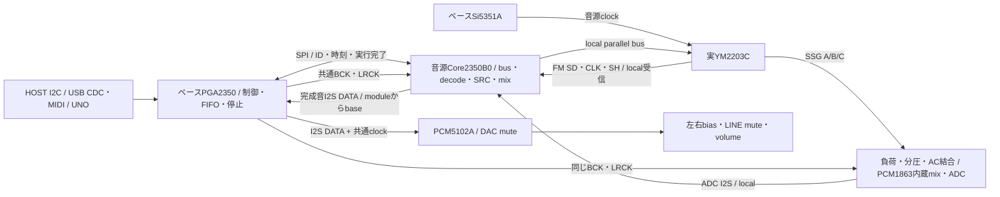

# P2 revision 3.1：音源側MCU合成I2S / 設計レビューB

2026-11-16。ユーザー選定の**音源基板側でFMとADC音声を合成する方式B**を主案にする。
**ベースPGA2350＋音源Core2350B0＋PCM1863＋実YM2203C、SPI制御＋合成I2S返送、32接点**。
今回の成果は部品選定、接点・電源・clock・GPIO候補と静的検査。接続済み新回路図、PCB、firmware実装・実機評価ではない。
旧[60接点review A](../modular-review-a/README.md)の回路・ERC結果は保存し、本案のERC合格としない。
GPIOは[proposal](gpio-proposal.json)だけを提示し、承認済みpin表・回路・firmwareには未適用。

## 部品と分担

| 場所 | 主部品 | 分担・選定理由 |
| --- | --- | --- |
| ベース | PGA2350 PIM722 | 外部I2C v2、USB CDC/MIDI、FIFO・所有権・lease、UNO、panel、音声clock master、合成I2S受信と共通DAC出力 |
| ベース | Si5351A-B-GT / 25MHz crystal | 音源clock専用。CLK0=4MHzから開始し、CLK1/2は当初disable。可変clockは停止中のみ設定 |
| 音源基板 | **Waveshare Core2350B0** | SPI slave、時刻付きYM実行、FM受信/PCM/SRC、ADC受信・mix、I2S slave送信。RP2350B 150MHz、520KiB SRAM、3PIO/12SM。GP39はboard LED、GP47は将来PSRAM予約。**MCU siliconは同じRP2350BでもPGAとは別メーカー・別pin配置** |
| 音源基板 | **PCM1863DBT** | 3.3V・2ch ADC、TSSOP30/0.5mm。複数のanalog入力を内蔵mixでき、BCK由来PLLで別MCLKを省ける |
| 音源基板 | TLV75533PDBVR | ADCのAVDD/DVDD/IOVDDを専用3.3Vへ。MCU内蔵LDOと出力を接続しない |
| 音源基板 | YM2203C / DIP40 socket | 初回は実YM×1・4MHz。module内部に5V bus変換、FM receiver、default resetを残す |
| ベース | PCM5102APWR | 完成したFM＋SSGのstereo I2SをD/A変換。最終DAC/LINE muteをbase単独で閉じる |

部品候補・数量・実装条件は[parts.csv](parts.csv)、根拠は[sources.json](sources.json)。
これは製造用の全数BOMではない。抵抗/decoupling/connector footprintは接続済み回路化で確定する。
PGA2350は在庫事情から**baseの1枚だけ**にする。音源側は別メーカーのRP2350Bボードを選び、処理能力とSDKの共通性を保つ。
Core2350B0はPSRAMなし版を初回採用し、音声bufferは内部SRAMへ置く。異なるMCUファミリーへの変更を意味しない。
PGAはUSB connectorなし、Core2350Bは6pin FPC経由の専用USB adapter候補がある。通常運用USBはbaseだけ。
module更新はSWDを第一とし、FPC adapterで更新する場合はcarrier給電を外し、VBUSを二重給電しない。
USB D+/D−やVBUSを共通32接点で結ばない。
調達価格・在庫は未確約。ADCやPGAは秋月だけで調達できる前提にせず、メーカー/正規代理店を併用する。

| MCU比較 | 判断 |
| --- | --- |
| Pico 2 | C SDK音声処理の実績は活用できるが、今回のbus/OE/ADC/SPI等30GPIO候補は通常の露出26GPIOへそのまま収まらない |
| PGA2040 | 30GPIO級で余裕が乏しく、RAM/PIO/CPUに差がある。追加ADC処理を含む新負荷の性能は未評価 |
| **Core2350B0** | RP2350B/SDKを共通化でき、30/46GPIO候補に16本余る。追加DSP込みの実測合格ではない |
| PGA2350追加 | 当初候補だったが在庫制約により採用しない。baseの1枚に限定する |
| RP2350B bare IC | 小型化余地があるがQFN/電源/Flash等の実装が増える。今回の主案にしない |

| ADC比較 | 判断 |
| --- | --- |
| PCM1808 | TSSOP14で小さいがanalog5V＋MCLK同期条件が増える。3声mix回路も別に必要 |
| **PCM1863** | 2ADCで初回のSSG合成monoを十分取り込める。analog入力数8とADC数2を区別する |
| PCM1865 | 4ADCへ拡張したいカードの候補。pin互換でもTDM等のclock/受信実装を変更・検証する。初回へ無条件追加しない |

## 音声・クロック

共通I/Fは**48kHz・2ch・32bit slot中24bit有効、Philips I2S**。BCK=3.072MHz、LRCK=48kHzはbaseだけが生成する。
moduleのADC受信とmix送信、baseの受信とDAC送信は同じBCK/LRCKのslave/clock共有境界に置く。
ADCはPCM1863のBCK input slave PLL、48kHz/64fs条件を使い、外部MCLKは配線しない。
ADCとmixのDATAは別線で、電気的に束ねない。設定詳細は[clock-tree.json](clock-tree.json)。
baseの一度のI2S受信→次の出力blockへの転送は別bufferとして扱う。clock共通でもDATAが同時刻の無遅延転送になる意味ではない。

音源clockは別domain。4MHzのYM2203は約55.556k sample/sで、125→108のSRCは**4MHz→48kHz時だけ**の基準。
可変clockではmoduleがcapability内の周波数からSRC比を求め、測定したframe rateとの整合性を検査する。
全候補ICのdecoderや任意周波数への対応が実装済みという仕様ではない。
ADCのfilter遅延とFM/SRC/複数buffer遅延を測り、速い枝を遅延させて音の立上りを揃える。
暫定の完成音遅延目標は10ms以下。実測前の保証値ではなく、Rev Cの4.5msと同じと説明しない。
音声clockは待機中も維持する方針。clock喪失/ADC PLL異常/underrunではbaseで出力を閉じ、勝手に再開しない。

### SSG入力の具体案

[adc-plan.json](adc-plan.json)に、SSG A→VINL1(pin3)、B→VINL2(pin1)、C→VINL3(pin29)を記載した。
PCM1863のleft analog MUXのselect fieldを0x07、rightをmuteとし、3声はADC前に加算する。
page0 register0x06の**field値0x07を、そのままregisterへ書かない**。bit6等の予約値を保つ（通常極性なら0x47）。
ADCは2chだが、初回はleft合成monoを使い、MCUがFMとSSGをそれぞれL/Rへ複製する。
3声の個別PCMは得られない。発音LEDやvoice停止はYMへの実行済みregisterから管理する。

各SSGに1.33kΩ負荷と3.01kΩ:1kΩ分圧を置く候補。合成DC負荷は約999Ωで旧1k負荷に近く、分圧比は約0.249。
その後2.2µF AC結合・1kΩ直列・1nF対AGNDの初期値とし、ADC側のbiasを使用する。
PGAは初期0dB、AGC/clipping suppressionは無効で、楽曲の音量を勝手に変えない。
5.25Vの単線rail stepは分圧後約1.31V。ADCのbiasと入力impedanceを含む過渡・off時の注入電流、
anti-aliasと通過帯域のSPICE/実測は未完で、保護素子用の余地を残す。値だけを製造根拠にしない。
未使用analog入力の終端、VREF/LDO/電源decouplingはTIの推奨に従い回路化する。

デジタル加算は広いaccumulatorと明示的なheadroom/飽和検出を用いる。
初期安全設定は各枝を十分減衰して開始し、FM100%をFM枝のunityとして保ちつつSSG係数をRev C実音と校正する。
新ADC経路での音量比・SNR・立上りが既に一致したとはしない。
FMだけのmuteは**mix前のFM枝**を0にする。完成音DACのhardware muteはSSGも含めた全音を止める。

## 共通32接点

[connector.csv](connector.csv) / [connector.json](connector.json)。2列×16、pitch2.54mm、接点grid長38.10mm。
旧60接点73.66mmから接点gridは35.56mm短くなる。これは基板面積やconnector body長の縮小保証ではない。

| odd pin / A列 | even pin / B列 |
| --- | --- |
| 1 MODULE 5V | 2 GND |
| 3 MODULE 5V | 4 GND |
| 5 SPI SCK →module | 6 GND |
| 7 MOSI →module | 8 MISO →base |
| 9 SPI CS_N →module | 10 GND |
| 11 MODULE_ENABLE →module / Hで起動許可 | 12 ALERT_N →base / open drain |
| 13 I2S BCK →module | 14 GND |
| 15 I2S LRCK →module | 16 GND |
| 17 完成音I2S DATA →base | 18 GND |
| 19 SOUND_CLK0 →module | 20 GND |
| 21 SOUND_CLK1 / 初回NC | 22 GND |
| 23 SOUND_CLK2 / 初回NC | 24 GND |
| 25 RES_MCLK / 両側NC | 26 GND |
| 27 RES0 / NC | 28 RES1 / NC |
| 29 RES2 / NC | 30 RES3 / NC |
| 31 GND | 32 KEY / 接点除去・穴塞ぎ |

内訳：SPI4＋enable/alert2＋I2S3＋sound clock3＋MCLK予約1＋予備4＋5V2＋GND12＋key1=32。
**3.3Vの電源、analog、raw FM、I2C、USBは渡さない。digital信号は3.3V、GND共通。**
ID/clock上限/電源要求はSPIの能力応答へ移し、旧ID EEPROMとservice I2C延長を削る。
旧P2M1/audio-format1のIDを新I2S形式へ流用せず、内部linkの版・module種別・firmware版を分けて照会する。
既存60接点版や40接点候補と**電気的/機械的に互換ではない**。変換adapter前提にしない。

Samtec SSW-116-02-G-D / TSW-116-07-G-Dは候補。雄32を除去・雌32を塞ぎ、非対称guide/固定穴を設ける。
key1個だけで反転・1列ずれ挿入を防げたと判断しない。pin番号は導体の同一性を表し、嵌合面の鏡像はCAD化時に検査する。
採用品drawing・高さ・嵌合長・socket保持力とUNO shield干渉、クロストークは未確認。
短いboard-to-boardを前提とし、長いribbon cableでの信号品質は仕様に含めない。
3.3V信号の独立電源境界にはIoffを明記したSN74LV4T125等のbufferを置き、各receiver側の電源で動かす。
SPI MISOはCS非選択時にHi-Z、base側のreturn buffer OEもCSと連動させる。
初回はclock0だけをbuffer使用、clock1/2はdisable＋module NC。将来使う時はbuffer/負荷も再配分する。

## 電源・出力段

[power-plan.json](power-plan.json)が割当の入力、[verification.json](verification.json)が算術結果。
共通外部5V系からbase MCU、base DAC/UNO AUX、module MCU、module ADCへ**各々の3.3V**を作る。
3.3V出力同士を結ばず、各GNDは共通にする。これはガルバニック絶縁ではない。
5V YMのdata/control/FM/clockのlevel変換はmodule内部に残す。RP2350のFT端子の条件だけで無電源保護/OEを撤去しない。

| rail / 配電 | 今回の設計割当 | 供給能力 / 注意 |
| --- | --- | --- |
| base PGA onboard 3V3 | 272.4mA | 300mA。3本のSi clock余裕を含む。実測ではない |
| base AUX 3V3 | 150mA | TLV755 500mA。DAC45＋UNO100＋余裕5 |
| module Core2350B onboard 3V3 | 198mA | board仕様800mA。電流定格とSOT-23 LDOの実装放熱は別。ADCは別rail |
| module ADC 3V3 | 50mA | TLV755 500mA。ADC全電源/clock buffer/余裕を含む割当 |
| module 5V直接 | 150mA | YM120mA上限を含むbus等余裕 |
| module合計5V入力 | **398mA / 入場上限500mA** | LDOなので3.3V側電流も5V入力へそのまま加算 |
| base直接5V | 115mA | analog15＋optional UNO5V100。JP5Vは通常open |
| 全体 | **935.4mA / module500mA枠使用時1037.4mA** | 2A adapter候補。USBから供給しない |

PTC候補をMF-MSMF150/16X-2へ見直す。23°C hold1.5Aでも40°Cでは1.25Aのため、初回は基板周囲40°C以下に限り評価する。
上限5V電流1037.4mAとR1max0.12ΩによるPTC dropだけでも約0.124Vあり、ケーブル/接点のdropも加わる。
入力は規制された5.1V級・2Aを候補とし、**YM VDDの実測4.75〜5.25V**を受入条件にする。
公称5Vだけで定格内と断定せず、5.25V超へ上げて補償しない。connector電源接点/配線の定格も0.5A以上のmodule枠で確認する。

電力のstress計算は5.25→3.2V。base内蔵LDO約0.558W、module内蔵約0.406W、base AUX約0.308W、ADC用約0.103W。
small moduleの実際の熱抵抗は未確定で、放熱面積・温度上昇を測って連続使用を判断する。
ADC LDOはDBV SOT-23-5であり、thermal pad付きDYDの低い熱抵抗を流用しない。
TLV755の入出力は4.7µF候補、DC bias等を引いて各effective1µF以上。ADC各pinの100nF/10µF、LDO pin11、VREF pin6のdecouplingも別途必要。
module入口に10〜47µF候補と各railのtest point。突入・brownout・ground returnは実機で評価する。

ADCのAVDD/DVDD/IOVDDを同一のmodule ADC railとし、BCK/LRCK入力bufferもこのrailで動かす。
ADC_DOUTはMCU rail側Ioff receiverで受ける。ADC用I2C pullupはADC rail、MCU端子はopen-drainだけで駆動し、rail消失時はHi-Z。
PCM1863にはreset pinもbrownout detectorもない。ADC用TLV755 ENをmodule電源のENABLE Schmitt出力へ接続し、10kでdefault Lにする。
STOPでRUNとADC給電を同時停止し、railが十分低下する休止を挟んで再初期化する。放電時間とPOR成立は実測で決める。
ADC pin11はdecoupling用で、外部3.3Vを入れない。ADC起動とoff時の全pin電圧・注入を回路レビューで検査する。
USB VBUSはbaseで検出専用を維持し、module/baseの5V、SWD probeからUSBへの逆流を禁止する。
交換時は外部電源とUSBを全て切る。hotplugは非対応。

PCM5102A出力はground-centeredで負電圧にも振れる。既存0〜5VのCD4053へ直結しない。
baseのVREF bias付きL/R opampとAC couplingを残し、SSG/AUX加算抵抗を外す。
初期候補はDAC入力100k/feedback47k、1%としてgain約0.47。2.2Vrms仮定でmax約1.492Vpk、
VREF誤差とrail-to-rail余裕0.30Vを置いた約2.051Vpk内に収める。
DC過渡・負荷・クリック・DAC実出力差は実測前で、旧回路ERC0をこの変更後へ流用しない。

## 制御・停止・互換

外部は既存I2C v2（0x42/100kHz、YM22S002、status64、PUSH32、FIFO1024、1000ms lease）を保持する。
[内部link要件](LINK-AND-SAFETY.md)は新しいSPI層で、公開HOST wireにopcode/隠しchip bitを足さない。
WYM1 `<IBB`/4MHz/1YMは無変更互換対象。多chip/port/sampleは別版で能力照会・形式追加が必要。
USB CDC/MIDIはbaseが終端。I2C所有中のMIDIは拒否/消費し、MIDI所有中BEGINを拒否し、切替で古いNote Onを再生しない。
USBを抜いても外部電源がありI2C所有なら演奏を継続。MIDI所有時の切断ではpanic・gate閉を行う。
UNOの形状、IOREF3.3V、各UART/SPI/PWM/ADC、HOST20/21、service42/43、VBUS46はGPIO候補でも保持する。

[Core2350B header identity](module-header.json)はメーカー回路図を取得・描画してP1〜P4を転記した。
PGA2350とは64pin/2.54mmという外見が似ていても**pin互換ではない**。専用socket/footprintを新規レビューする。
module VBUS=P2.15、3V3出力=P2.16、RUN=P2.11。PGAのpad名やsocket netlistを流用しない。

GPIO候補はbase35本（12本空き）、module30本（16本空き、GP39/47除外）。base SPI0 GP0〜3とALERT GP4、I2S受信GP16、ENABLE GP34を提案する。
DAC送出GP26/27/28、mute38/39は保持。moduleはSPI1 GP8〜11、FM16〜18、ADC I2C20/21、
ADC DATA24、mix DATA25、BCK26/LRCK27、ALERT28、YM bus0〜7/30〜37。
PIOはbase2SM、module3SM、DMAは各8ch以内を暫定予約。[resources.json](resources.json)の数は割当で、
実際のPIO命令数・divisor・IRQ/DMA競合やSRC性能を検証した値ではない。
GP32以上のSIO/PIOアクセスはRP2350Bのbankを明示し、32bit GPIO maskだけで全端子を扱わない。

部品選定とコネクタ設計はここまで進めた。新しいGPIO役割を回路/firmwareへ反映する前に、project AGENTSの規定どおり確認する。
次工程はGPIO確定後のnative回路図、電源順序/ADC入力保護のレビュー、二MCUのSPI/clock/audio試作。
その後PCB/DRCと、旧HOST無変更・MIDI切替・STOP/lease・全曲/無音待機を回帰する。
新回路の製造可・音質同等・全候補音源への性能合格はまだ判断していない。

## 検査

正本repo rootで `python3 -B projects/ym2203-sound-module/hardware/ym2203-fpga-board/digital-module-review-b/check.py`。
標準ライブラリのみ。connector/clock/ADC入力数/独立電源/承認済みGPIO保全/公開I2C定数と、
誤配線・誤設定に対するnegative tests、割当/電力/headroom算術を検査する。
これは通信・音声のruntime simulation、回路ERC、PCB DRC、実音評価ではない。
結果は[verification.json](verification.json)。

今回の設計manifest検査は34件合格。既存P2の12件、旧分離Aの18件、C/HOSTの111件合格・楽曲依存4件skipも確認した。
既存実装の回帰結果は[regression-results.json](regression-results.json)に分離し、新基板の実機合格に流用しない。
