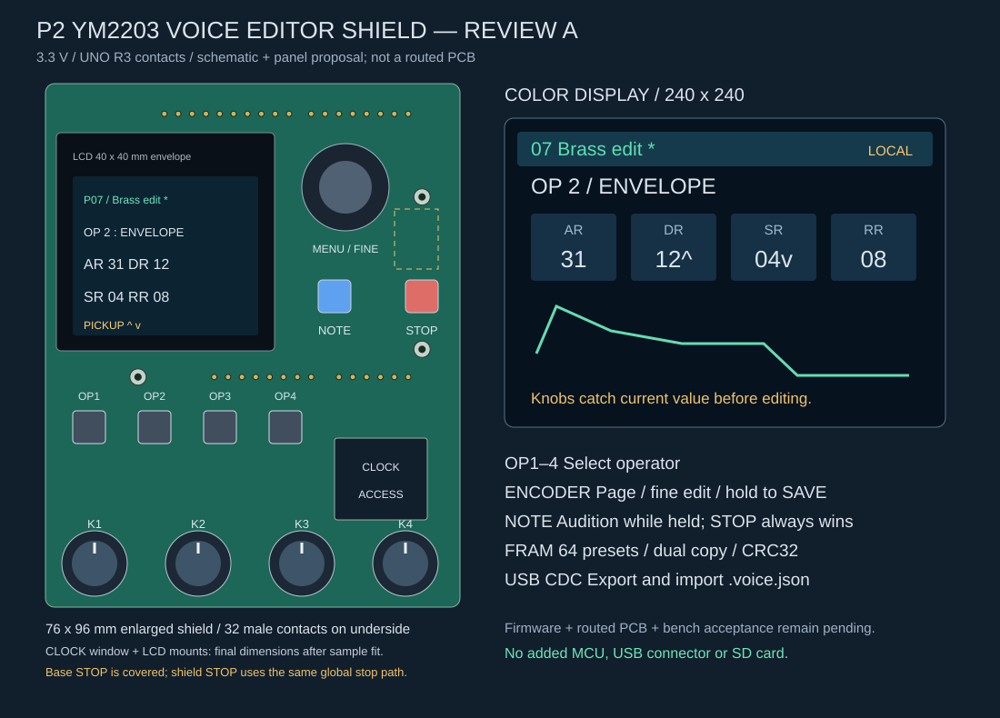

# YM2203音色編集シールド：review A

2026-11-18。P2 review IのUNO R3形状・3.3V信号に挿す、物理操作式FM音色エディター。
**接続済みKiCad回路図・BOM・操作面・保存形式までの設計。配線済みPCB、P2 firmware、実機合格ではない。**
ベース/音源のreview H/I、40接点、GPIO、既存HOSTとRev C firmwareは変更しない。



| 機能 | 初版の設計 |
| --- | --- |
| 音色 | YM2203のFM4オペレーター、ALG/FB、DT/MUL/TL/KS/AR/DR/SR/SL/RR/SSG-EG、OP有効/無効 |
| 物理操作 | B10kボリューム4個、押し込み式エンコーダー、OP1～4・NOTE・STOPの6ボタン |
| 表示 | Waveshare15867 / 1.3インチST7789 / 240×240カラーLCD、SPI接続 |
| 保存 | MB85RC256V / I2C FRAM32KiB、64音色、各音色2コピー・CRC・commitを最後に書込む |
| 外部へ取り出す | ベースのUSB CDCからJSON export/import。シールドにUSB端子・MCU・SDは追加しない |
| 試聴 | NOTEを押している間だけ、既定C4をFM CH1で発音。USB-MIDI鍵盤も編集sessionへ入力する設計 |

初版はFM音色を対象とする。SSGの矩形波/ノイズ/共有エンベロープ編集は拡張項目。
SSG-EGはFMオペレーターの機能で、SSG3声の共有エンベロープとは別。
楽曲のレジスター列を編集画面と同時に書き換えるモードは設けない。

## 回路と購入対象

[KiCad回路図](schematic/p2-editor-a.kicad_sch) / [BOM](bom.csv) / [接点表](pins.json) / [電気検査](native-verification.json)。
46部品参照・31net、native ERC違反0、exportしたnetlistとdesignの全pin/net一致を確認した。
[footprint検査](footprint-verification.json)で46参照のpin集合・157物理pad・32 UNO座標を照合した。
BOMのLCDはJ5という接続口を表す。購入時には**LCDモジュール1個＋PH2.0 8線ケーブル**を別途加える。
UNO用雄ヘッダーは1×8を2本、1×10を1本、1×6を1本。重ねるシールド用の上向きソケットは不要。
4個の直径12mm以下のノブ、encoder用ノブ、絶縁支持3組も別途必要。
電子部品は0805、FRAMはSOP8/1.27mm、操作子とコネクタはTHTを基本とする。
PTV09/EC11は候補型番と標準footprintを対応付けた段階。購入品の端子・shaft・高さの最終照合は残る。

LCDはメーカーの[製品仕様](https://www.waveshare.com/1.3inch-LCD-Module.htm)、
FRAMは[RAMXEED資料](https://www.ramxeed.com/zh-tw/cms/wp-content/uploads/2025/05/MB85RC256V-DS11v2-E.pdf)を参照。
メーカー資料そのものや写真は再配布しない。[参照元一覧](sources.json)。

## P2との接続

- D10=LCD CS、D11=MOSI、D13=SCK、D12=DC、D1=RST。SPI1は送信専用。**D12をSPI RXに設定しない。**
- D2/D3=encoder A/B、D4=押込み、D5～8=OP1～4、D9=NOTE、D0=STOP。
- A0～3=4ボリューム。各wiper→1k→ADC、ADC→100nF→GND。
- A4/A5=内部service I2C1を共用、FRAM0x50。base jumperは閉。既存0x20/0x4A/0x60と重複しない。
- LCDはUNOの3V3（AUX）から給電、80mAを設計上限として実測する。IOREFからLCDを給電しない。
- FRAM・ボリューム・pull-upはIOREF（PGA3.3V）。追加8mA予算で既存265mA＋8mA＜300mA。
- AUXとIOREFは直結しない。5V/VIN/AREF/RESETはNC。I2C追加pull-upは載せない。
- J5のBLは選定モジュールのバックライト制御入力としてAUXへHIGH固定。裸LEDをGPIO駆動しない。

一般的な5V AVR UNO向けの電気互換は持たない。P2専用シールドであり、Arduinoスケッチがそのまま動く意味でもない。
既存HOST0x42/100kHz/WYM1/PUSH32/FIFO1024/1000ms lease、USB-MIDI/CDC、global STOPの契約は維持する。

## 操作・保存・実装境界

[操作とfirmware仕様](UI-FIRMWARE.md)、[音色ファイルと保存](STORAGE.md)、[寸法と組立](MECHANICAL.md)。
保存・読み出し・外部取得を**現在のP2で実行できる状態ではない**。追加firmwareの実装契約として具体化した。
現在のRev Cにこのシールドを装着する構成でもない。

## 検証

```sh
python3 generate.py                  # kicad-cliをPATHへ: 回路図/BOM/ERC/netlistを生成
python3 check_design.py              # 隣接review Iとの32接点・GPIO・rail・予算検査
python3 check_footprints.py          # pcbnewをimportできるKiCad付属Pythonで実行
python3 -m unittest -v test_voice_model.py
python3 voice_tool.py example.voice.json --registers
```

KiCad10.0.5、モデル検証Python3.15.2を使用。新たなPython外部依存は不要。
9件のモデル試験で、全64slot、全257書込み中断点、256byte各位置の破損、generation周回、JSON検証、OP順序、pickupを確認。
これらは実FRAMの低電圧保証やP2リアルタイム性能・実機音質の試験ではない。
GPIO/電源/コネクタを変えた場合は回路・netlist・検査を同時に更新する。

次工程はLCD/操作子の現物採寸、配置・配線PCBとDRC、P2 firmwareの移植後に表示・試聴・保存・PC export/importを受け入れること。
commit・push・製造発注はこの設計作業に含めない。
