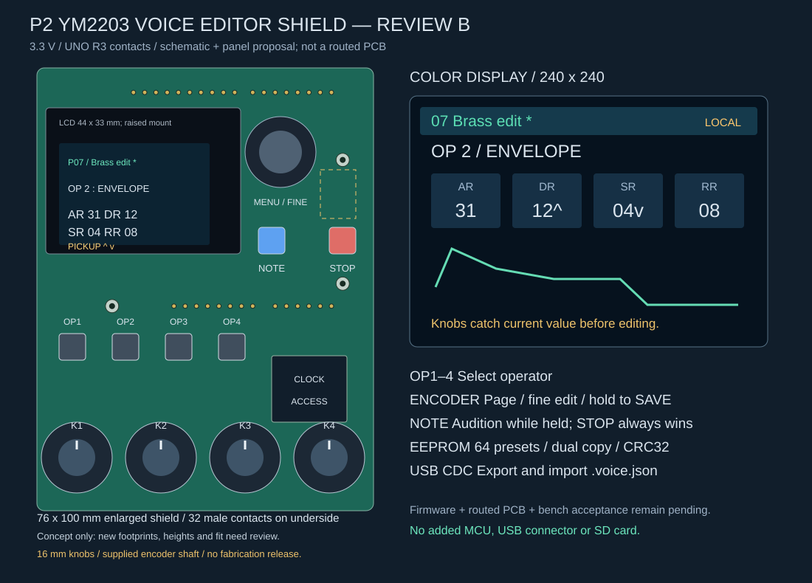

# P2 YM2203 音色編集シールド — review B

**大きな開口・外周切欠きのない矩形PCB review Bを作成した。**
[配置・配線と検証](pcb-review-b/README.md)／[干渉・組立条件](pcb-review-b/ASSEMBLY.md)。
シールドB自体のLCD・操作部・外形を維持する。旧ベースIではDIP/STOP/TESTを覆う検査記録。
現行[ベースJ](../clean-sheet-pcb-review-j/README.md)は220mm幅で3操作部を右へ移し、開口なしで露出させる。
Jとの嵌合・干渉は[J積層検証](../clean-sheet-pcb-review-j/stack-verification.json)に別記し、Bの過去記録は上書きしない。
[設計方針](NO-CUTOUT-PLAN.md)と開口付き[旧PCB review A](pcb-review-a/README.md)も保存する。

秋月電子通商で調達できる部品を優先した設計。2026-11-18に販売ページと在庫あり表示を確認した。
**購入単位での部材小計は3,160円（税込、PCB・送料・支持材など別）**。
注文用の[購入部品表](PURCHASING.md)と[purchase-bom.csv](purchase-bom.csv)を参照する。

[review A](../editor-shield-review-a/README.md)は変更せず保存した。
[矩形PCB review B](pcb-review-b/README.md)へ更新した。2層76×100mm、ERC/DRC/未配線/回路図差分0。
32接点と166pad（取付穴を含む）を照合。P2 firmware・現物嵌合・実機受入は未完了。

| 用途 | 採用品 | 秋月販売コード | 必要数 |
| --- | --- | --- | ---: |
| カラーLCD | M154-240240-RGB、1.54インチ240×240、ST7789 | 131019 | 1 |
| ボリューム | RK09D117000B、B10k、センタークリック | 114827 | 4 |
| ボリュームつまみ | S-42、外径16mm | 116278 | 4 |
| 押込みencoder | RE111F-4S1-152S4-15P-A、専用shaft付 | 114936 | 1 |
| 保存メモリー | 24FC256-I/P、DIP8 EEPROM、32KiB | 103568 | 1 |
| OP1～4・NOTE・STOP | TVDP01-095BB1、6×6mm、高さ9.5mm | 117166 | 6 |

抵抗19本はリード品。コンデンサーはリード品8個と0805サイズ2個を選んだ。
ヘッダーとLCD配線も秋月商品に対応付けた。袋売りの余剰部品を購入小計に含む。

## Aからの変更

- LCDは8pinの順序をGND/VCC/SCL/SDA/RES/DC/CS/BLKへ変更。SCL/SDAはSPI信号。
  J5は2.54mm 1×8へ変更し、3.3Vで給電。旧Waveshare用ケーブルをそのまま使わない。
- FRAMの秋月販売ページを確認できなかったためEEPROMへ変更。同じ64音色とJSON・record形式を維持する。
  page分割・書込み完了待ち・手動SAVEは[保存仕様](STORAGE.md)に追記した。
- LCD外形、16mmつまみ、encoder実装方式、DIP8メモリーに合わせ配置を再検討する。
  76×100mmの矩形外形と取付穴をPCBへ反映した。[組立条件](pcb-review-b/ASSEMBLY.md)の現物確認が必要。
- LCDの20cm候補配線はSPI 2MHzから評価する。高速化やケーブル延長は波形と音声回帰確認後。

## 設計データと検証

- [回路図](schematic/p2-editor-b.kicad_sch)：7 sheet、46電気部品、31net、KiCad ERC 0件。
- [回路BOM](bom.csv)、[購入BOM](purchase-bom.csv)、[ピン仕様](pins.json)、[回路正本](circuit.json)。
- [操作・firmware契約](UI-FIRMWARE.md)、[保存・取り出し](STORAGE.md)、[JSON例](example.voice.json)。
- [部品フットプリント検査](footprint-verification.json)：46pin集合、159pad、UNO32接点。
  これは現物との嵌合・配線・DRC検証ではない。
- 13件のPCモデル試験：音色の範囲、OP対応、64slot、CRC、途中断、pickup、EEPROM page分割など。
  [モデル検証結果](model-verification.json)を参照。実EEPROMの電源断試験は未実施。

```sh
python3 make_footprints.py
python3 generate.py
python3 check_design.py
python3 -m unittest -v
python3 catalog.py
```

`check_footprints.py`はKiCad付属Pythonのpcbnewを使用する。各版は[toolchain.json](toolchain.json)。
P2ベースI/HのGPIO・40接点・HOST I2C ABIは変更せず、USB-MIDI・global STOP・leaseを維持する実装契約。
新しいLOCAL_EDIT所有権はまだfirmwareに組み込んでいない。

## 操作面の概念図



図は機能配置の提案。購入部品の実寸・端子・高さを全て確定した製造図ではない。
