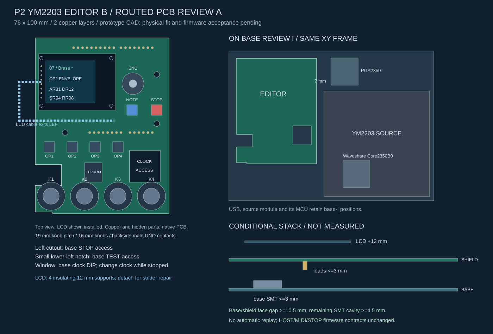

# 音色編集シールド review B — PCB review A

2026-11-18。秋月採用品を使ったreview B回路を配置・配線した**2層、76×100mmの試作候補**。
ベースreview Iと重ねるためクロックDIPの窓、ベースSTOPとTESTの切欠きを設けた。
製造発注・実物嵌合・P2 firmware実装・実機受入はまだ行っていない。

| 対象 | 結果 |
| --- | --- |
| 電気部品 / 物理pad | 46参照 / 159pad（取付穴7個を含め166pad） |
| 配線 | 692 segment、28 via、最小幅0.25mm、表裏GND面 |
| ERC / DRC / 未配線 / 回路図差分 | **0 / 0 / 0 / 0** |
| DRC個別除外 | 0。ベースIと同じKiCad既定ignore5項目は[検証記録](verification.json)に列記 |
| UNO嵌合 | 裏面雄32接点、ベースIの同番号座標と全点一致 |
| メモリー等のPCモデル | 親review Bの13試験は合格、実EEPROMの試験ではない |

編集可能な[配線済みPCB](p2-editor-b.kicad_pcb)と[回路図](p2-editor-b.kicad_sch)がCAD正本。
[表面銅箔](preview-top.svg)・[裏面銅箔](preview-bottom.svg)、[配置表](placement.csv)、
[パッド照合](native-pads.json)、[機構・電源・組立条件](ASSEMBLY.md)も参照する。



## 部品と機構

- 秋月LCD M154、B10k×4、RE111F、EEPROM、ボタンを維持。Waveshare販売品も選定可とする。
  今回の配置には秋月品で解消できない干渉はなかったため、供給元を変える目的だけの交換はしていない。
- LCDは横向き・コネクタを左へ向け、12mmの絶縁支持で持ち上げる。エンコーダー軸の上へケーブルを通さない。
- つまみは外径16mm、19mm間隔。軸位置の相対許容を各0.5mm置いても隙間2mm。
- エンコーダーの位置決め穴は、図面の長穴を反映して2.1×1.6mmとした。中心穴は2.15mm。
- UNOの裏面雄ヘッダーを、上から見た座標でベースと照合。ICSPには嵌合せず、上方にTHTリードを置かない。
- 支持はUNOの3か所とLCDの4か所。音源基板とのXY間隔は7mmを維持する。

ベースIのCore2350B0はWaveshare品を想定したままで、モジュールやそのGPIOは変更しない。
最新購入ロットのUSB/FPC・ピン長・ソケットの現物嵌合は、元のベースIと同様に未受入。
LCDだけでなく、ソケット・支持材と長いボリューム軸の確認を[組立手順](ASSEMBLY.md)に残した。

## 互換性と検証範囲

review Bの46参照の値・footprint識別子・pin/netを維持する。PCB用のED2ライブラリでは
裏面ヘッダーを正しい座標で定義し、エンコーダーの長穴と取付穴を追加した。
親review Bの回路図とライブラリは当時の候補記録として保存し、このディレクトリのライブラリをPCBに用いる。

ベースI/H、40接点、HOST/player、C firmwareは変更しない。
I2C0x42/100kHz、既存WYM1・PUSH32・FIFO1024・1000ms lease、USB-MIDI/CDC所有権とglobal STOPを維持する設計契約。
シールドD0のSTOPはP2 firmwareでglobal STOPへ接続する必要があり、独立したハード停止回路ではない。
**新PCBでHOST・USB-MIDI・停止が動作したという実機合格ではない。**

## 再検証

KiCad10.0.5、pcbnew付属Python3.9.13。以下のpython3はpcbnewを使えるものを指定する。[ツール・来歴](toolchain.json)。

```sh
python3 validate.py  # ERC・DRCを実行し、保存CADとレポートのSHA-256を結び付ける
# KiCad pcbnewを使えるPythonで、結果を上書きせず照合する
python3 verify.py
# レポートの更新を伴う検証
python3 verify.py --write
# 親ディレクトリの音色・EEPROM計画モデル
cd ..
python3 -m unittest -v
```

`build_pcb.py`は初期配置の参考生成器。最終配線を再現するものではない。
生成途中のplaced/DSN/SESやルーター環境は配布しない。最終の修正配線・GND面・サーマルはnative PCBが正本。
回路変更時は、この回路図と親review Bの回路正本との一致も保ち、ERC・DRC・`verify.py`を再実行する。
