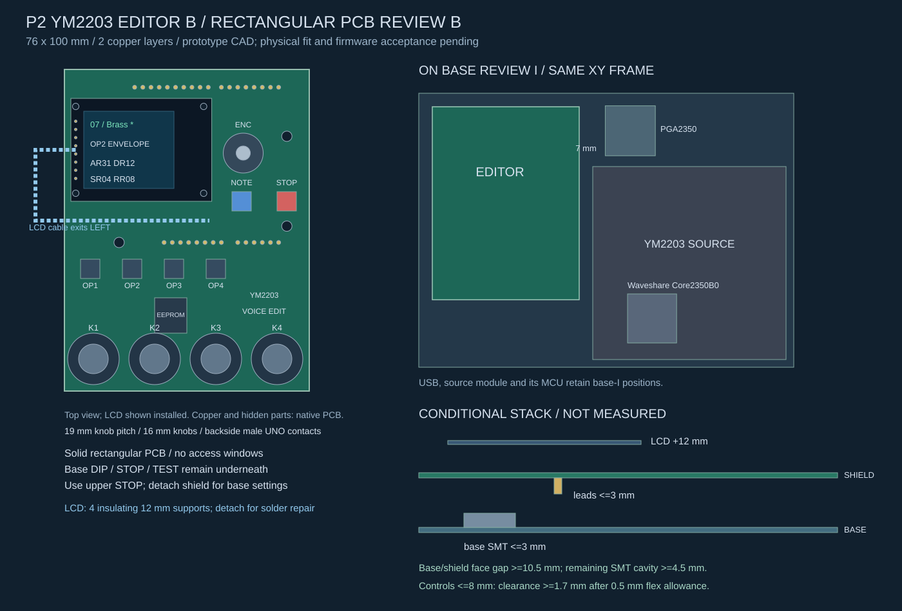

# 音色編集シールド review B — 矩形PCB review B

2026-11-18。現行LCD・全操作子とベースIの配置を維持し、
**大きな開口・外周切欠きのない2層76×100mmシールド**へ変更した。
[開口付きPCB review A](../pcb-review-a/README.md)は比較・検証記録として保存する。
取付穴・端子穴・encoder位置決め穴は残す。未製作であり、現物嵌合・新P2 firmware・実機受入は未完了。

| 対象 | 結果 |
| --- | --- |
| 外形 | 矩形4辺のみ。大きな開口0、外周切欠き0 |
| 電気部品 / 物理pad | 46参照 / 159pad、取付穴7個を含め166pad |
| 配線 | 674 segment、28via、最小幅0.25mm、表裏GND面 |
| ERC / DRC / 未配線 / 回路図差分 | **0 / 0 / 0 / 0**、個別除外0 |
| 配置・ピン | review Aから全53 footprintの位置/向き/実装面、全pad座標・穴径を維持。UNO32嵌合を照合 |
| 機構検査 | DIP・STOP・TESTへのTHTリード投影重複0。高さ条件下で残り1.7mm |
| 検証の拒否試験 | 隠れたTHT脚・背高部品・追加開口をnative CAD上で混入させ、拒否を確認。正常系を含め4件合格 |

[配線済みPCB](p2-editor-b.kicad_pcb)／[回路図](p2-editor-b.kicad_sch)／[組立条件](ASSEMBLY.md)／
[検証結果](verification.json)／[配置表](placement.csv)／[表面](preview-top.svg)・[裏面](preview-bottom.svg)。



## 変更内容

- DIP窓・STOP切欠き・TEST切欠きを廃止。LCD、4ノブ、encoder、6ボタン、EEPROMの位置は維持。
- KNOB1_RAWとSCLを新しい外形で引き直し、GND面を再充填。その他の信号接続を維持。
- ベース基板・音源基板、GPIO割当、40接点、既存HOST/player/C firmwareを変更しない。
- シールド装着中は上面STOPを使う。ベースDIP/STOP/TESTは覆われ、設定・診断時は無通電で取り外す。
  NOTEは音色試聴用で、ベースTESTの診断機能と同一ではない。

## 干渉検査の条件

基板対向面間10.5mm以上、DIP/ボタンは基板面から8mm以下、直付けを条件とする。
覆われる場所にTHT脚を置かず、銅箔・viaは0.3mmの包絡、たわみ0.5mmを見込んで
`10.5−8−0.3−0.5=1.7mm`を確保する。
K1の脚とベースTESTのXY距離は、両側0.25mmの組立余裕を差し引いて最小約0.575mm。
実物での寸法・はんだ量・たわみを測定した意味ではない。詳細は[組立条件](ASSEMBLY.md)。

既存HOST I2C0x42/100kHz、WYM1・PUSH32・FIFO1024・1000ms lease、USB-MIDI/CDC所有権とglobal STOPは同じ設計契約。
シールドD0 STOPをglobal STOPへつなぐP2 firmwareは未実装。新PCBで互換動作を実測したという主張ではない。

## 検証と編集

KiCad10.0.5、pcbnew付属Python3.9.13。以下のpython3はpcbnewを使える環境を指定する。

```sh
python3 validate.py  # ERC/DRC、保存CADとのSHA照合、全pad/配置/機構照合とレポート更新
python3 verify.py    # 保存済み検証レポートを上書きせず再照合
python3 -m unittest -v test_mechanical.py
```

[検査条件](mechanical-inputs.json)、[投影と最近接距離](covered-controls-projection.json)、
[拒否試験](mechanical-test-results.json)、[来歴](preservation.json)を管理する。
KiCad既定ignore5項目は親レビューから継承して列記し、違反を隠す追加ignoreや個別除外は設けていない。
`build_pcb.py`は初期配置の参考生成器。最終配線を再生成するものではなく、native PCBを正本とする。

ベース右側への操作子移設については[別案](RIGHT-SIDE-OPTION.md)を記録した。
今回の矩形シールドの配置・DRC合格とは独立した検討で、ベースの移設はまだ行っていない。
