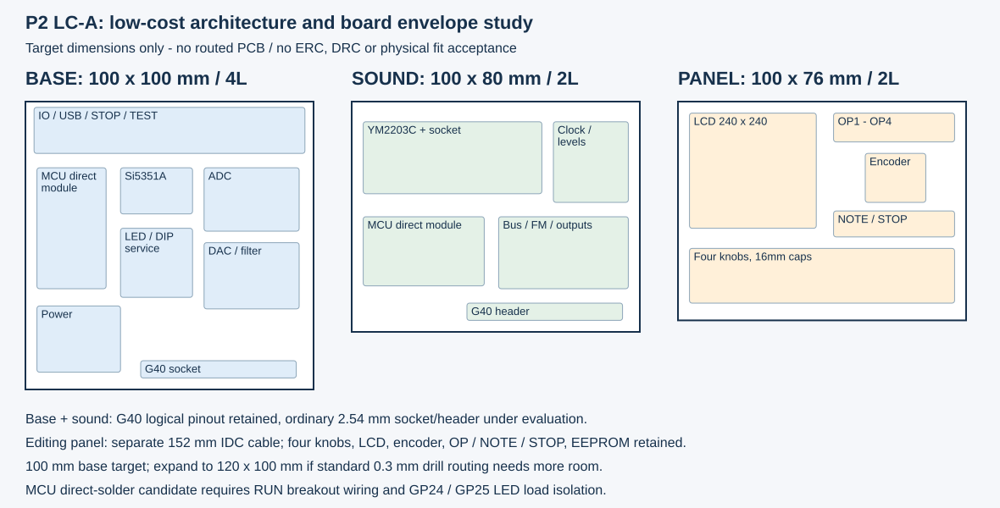

# P2 低コスト構成案 LC-A

2026-11-19。現行ベースL・音源K・編集シールドBと購入資料B/C/Dを保存した、別の構成・費用検討。
**音色編集機能を残し、UNO互換形状を廃止する。** active-plan.json、現行CAD、GPIO番号、Rev C firmwareとHOSTは変更していない。

有力候補は、ベース・音源にPicossci 2Bを各1枚直接はんだ付けし、着脱する音源接続に一般的な2.54mm連結ソケットを使う構成。
ベースは100×100mm・4層、音源は100×80mm・2層、操作パネルは100×76mm・2層を目標とする。
152mmのケーブル接続により、操作パネルをベースの上へ重ねる必要をなくす。LCDと操作子の面積を無理に縮めない。

今回の成果は**構成・端子照合・矩形領域配置・予算の検討**。新たな回路図・配線済みPCB・ERC/DRC・Gerber・実機受入ではない。
標準ビアで100mmへ配線しきれなければ120×100mmへ広げる。原設計を加工したかのような製造データは出さない。

- [費用比較と削減内訳](COST.md)／[再計算入力](cost-inputs.json)
- [GPIO・パネル端子候補](PIN-COMPATIBILITY.md)／[構成正本](plan.json)
- [メーカー仕様・加工と採用条件](ASSEMBLY.md)
- [互換・停止処理と実装後の試験項目](COMPATIBILITY.md)
- [製造価格の入力観測](pcb-price-observations.json)



## 残す機能と部品

| 機能 | LC-Aでの扱い |
| --- | --- |
| 音源交換 | G40の論理端子を維持。一般40Pソケットへ。新寸法の音源基板との組合せを検討 |
| FM・アナログ入力 | 実YM2203C、PCM1863共通ADC、PCM5102A DAC、必要な5V変換を維持 |
| 可変クロック | Si5351A、DIP設定・停止中だけの変更を維持 |
| 音色編集 | 240×240 LCD、4 knob、encoder、OP1～4・NOTE・STOPを維持 |
| 音色保存・取出し | 24FC256、64slot、既存record/CRCとJSON import/export仕様を維持 |
| HOST | I2C v2、WYM1、0x42/100kHz、既存HOSTプレーヤーを変更しない契約 |
| USB | ベースUSB-C、CDC・USB-MIDI、USB経由WYM1の機能要件を維持 |
| 停止 | global STOP、lease、USB所有者切断停止、再接続時無音、RESET経路を維持 |
| 表示・操作 | 受信LED、6声表示、DIP、STOP/TEST、ハードリセットを維持 |
| UNO | 互換外形・汎用シールド給電・ピン配置を廃止。編集専用PANEL40へ置換 |

現在のRev C firmwareには、P2専用回路・LOCAL_EDIT・USB WYM1等の未実装部分がある。
上表は今回の設計要件を維持する意味であり、新基板用firmwareへ実装・受入済みとするものではない。

## 費用の見通し

基板各5枚・部品1セット、YM2203CをRev Cから流用、1 USD=160円の仮定。
100mm主案は部品商品約2.37万円、基板製造3,824円。送料枠・輸入/決済差・再設計小物の予備枠まで含めて、**4.5万円を目標予算**とする。
120mmベースへ広げた場合は約5万円、現行MCUと高価な単端子ソケットを維持する保守的比較は約5.5万円の予算目安。
正確な再計算額はCOST.md。新案の小口支柱・支持材は明示的な予算枠で、販売単位が確定した新注文BOMではない。
在庫待ち部品、CAM追加費、実カート送料は依然として確認が必要。PCBA・工具・ケースは含まない。

## 採用前に解決する点

Picossci 2Bは提示された[SSCI-105071](https://www.switch-science.com/products/10507)。36.83×17.8mm、1.27mm端面端子、48GPIO、税込2,310円/枚を確認。
端面にRUN端子がないため、RESETスイッチ信号端子からの追加配線が採用条件となる。GP24/25の基板上LED負荷も切り離す候補。
特に音源側の外部RUNは、MOD_ENABLEによる停止経路を維持するため必須で、GPIOやソフト停止への置換で済ませない。
フラッシュ容量は商品ページ32Mbitと公開回路図のW25Q16表記が異なる。実機JEDECを確認するまで固定容量のUF2を作らない。

これらの加工を避ける場合は、既存PGA2350＋Core2350B0と単端子ソケットを残す比較案がある。
4辺に配置するMCUソケットは端部干渉の履歴があるため、一般連結ソケットへそのまま置き換えた低価格を計上していない。
一般ソケットを使う主対象は、直線2列のG40とパネル接続である。丸ピンIC用ソケットへ0.64mm角ピンを押し込む案は採用しない。

## 検証・再計算

```sh
python3 projects/ym2203-sound-module/hardware/ym2203-fpga-board/low-cost-review-a/tools/build.py
python3 projects/ym2203-sound-module/hardware/ym2203-fpga-board/low-cost-review-a/tools/verify.py
```

Python標準ライブラリのみ。費用差分、数量、端子重複、既存44/28 GPIOの全件同一性、パネル20 GPIO、G40の保存、矩形領域、外形面積、現行CAD/firmware/HOSTハッシュを検査する。
これらは配置配線・信号品質・消音実時間の検証ではない。検証の実行結果はverification.json、入力と上流PDFの識別はsource-lock.jsonへ記録する。
commit・push、部品注文、現行設計の上書きは行わない。

今回、現行editor-shield-review-bで`python3 -m unittest -v`を実行し、EEPROM/音色/JSON/pickup等の13モデル試験が合格した。LC-Aの配線・実物部品の試験ではない。
