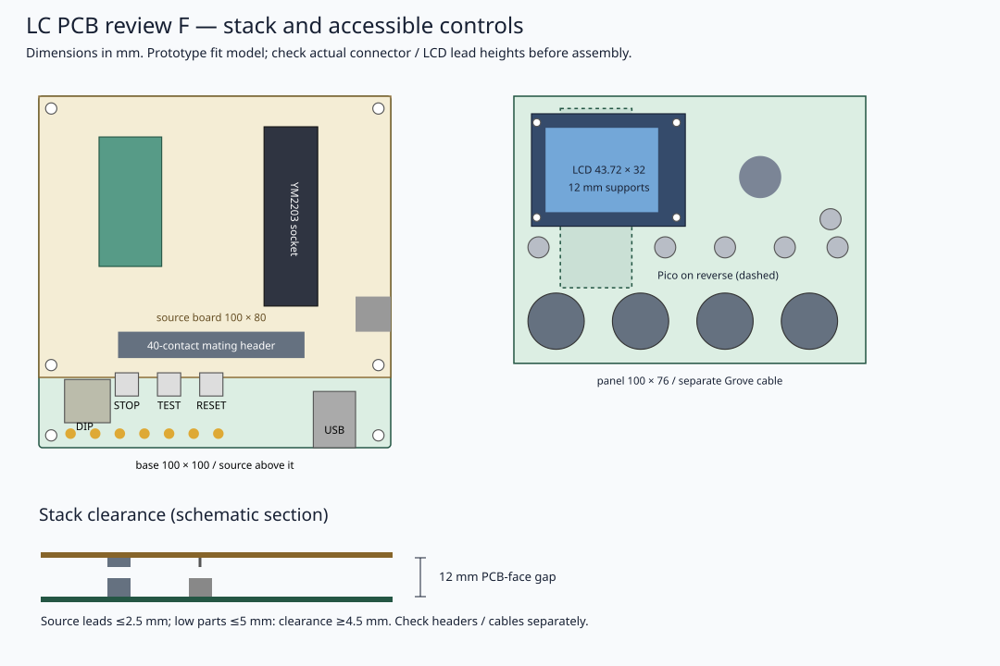

# YM3014B-F音源基板：部品配置・PCB review F

2026-11-19。保存した[回路図 review E](../low-cost-ym3014-schematic-review-e/README.md)を電気回路の正本とし、別版のネイティブKiCad PCBを作成した。YM2203CはRev Cから流用、YM3014B-Fは支給、他の部品は実装1セット、裸基板は3種類各5枚。旧CAD・ファームウェア・実機受入記録は変更しない。

| 基板 | 外形 / 層数 | 部品参照（取付穴を除く） | PCB |
| --- | --- | ---: | --- |
| ベース | 100×100mm / 4層 | 143 | [p2-base-lc-f.kicad_pcb](base/p2-base-lc-f.kicad_pcb) |
| YM2203音源 | 100×80mm / 2層 | 83 | [p2-ym2203-lc-f.kicad_pcb](module/p2-ym2203-lc-f.kicad_pcb) |
| I2C音色編集パネル | 100×76mm / 2層 | 51 | [p2-panel-lc-f.kicad_pcb](panel/p2-panel-lc-f.kicad_pcb) |

PCBと同じフォルダの`.kicad_pro`と`.kicad_sch`を一緒に開く。独自フットプリントは[P2LC.pretty](P2LC.pretty)、3枚の回路図の部品/端子/ネットはEと同一で、物理フットプリントだけを具体化した。通常の0.6mm径/0.3mm穴の貫通ビア、0.2mm以上の配線、0.15mmクリアランスを使う。ビア穴埋め・キャップ・マイクロビア・バックドリルを要求しない。はんだ仕上げは鉛フリーHASLを想定する。

- [検証と制約](VALIDATION.md) / [独立検証結果](verification.json)
- [組立・高さ・コネクタ](ASSEMBLY.md)
- [費用と発注条件](COST.md)
- [互換境界](COMPATIBILITY.md)
- [一次資料と独自ランド](SOURCES.md)

表裏の部品配置図は各基板フォルダの`preview-top.svg` / `preview-bottom.svg`に保存する。

## 音声と停止

音源のFMはYM3014B-F＋MCP6002でG40の37番へ、SSGは抵抗合成して39番へ送る。ベースのPCM1863で2ch取り込み、RP2350AでFM/SSGを合成してPCM5102Aから左右へ同じ信号を出す。FMとSSGを左右へ分離して聞く設計ではない。

G40の31/33/34番I2S入力も維持する。YM3014の通常プロファイルはアナログ2chを使い、同じFMのI2S寄与を0にし、音源側TX_DISABLEをHIGHに保つ。別の音源用にI2S対応を残したもので、今回のYM2203のFMを二重加算しない。

STOP・リース・USB切断に対する制御権処理の契約は保存した。最終出力DACのXSMT強制ゲート、音源MCUのRUN/ENABLE、USB VBUS検出・外部5Vとの分離も回路図から維持している。新P2のファームウェア移植と実機受入はこれからで、Rev C用UF2をそのまま使える意味ではない。

## 検証範囲

ネイティブERC/DRCと全ピンのネット照合、G40全40端子の実装座標照合、外形・穴径・積層高さを確認する。波形、ジッタ、ADC/DACの音質、熱、USB電気特性、実物ソケットの嵌合を実測した合格ではない。製造用Gerberや注文は本版に含めず、現物のランド合わせと最終CAM見積を経て発注する。
