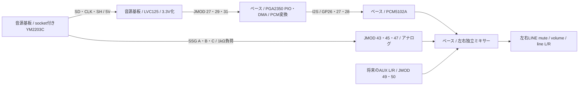

# P2分離構成 review A：共通コネクタ＋YM2203×1

2026-11-16。revision 3.0-draftを接続済みKiCad回路図へ具体化した。
**PGA2350によるFM受信・PCM変換・I2S出力をベースに残す。音源基板にDACを置かない。**
前回の「合成済みanalog L/Rを必須の境界にする」主案を変更する。

成果物は回路レビュー用。PCB、実組立、P2 firmware、USB列挙・音声の新規実機受入、製造リリースは未完。
旧review Bの配線・DRC結果とRev C実機合格は保存し、本設計の合格に転用しない。

## 音声の経路



I2Sに入るのはデジタル受信したFM。SSGは従来のRev Cと同じく、DAC出力の後でアナログ合成する。
**SSGも含めた完成音をI2Sで取り出す回路ではない。** その用途には別途ステレオADC等が必要。
今回はADCもUSB Audioも追加しない。
YM2203のserialはI2Sそのものではないため、PGA2350で形式変換とSRCを行う。
4MHz以外のSRC対応や、別音源のdecoderは引き続き未実装。

左右独立のDAC出力・ミキサー・LINE gateを用意した。最初のYM2203ではFMを両I2S channelへ複製し、
同じSSG3音をL/Rの各ミキサーへ入れる。将来のOPNA/OPMのstereo信号は、対応decoderを追加してから使う。
L側の`SUM_MONO`等は旧回路のnet名を保持しているが、新回路のR側は`SUM_R`等に独立している。

## 回路図・BOM

| 場所 | 回路・担当 | KiCad入口 |
| --- | --- | --- |
| ベース | PGA2350、USB/VBUS分離・検出、HOST、Si5351A、I2S DAC、左右mix/mute、panel、UNO、JMOD | [p2-base-a.kicad_sch](base/p2-base-a.kicad_sch) |
| 音源基板 | YM2203C DIP40 socket、data/control変換、default reset、clock変換、3.3V FM return、SSG負荷、ID | [p2-ym2203-a.kicad_sch](module/p2-ym2203-a.kicad_sch) |

[BOM：ベース](base/bom.csv)、[BOM：音源基板](module/bom.csv)。
回路図refは140＋55=195。ソケット接点・外付けvolume等の実装品は別に数える。
旧一体型164refに対し、コネクタ、ID、終端、右chとAUXを追加したため31ref増える。
部品削減の結果だとはしていない。PGA2350の64単端子ソケット案とYMのDIP40 socketは旧Bから継続する。

確認PDFはプロジェクト内のGit管理外`outputs/p2/p2-modular-review-a.pdf`。
先頭が音声経路、次が60接点の一覧、以後ベース13ページ＋音源基板8ページの計23ページ。
ネイティブ回路図は実pin番号を持つ独自symbolを使い、全netをKiCadの出力と照合する。

## 共通コネクタ1.0-draft

正本は[connector.json](connector.json)、一覧は[connector.csv](connector.csv)。
2列×30、pitch 2.54mm。接点grid長は29×2.54=73.66mmで、小型のリボン線接続を想定する仕様ではない。
短いboard-to-board接続を前提にし、配線時はFM/clock近傍のGND接点を使う。

- ベースfemale候補：[Samtec SSW-130-02-G-D](https://www.samtec.com/products/ssw-130-02-g-d)。
- 音源基板male候補：[Samtec TSW-130-07-G-D](https://www.samtec.com/products/tsw-130-07-g-d)。
- 60番は電気的NC。maleのpin60を抜き、femaleの60番穴を絶縁plugで塞ぐ加工を指定する。
- この加工だけで横ずれ挿入を保証して防げるとはしない。非対称固定穴・guideをPCB段階で追加する。
- pin1は同じ導体同士を接続する。部品面/はんだ面/嵌合面の図は鏡像になるので、PCB配置前に実物で照合する。
- 採用品のbody、嵌合長、tail長、基板間隔、YM/PGA socketとUNO shieldの干渉は未確認。汎用KiCad footprintはpad番号を照合した段階。

| 接点 | 信号 | この回路での扱い |
| --- | --- | --- |
| 1・3 / 5・7 | 5V / 3.3V_IO | 5V設計予算180mA、IO3V3予算20mA。いずれもモジュール合計。別電源を逆流させない |
| 9〜16 | D0〜D7 | 3.3V双方向。8T245でYM側5Vへ変換 |
| 18〜25 | A0、CS0、WR、RD、DIR、data OE、control OE、RESET_RELEASE | 既存GPIOと同じ役割・極性。OE=Hで遮断、RESET_RELEASE=Lでreset |
| 27・29・31 | FM SD・CLK・SH | 音源側LVC125で3.3Vへ変換し、33Ω直列終端後にベースへ |
| 35 / 37 / 39 | CLK0 / CLK1 / CLK2 | ベースSi5351A→33Ω。最初はCLK0のみ使用し、他2系統は出力disable・音源側NC |
| 41・42 | PANEL_SDA/SCL | HOSTと別のI2C1。3.3V、pullupはベースのみ。UNO A4/A5も共用 |
| 43・45・47 | SSG A/B/C | **0〜音源5VのDC bias付きanalog。MCUへ接続しない。** 1k負荷は音源基板、AC結合はベース |
| 49・50 | AUX_ANALOG L/R | ベースにAC結合と100k入力終端。YM2203×1音源基板ではNC。将来のPCM等のanalog入力用 |
| 33・51〜57・59 | 追加frame、A1、CS1、第2FM stream、IRQ/FAULT/検出 | 両側NCの予約。現ベースで使えるGPIOとして数えない |
| 60 | KEY | 接点なし。power/GND/信号へ流用禁止 |

その他の接点はGND。全GNDを同じ基準面へ接続し、analog GNDを独立floatingにはしない。
5V対応なのは電源と指定analog端子だけ。FM・bus・I2Cは3.3V。
AUXは0V中心・2Vrms以下を設計入力の候補とし、DC電圧・過渡・混合headroomを実測して確定する。
このコネクタだけで、全候補の多ICや全音声形式を現firmwareで扱えるわけではない。

## IC・停止の具体化

音源側の主要ICは次のとおり。

| ref | 部品 | 用途 |
| --- | --- | --- |
| U12 | YM2203C＋DIP40 socket | 実OPN。未使用IOA/IOBとIRQはNC、GND/AGNDは共通GND |
| U8 / U9 | SN74LVC8T245PWR×2 | data双方向とcontrol3.3→5V。VCCA=3.3V、VCCB=5V、OE pullupでdefault遮断 |
| U14 | SN74LVC1T45DBVR | Si5351の3.3V clock→5V、33Ω後にYM pin38 |
| U16 | SN74LVC125APWR | YM pin23 SD / pin39 clock / pin22 SHを3.3V化。第4gateは未使用入力を固定 |
| Q1 / Q2 | MMBT3904LT1G×2 | 5Vが先に来てもresetをassert。RESET_RELEASEの明示Hでのみ解除 |
| UID | 24LC02B-I/SN | 3.3Vのmodule ID。WPは10kでH、service TPから書込時だけL |

ベースのFM入力100k pulldownは音源基板へ移さない。モジュールがない時の浮遊を抑える。
SSGの1k負荷は音源側へ移し、connector前のsource follower負荷を確定する。
DAC XSMTとLINE許可のpulldown、LINE反転段はベースに保持する。
CD74HC4053のX/Y両系統を同じMUTE_5Vで選択し、defaultは両chともVREFへ切り替える。

STOP/lease：全イベント・遅延処理を破棄、YM全声を止め、DAC/両LINEを閉じる。
USB MIDI/CDCとI2Cの所有権規則は既存方針を維持し、USB切断でI2C所有の演奏を止めない。
再接続/readbackだけでは再発音せず、明示再生が必要。
RUN/起動時はreset、OE遮断、DAC/LINE mute。独立watchdog/停止記憶latchは追加しない。
ソフト停止・内蔵watchdogを前提とする試作品であり、MCU停止時の独立遮断保証はない。
差し替えは外部5VとUSBを両方切って行う。hotplugは非対応。

## 既存HOST・UNO・USBの保持

PGA2350の47 GPIO、GP47のPSRAM予約、UNOの38接点、HOST GP20/21、USB経路を変更しない。
追加EEPROMは既存service I2C上で読み、native GPIOを増やさない。
IDがない/異常な時に発音を拒否するP2用起動処理は、これからfirmwareへ追加する。

既存HOSTの互換対象：YM2203×1・4MHz、0x42 /100kHz、YM22S002、status64-byte、
PUSH32イベント、FIFO1024、CRC/sequence、1000ms lease。HOSTのソース・WYM1 byte形式は未変更。
MIDIのFM1..3/SSG A..C、CC120/123等の停止と排他、RX/6声表示、DIP、RUN/STOP/TESTも継続要件。
モジュールIDはHOST I2C statusや公開wireの拡張ではない。
最初のIDは4MHzだけを宣言する。別clockのDIPを選んだ場合に旧WYM1をそのまま鳴らさない。

UNO A4/A5のservice busではEEPROMの0x50〜0x57を予約する。
24LC02BはA0/A1/A2が内部NCで、0x50以外にもalias応答するためである。
MCP23017の0x20、Si5351Aの0x60とは重ならないが、同addressのshield EEPROMとは共存できない。
3.3V/IOREF・VIN/AREF NC・service ADC切替制約は従来どおり。

## IDレコード案

[module-id.json](module-id.json)と[module_id.py](module_id.py)で64-byteのdraftを生成・検査できる。
実機の起動処理へはまだ組み込んでいない。未書込EEPROMのまま受入完了とはしない。

| offset | 内容 |
| --- | --- |
| 0..3 | ASCII P2M1 |
| 4 / 5 | version1 / record bytes64 |
| 6 / 7 | module type1=YM2203×1 / audio format1=raw FM＋analog SSG |
| 8 / 9 / 10 | chip数1 / FM stream数1 / SSG analog数3 |
| 11 | reserved0 |
| 12..15 | clock Hz、little-endian u32、4000000 |
| 16..17 / 18..19 | 5V予算180mA / IO3V3予算20mA、各u16 |
| 20..59 | reserved0 |
| 60..63 | IEEE CRC32、先頭60byteを対象、u32 little-endian |

EEPROM全体は256byte。レコード外はこのdraftでは使用しない。
service書込は停止状態で行い、通常はWPをHに戻す。音源基板単体でのprogrammer使用時は
3.3Vロジック/IO電源だけを用い、ベースを接続したまま別電源を注入しない。
データ生成コードは個人識別情報や楽曲を格納しない。

## 電源・音量の設計予算

[static-checks.json](static-checks.json)と[verify.py](verify.py)に入力を記録する。
旧review Bの予算を全量残し、移動した負荷を差し引かずにmodule IO20mAと5V追加分を加えた保守的算術：
PGA3V3 **279.4/300mA**、AUX **150/500mA**、外部5V **728.4mA**、電源候補1.5A。
module5Vは180mA、IO3V3は20mAの設計割当で、実測値・IC定格最大の保証ではない。
CLK1/2はdisable。別module・clock・shield負荷は再計算する。PTCの温度derating、LDO発熱、電圧降下を実測する。

左右の加算抵抗は100k、feedbackは**8.2k**（旧Bの22kより低いgain）。FM/SSG比は変えず、全体の出力を小さくする。
SSG各5.25Vの過渡、DAC2.2Vrms、AUX2Vrms、抵抗1%を仮定する線形上界は約1.814Vpeak。
5V電源下限とVREF分圧誤差・0.3V余裕を置いた約2.051Vpeak枠に収める計算。
DCステップも考慮した設計上の余裕で、SPICE/実機の歪み、周波数特性、loading、popを検証した値ではない。
volume設定と出力levelは実機で再確認する。

## 検証結果と再実行

- KiCad10.0.5：ベース13ページ・140ref / 音源8ページ・55ref、両方ERC0。ERC除外は追加しない。
- [verification.json](verification.json)：全pin/netとnative XML netlistを照合。
- [static-checks.json](static-checks.json)：18回帰試験、195refのfootprint pad番号、電源/加算余裕の算術。
- 既存P2 pin/resource検査12件は合格。旧回路・UNO接点と承認済みnative GPIOを保持。
- 既存C SDK/HOST検査115件中111件合格。非公開曲を指定する4件は未実行。
- PDF23ページを描画して確認。新PCB DRC、timing/SI、実機・P2 firmwareは未実施。
- [preservation.json](preservation.json)：既存HOST/firmware、承認済みGPIOと旧回路のsource hashを保持。

プロジェクトルートで実行：

```sh
python3 -B hardware/ym2203-fpga-board/modular-review-a/generate.py --check
python3 -B hardware/ym2203-fpga-board/modular-review-a/verify.py
python3 -B -m unittest discover -s firmware-c/tests
python3 -B hardware/ym2203-fpga-board/modular-review-a/export_review.py --pdf outputs/p2/p2-modular-review-a.pdf
```

`verify.py`がKiCad footprintを自動検出できない環境は`--footprints`でライブラリdirectoryを指定する。
生成器は旧review Bを読み取り参照するが、書き換えない。
次はconnectorの嵌合・高さ・配置と電源の確認、ベース/音源各PCBの配線・DRC、P2 firmware移植、実機受入。

## 資料

[Yamaha YM2203 1989/11](https://www.bitsavers.org/components/yamaha/YM2203_198911.pdf)は以前取得した原資料の
pin表と端子説明も照合した。当日PDF endpointは403で、今回の取得成功とは記録しない。
[SN74LVC8T245](https://www.ti.com/lit/ds/symlink/sn74lvc8t245.pdf)、
[SN74LVC125A](https://www.ti.com/lit/ds/symlink/sn74lvc125a.pdf)、
[SN74LVC1T45](https://www.ti.com/lit/ds/symlink/sn74lvc1t45.pdf)、
[24LC02B](https://ww1.microchip.com/downloads/aemDocuments/documents/MPD/ProductDocuments/DataSheets/24AA02-24LC02B-24FC02-2Kbit-I2C-Serial-EEPROM-DS20001709.pdf)、
[MCP6022](https://ww1.microchip.com/downloads/en/DeviceDoc/20001685E.pdf)のメーカー資料を照合。
データシート・メーカーfootprintの原本は再配布しない。
